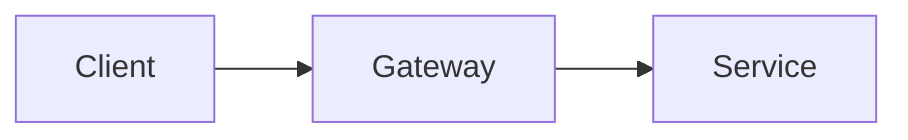

# Blog Writing Guide

## Location and filename

Store posts in `src/content/posts/`. Use a short lowercase kebab-case slug, such
as `src/content/posts/kubernetes-network-policy.md`. `pnpm new-post <slug>` can
scaffold a post. Check that the target does not already exist.

Shared article images normally live under `src/assets/images/posts/`. A post may
use a directory with `index.md` when its assets belong beside it.

## Frontmatter

Begin every post at byte one with Frontmatter in this field order:

```yaml
---
title: 清晰、具体的文章标题
published: 2026-11-01
updated: 2026-11-02
description: '一句话说明文章解决的问题、覆盖范围或读者收获。'
image: '../../assets/images/posts/topic/cover.webp'
tags: ['primary-topic', 'secondary-topic']
category: 'Development'
draft: false
lang: 'zh-CN'
---
```

- `title` and `published` are required by `src/content.config.ts`.
- `updated` is optional and belongs only on a meaningful revision.
- Make `description` concrete and useful in a card; do not repeat the title.
- `image` accepts HTTPS, a root path under `public/`, or a path relative to the
  Markdown file. Prefer a local optimized asset.
- `category` must be exactly one word with its first letter uppercase, for
  example `Development`, `DevOps`, or `Reading`. Do not use spaces, hyphens, or
  multiple categories. Reuse an existing category when it fits.
- Every `tags` value must be lowercase. Prefer one word, such as `kubernetes`.
  A tag may contain at most two words; when two words are unavoidable, join them
  with a hyphen, such as `cloud-native`. Do not use spaces, underscores, uppercase
  letters, or tags containing three or more words.
- Add a new category or tag only when it represents a durable topic rather than
  wording that applies to a single article.
- Use `draft: true` for an intentionally incomplete post that must stay out of a
  production build.
- Use `lang: 'zh-CN'` for Simplified Chinese and another code only when the post
  itself uses that language.
- Do not write `prevTitle`, `prevSlug`, `nextTitle`, or `nextSlug`; the site fills
  those fields.

Dates use `YYYY-MM-DD`. Do not use a future date unless the user is scheduling
publication.

## Opening and structure

Start the body with a prose paragraph explaining the real problem, context, or
question. The pipeline uses the first paragraph as the excerpt, so do not begin
with an image, heading, code block, list, admonition, or generic welcome.

The page already renders the title. Do not add an `# H1`. Use `##` for main
sections and `###` for subsections. Headings should say what each section
explains. A technical article often moves through the mental model, important
concepts, worked examples, limitations or debugging, and a concise synthesis.
Adapt that shape to the topic rather than forcing it.

Use direct Chinese prose, active verbs, and concrete examples. Explain why a
command or setting matters near the example. Define specialized English terms on
first use and keep terminology consistent. Wrap prose near 80 characters when
practical without damaging tables, links, or code.

## Code, commands, tables, and quotations

Use fenced blocks with the most precise language identifier:

````markdown
```yaml
apiVersion: v1
kind: ConfigMap
```
````

Use `bash` or `shell` for commands, `text` for output and conceptual layouts, and
`mermaid` for diagrams. Examples must work or be labeled as pseudocode. Never
include real credentials, private URLs, or tokens.

Use inline code for identifiers, filenames, flags, fields, and short commands.
Use tables for exact comparisons or mappings. Use blockquotes for actual quotes
or a statement being examined, and link external sources.

## Links and references

Use descriptive link text and remove tracking parameters:

```markdown
[Kubernetes Gateway API 概览](https://gateway-api.sigs.k8s.io/)
```

Avoid bare URLs and “点击这里”. Prefer official documentation, standards, source
code, and original research for technical facts.

Internal posts use the deployed route with a trailing slash:

```markdown
[云网络基础](/posts/cloud-network-vpc-subnet-routing/)
```

Verify that the slug exists. Link articles in a series naturally in the opening
or closing prose.

Use `## 参考资料` for a substantial source list. A short post may use:

```markdown
:::note[Reference]
- [Astro 内容集合](https://docs.astro.build/en/guides/content-collections/)
:::
```

## Images

Prefer WebP or AVIF for raster images and SVG for diagrams with text. Put an
imported asset in a topic folder such as:

```text
src/assets/images/posts/kubernetes/network-policy.webp
```

Reference it relative to the Markdown file. From a root-level post:

```markdown

```

For nested posts, calculate the relative path instead of copying this example.
Files requiring a fixed URL belong in `public/` and use a root path such as
``.

Every informative image needs concise alt text that describes its meaning, not a
filename. Credit third-party images and confirm reuse rights. Avoid unreliable
hotlinks. Reusing the cover inline is fine when it helps explain the article.

## Mermaid and custom directives

Use Mermaid when a flow, relationship, state, or sequence is clearer visually:

````markdown

````

Keep node labels short, quote labels containing punctuation, introduce the
diagram beforehand, and explain its implication afterward.

Supported admonitions are `note`, `tip`, `important`, `warning`, and `caution`:

```markdown
:::warning[生产环境注意]
修改前先确认回滚路径。
:::
```

Use them only when information deserves separation. The bracketed title is
optional. Embed a central public GitHub repository with:

```markdown
::github{repo="owner/repository"}
```

Ordinary citations should remain normal links.

## Completion checks

- Frontmatter matches `src/content.config.ts`, and the filename is the intended
  slug.
- `category` is one capitalized word. Every tag is lowercase and contains one
  word, or at most two words joined by a hyphen.
- The first paragraph works independently as the card excerpt.
- Claims distinguish verified behavior, inference, opinion, and vendor-specific
  behavior.
- Commands, configuration keys, version-sensitive details, quotations, and URLs
  are verified.
- Internal slugs and local image paths exist.
- Code fences and directives close correctly.
- The heading outline is useful, and the conclusion adds synthesis.
- No placeholders, fabricated facts, duplicated sections, or unused assets remain.
- `pnpm type-check` and `pnpm build` pass. Inspect desktop and mobile rendering
  when tables, diagrams, or images materially affect layout.

