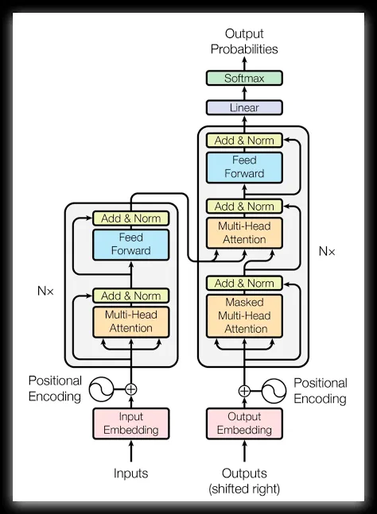
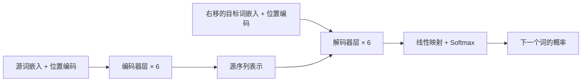
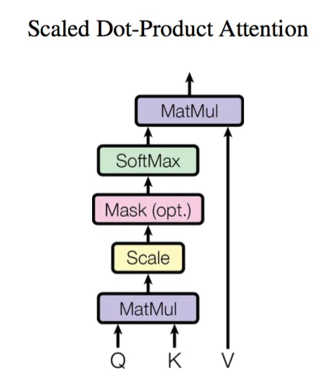
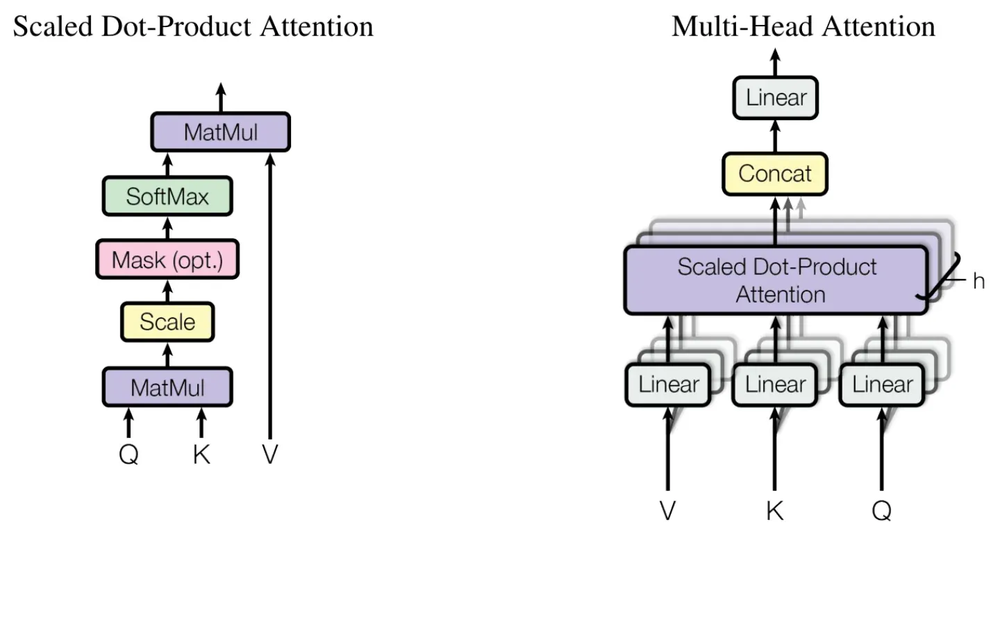
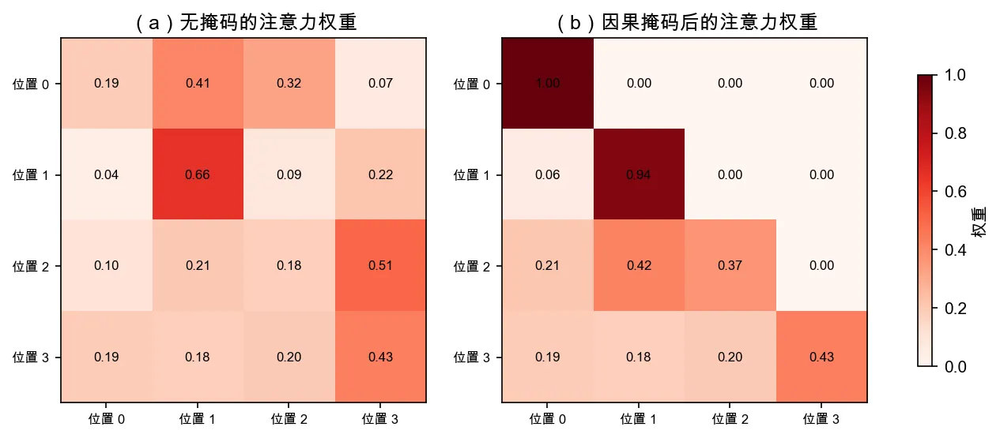

2017 年的《Attention Is All You Need》提出了 Transformer：在机器翻译中，以注意力机制构建编码器与解码器。这篇论文给后来的语言模型和视觉模型提供了一套影响深远的架构。理解它的价值，可以从序列位置如何交换信息开始，再看多头注意力、位置编码与编码器–解码器如何组合成完整模型。

## 从循环计算走向并行的序列表示

在 RNN 中，位置 $t$ 的状态依赖上一个位置：

$$h_t=f(x_t,h_{t-1})$$

此前的机器翻译模型常用循环结构表示序列，并用 Attention 让解码器动态选择源语言中的相关位置。Transformer 将 **Self-Attention（自注意力）**提升为序列表示的核心：同一序列内的任意位置可以直接交换信息，各位置的表示也更适合通过矩阵运算并行计算。

论文特别关注序列层的顺序计算步数和远距离位置之间的信息传递路径。自注意力让两个位置在单层中直接建立联系，这为学习跨越多个词的关系提供了简洁的计算路径。

## 先看完整的编码器与解码器

原始 Transformer 服务于序列到序列的机器翻译。编码器读取源语言，解码器根据编码结果和已知目标词预测下一个词。Base 配置中，两侧各堆叠 6 层，模型维度为 512，注意力头数为 8。



下面是依据论文 Figure 1 重绘的简化数据流；每个子层外还有残差连接与层归一化。



每个**编码器层**依次执行多头自注意力和逐位置前馈网络（FFN）。每个**解码器层**先执行带因果掩码的自注意力，再用编码器输出做交叉注意力，最后执行 FFN。

| 模块 | Query 来自 | Key、Value 来自 | 作用 |
|---|---|---|---|
| 编码器自注意力 | 源序列当前表示 | 同一源序列 | 融合源语言上下文 |
| 解码器自注意力 | 目标序列当前表示 | 同一目标序列 | 利用已知目标词 |
| 编码器–解码器注意力 | 解码器当前表示 | 编码器输出 | 从源语言中提取相关信息 |

交叉注意力和自注意力使用同一个计算公式；区别在于 Q、K、V 的来源。

## 自注意力到底计算了什么

设输入序列表示 $X\in\mathbb{R}^{n\times d_{model}}$。模型用三个可学习矩阵把它投影为查询、键和值：

$$Q=XW^Q,\qquad K=XW^K,\qquad V=XW^V$$

可以把 Query 理解为“当前位置想找什么”，Key 理解为“各位置供匹配的特征”，Value 理解为“匹配后实际取出的内容”。三者都由可学习的投影产生，使模型能够从训练数据中形成适合任务的信息检索方式。

论文的缩放点积注意力为：



$$\operatorname{Attention}(Q,K,V)=\operatorname{softmax}\left(\frac{QK^T}{\sqrt{d_k}}\right)V$$

按矩阵形状看，$Q\in\mathbb{R}^{n_q\times d_k}$、$K\in\mathbb{R}^{n_k\times d_k}$、$V\in\mathbb{R}^{n_k\times d_v}$。$QK^T$ 产生 $n_q\times n_k$ 个匹配分数；Softmax 沿每个 Query 对应的 Key 维度计算权重；最后乘 $V$，输出形状为 $n_q\times d_v$。

一个只有一个 Query、两个 Key 的小例子：若缩放后的分数是 $[\ln 3,0]$，Softmax 权重就是 $[0.75,0.25]$。当两个 Value 分别是 $[2,0]$ 和 $[0,4]$ 时，输出为 $0.75[2,0]+0.25[0,4]=[1.5,1]$。这种加权聚合让每个位置都能形成融合上下文的新表示。

为什么除以 $\sqrt{d_k}$？若 Query 和 Key 的各维近似独立、均值为 0、方差为 1，点积的方差随 $d_k$ 增长。分数过大容易让 Softmax 饱和，梯度变小；缩放有助于控制分数尺度。

下面是公式的 PyTorch 教学复现，并非论文提供的源码。`mask=True` 表示该位置允许被关注。

```python
import math

import torch


def scaled_dot_product_attention(q, k, v, mask=None):
    scores = q @ k.transpose(-2, -1) / math.sqrt(q.size(-1))
    if mask is not None:
        scores = scores.masked_fill(~mask, torch.finfo(scores.dtype).min)
    weights = torch.softmax(scores, dim=-1)
    return weights @ v, weights
```

输入可为 `(batch, heads, query_len, head_dim)` 等形状；矩阵乘法和 Mask 会在批次、头维度上广播。每行至少要有一个可关注位置。

## 多头注意力为什么有用



一个头只生成一套投影和注意力权重。多头机制使用多组独立参数，在不同表示子空间中并行计算，再拼接并投影回模型维度：

$$\operatorname{head}_i=\operatorname{Attention}(QW_i^Q,KW_i^K,VW_i^V)$$

$$\operatorname{MultiHead}(Q,K,V)=\operatorname{Concat}(\operatorname{head}_1,\ldots,\operatorname{head}_h)W^O$$

Base 模型使用 $h=8$、$d_k=d_v=64$；8 个头拼接后的宽度为 $8\times64=512$。多组可学习的投影让模型能同时从不同表示子空间聚合信息，成为后来 Transformer 架构中极有代表性的设计。

## 位置编码怎样表达顺序


单纯的自注意力无法凭自身区分同一组词的不同排列。原论文把位置编码加到词嵌入上：

$$Z=X_{embed}+PE$$

固定正弦位置编码对偶数、奇数维度分别使用正弦和余弦：

$$PE(pos,2i)=\sin\left(\frac{pos}{10000^{2i/d_{model}}}\right)$$

$$PE(pos,2i+1)=\cos\left(\frac{pos}{10000^{2i/d_{model}}}\right)$$

各维频率不同，因此每个位置得到一组有规律变化的数值。作者希望模型由此学习位置之间的相对关系。将位置信息与词嵌入相加，也让“内容表示”和“顺序表示”成为可以分别设计的模块；论文还比较了可学习的位置嵌入，报告两种方法表现接近。

## 因果掩码与逐词生成



翻译训练时，解码器读入右移后的目标序列。例如目标是“我 爱 你”，预测“爱”的位置只能使用起始符和“我”，不能偷看“爱”或“你”。因果掩码在 Softmax 前把未来位置的分数设为负无穷：

$$\operatorname{Attention}(Q,K,V;M)=\operatorname{softmax}\left(\frac{QK^T}{\sqrt{d_k}}+M\right)V$$

其中 $M_{ij}=0$ 表示允许，$M_{ij}=-\infty$ 表示屏蔽。以 4 个位置为例：

```text
       key 1   2   3   4
query 1    ✓   ×   ×   ×
      2    ✓   ✓   ×   ×
      3    ✓   ✓   ✓   ×
      4    ✓   ✓   ✓   ✓
```

训练时已知完整目标句，因果掩码让所有位置可以在一次前向计算中并行学习“根据前文预测下一个词”。生成时，模型根据已经生成的词依次预测后续词。这种设计后来也成为自回归语言模型的重要基础。Padding Mask 则用于屏蔽补齐的无效位置。

## FFN、残差和归一化同样重要

注意力负责位置之间的信息混合；每层的 FFN 对每个位置独立应用相同参数，完成特征的非线性变换：

$$\operatorname{FFN}(x)=\max(0,xW_1+b_1)W_2+b_2$$

Base 模型中，FFN 从 512 维扩展到 2048 维，再映射回 512 维。原论文在每个子层外使用残差连接，并在相加后归一化：

$$y=\operatorname{LayerNorm}(x+\operatorname{Sublayer}(x))$$

这通常称为 **Post-LN**。注意力负责跨位置聚合，FFN 负责逐位置变换，残差与归一化帮助层与层之间传递信息；这些模块共同构成了可重复堆叠的 Transformer 层。

## 训练设置与实验结果

论文在 WMT 2014 英译德和英译法任务上评估。优化器为 Adam，学习率先经过 4000 步 warmup，再按步数的平方根倒数下降：

$$\text{lrate}=d_{model}^{-0.5}\min(\text{step}^{-0.5},\text{step}\cdot\text{warmup}^{-1.5})$$

会议论文 Table 2 报告的 BLEU 分数如下。BLEU 是机器翻译输出与参考译文之间的自动评价指标；这里只比较论文报告的相同任务结果。

| 模型 | 英译德 BLEU | 英译法 BLEU |
|---|---:|---:|
| Transformer Base | 27.3 | 38.1 |
| Transformer Big | **28.4** | **41.0** |

Big 在英译德任务达到 28.4 BLEU；英译法的 41.0 是当时出色的**单模型**成绩。论文还报告，Base 在 8 张 P100 GPU 上约训练 12 小时，Big 约 3.5 天。翻译质量与训练并行性同时得到验证，使这套架构受到广泛关注。

## 从 Transformer 到后来的模型

Transformer 的深远影响，来自一套能够按任务重新组合的模块：自注意力负责按内容建立联系，多头机制提供不同的表示子空间，位置编码引入顺序信息，FFN 与残差结构支持逐层提炼表示。论文证明，这些模块可以组成有效的编码器–解码器系统，并在机器翻译任务中取得优秀成绩。

后续研究沿着这套架构走出了不同方向：

| 后续工作 | 继承和发展的思想 | 带来的积极影响 |
|---|---|---|
| [GPT](https://cdn.openai.com/research-covers/language-unsupervised/language_understanding_paper.pdf) | 使用因果自注意力进行自回归预训练 | 让 Transformer 成为生成式语言模型的重要基础 |
| [BERT](https://arxiv.org/abs/1810.04805) | 使用编码器学习双向上下文表示 | 推动预训练模型在语言理解任务中的应用 |
| [T5](https://arxiv.org/abs/1910.10683) | 延续编码器–解码器结构，将任务统一为文本到文本 | 展示同一架构处理多种语言任务的潜力 |
| [ViT](https://arxiv.org/abs/2010.11929) | 将图像切成 Patch 序列，用 Transformer 建模 | 将序列建模思想扩展到计算机视觉 |

这些工作各自调整了模型结构和训练目标，也共同说明了原论文最重要的启发：**注意力可以成为构建通用表示模型的核心模块**。

读完这篇论文，可以用三个问题串起整套架构：**Q、K、V 如何让位置交换信息？多头注意力与位置编码各自贡献了什么？编码器和解码器又怎样把这些模块组合成翻译模型？**理解这条主线，也就能看出后续模型为什么不断借鉴和发展 Transformer。

## 参考资料

- [Vaswani 等：《Attention Is All You Need》，NeurIPS 2017 会议论文](https://proceedings.neurips.cc/paper_files/paper/2017/file/3f5ee243547dee91fbd053c1c4a845aa-Paper.pdf)
- [arXiv: 1706.03762](https://arxiv.org/abs/1706.03762)
