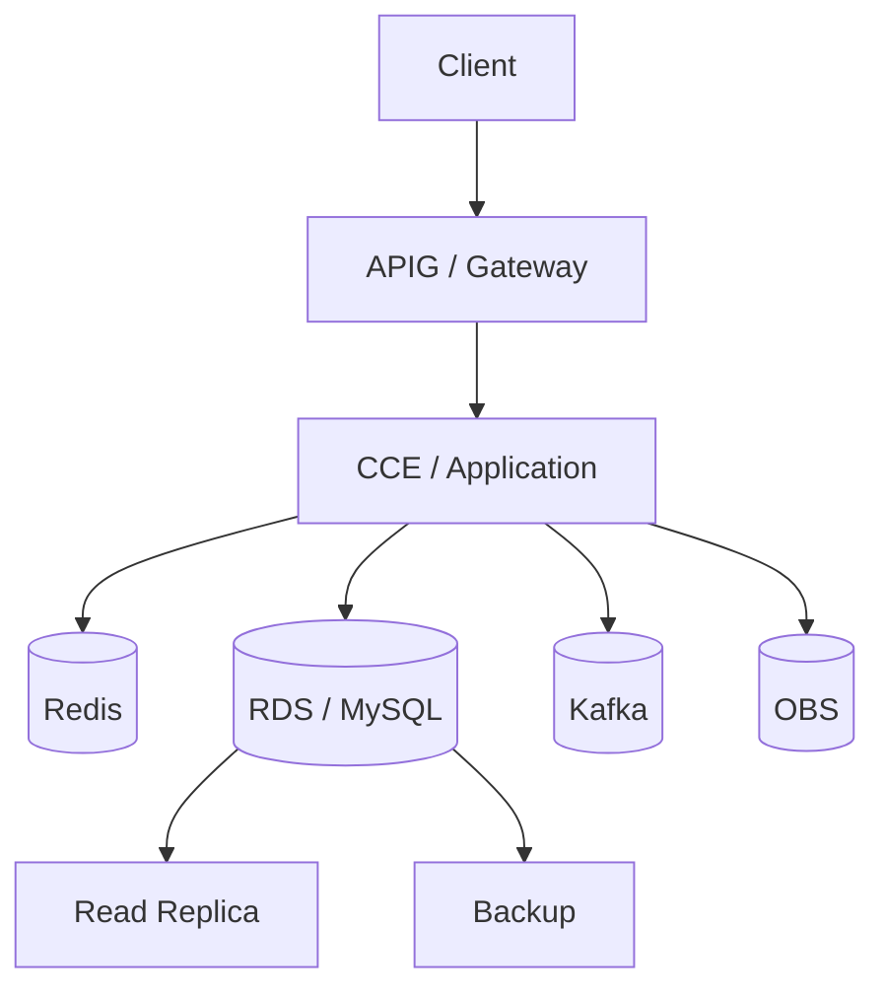
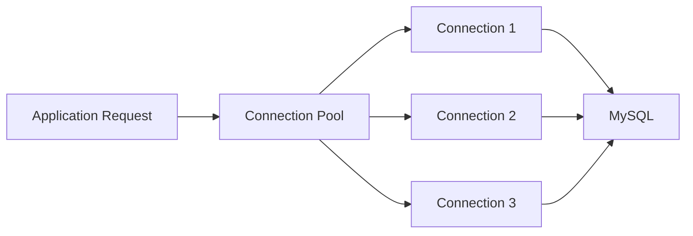
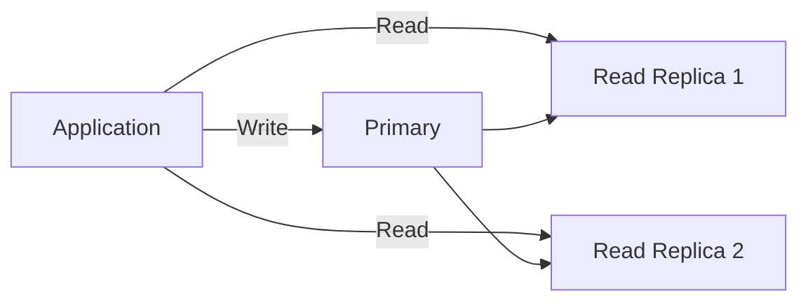
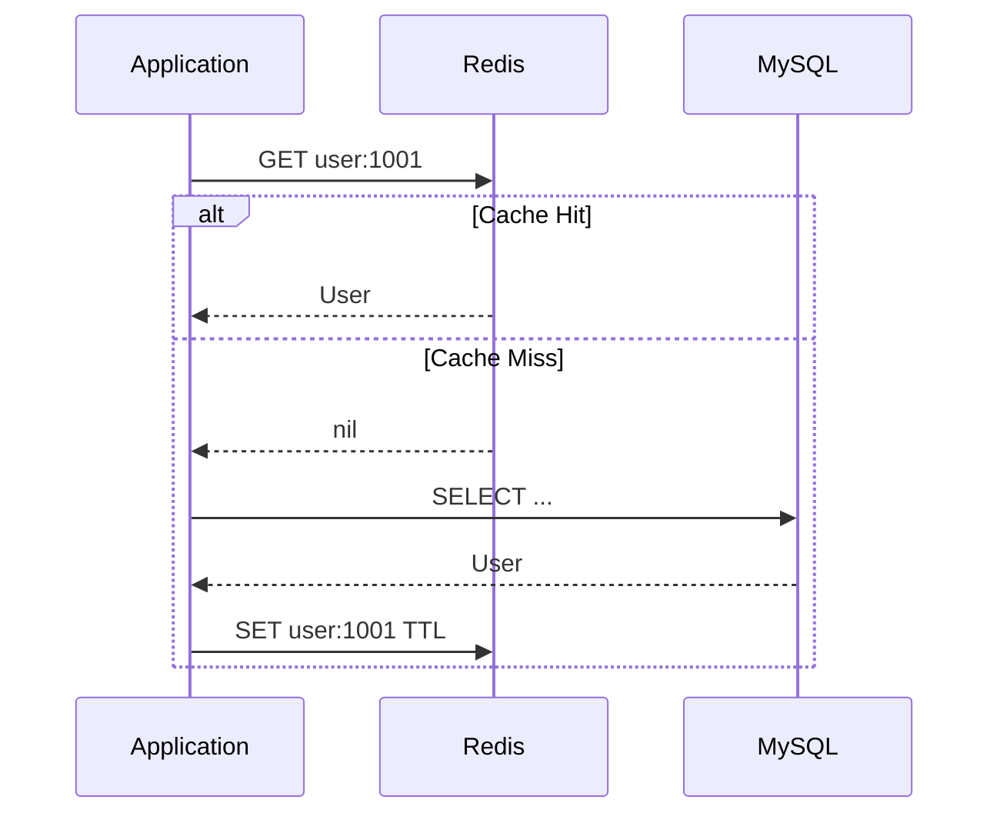
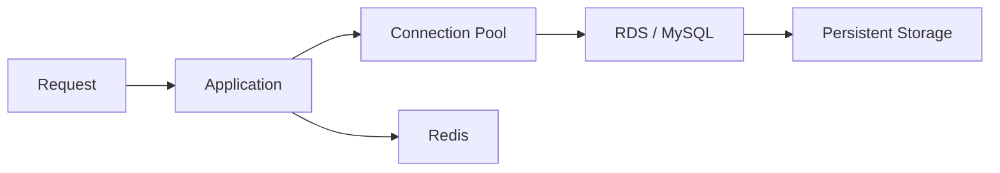

Pod 可以被删除、重建、扩缩容和重新调度，但订单、支付记录、用户账户与库存
状态不能随 Pod 一起消失。应用服务保持无状态，业务状态就必须被放入生命周期
更长、职责更明确的数据基础设施中。

于是系统里很快会出现多个数据组件：关系型数据库保存交易数据，Redis 承担热点
读取和临时状态，Kafka 传递事件，对象存储（OBS）保存文件。它们不是可以互相替换的
“存储选项”，而是数据访问体系中不同的层。设计时先要回答“这份数据属于哪一类”，
再讨论哪个组件更快。



## 一、先按数据职责分层

一个后端系统通常同时使用四类数据基础设施：

| 系统 | 核心职责 | 典型数据 |
|---|---|---|
| MySQL / RDS | 关系型业务数据、事务与查询 | 订单、支付、账户、库存 |
| Redis | 高速缓存、临时状态与计数 | 会话、验证码、热点对象、限流计数 |
| Kafka | 事件流与异步消息 | 领域事件、日志管道、异步任务 |
| OBS | 非结构化对象 | 图片、视频、备份文件、附件 |

区分它们的依据不是性能数字，而是数据的生命周期、一致性要求和访问模式。
订单需要长期保存、事务修改和条件查询；验证码只需要存在五分钟；视频文件
不适合塞进数据库行；事件则要被多个消费者按顺序读取。

> 数据放在哪里，首先取决于它是什么类型的数据，而不是哪个组件更快。

这也意味着，多数生产系统不是“MySQL 或 Redis”的二选一，而是让 MySQL 成为
权威数据源，让 Redis 承担派生状态和性能层。二者的边界会在后文反复出现。

事件如何通过 Kafka 在服务之间异步传递，以及消费端如何保证一致性，将在
[《Kafka 分布式消息与消费一致性体系》](/posts/kafka-messaging-consumption-consistency/)中展开。

## 二、RDS 改变了什么，又没有改变什么

RDS（Relational Database Service，关系型数据库服务）是把 MySQL 等关系型
数据库以托管方式提供的云服务。如果自己在 ECS 上安装 MySQL，团队需要负责
安装、配置、备份、恢复、主从复制、高可用、故障切换、版本升级、监控和磁盘
扩容。

托管服务把这些基础设施工作的一部分交给云平台：

| 工作 | 自建 MySQL | RDS |
|---|---|---|
| 安装与补丁 | 自行规划 | 平台提供版本与维护窗口 |
| 备份与恢复 | 自建脚本与校验 | 提供自动备份、时间点恢复等能力 |
| 主备与切换 | 自建复制与切换机制 | 提供高可用实例与故障切换 |
| 监控与告警 | 自建采集与看板 | 提供基础指标与事件 |
| 参数与容量 | 完全自行负责 | 可调参数受产品限制 |

但托管不等于开发人员可以不理解数据库。Schema 设计、索引、事务边界、锁竞争、
连接池和查询计划仍然由应用团队决定。云平台承担的是基础设施运维，不是业务
数据建模。

RDS 也不是“把数据库变成无状态 Deployment”。它仍然是长期运行、保存权威
业务数据的有状态基础设施，生命周期和发布方式与 Pod 完全不同。

## 三、MySQL 如何组织数据

MySQL 是关系型数据库管理系统（RDBMS，Relational Database Management
System），通过表、行、列、主键、外键和索引
组织数据。一个简化的订单表如下：

| id | user_id | amount | status |
|---|---:|---:|---|
| 1001 | 2001 | 99.00 | PAID |
| 1002 | 2002 | 199.00 | CREATED |

Schema 是这些结构的总和：表、列、类型、约束和索引。它既是数据库定义，也是
业务模型的一部分：

```sql
CREATE TABLE orders (
    id BIGINT PRIMARY KEY,
    user_id BIGINT NOT NULL,
    amount DECIMAL(10, 2) NOT NULL,
    status VARCHAR(32) NOT NULL,
    created_at DATETIME NOT NULL
);
```

主键唯一标识一行。在 InnoDB 中，主键还有额外的存储含义：表数据围绕主键
组织为聚簇索引（Clustered Index），叶子节点保存完整行。因此主键不只是
“唯一约束”，它还影响数据布局、二级索引大小和写入局部性。

业务主键不一定是好的存储主键。随机 UUID 作为聚簇索引键会让插入分散到许多
页，带来页分裂和写放大；自增或有序 ID 的插入更集中。这里没有统一答案，但
主键选择必须同时考虑业务含义和 InnoDB 的物理组织。

### 没有索引时会发生什么

假设 `orders` 有 1000 万行，查询：

```sql
SELECT *
FROM orders
WHERE user_id = 2001;
```

如果 `user_id` 没有索引，数据库无法直接定位匹配行，只能执行全表扫描（Full
Table Scan），逐页检查大量甚至全部记录。数据量越大，查询成本和 Buffer Pool
压力越高。

为 `user_id` 建立索引后，数据库可以先在索引中定位少量候选记录，再回表读取
完整行。索引的核心作用就是缩小需要扫描的范围，而不是“加速”这个动作本身。

### B+ Tree 与 Page

索引的目标是减少需要访问的数据量。InnoDB 最常用的索引结构是 B+ Tree，一种
多叉平衡搜索树：

```text
            [20 | 40]
          /     |     \
     [1..19] [20..39] [40..]
```

非叶子节点保存键和子节点指针，数据主要位于叶子节点，叶子之间通常还有链表
连接，便于范围扫描。

数据库不以“一条记录一次磁盘读取”为单位，而以 Page 为基本 I/O 单位。InnoDB
默认页大小是 16 KB，可以通过 `innodb_page_size` 调整。一个页能容纳大量键值，
使 B+ Tree 的扇出（fan-out）很大。即使表有数百万行，树高通常仍只有几层，
查询需要的页访问次数远少于普通二叉树。

这也解释了数据库为什么不用二叉搜索树：真正的成本通常不是 CPU 比较，而是
Page I/O。索引设计本质上是在减少需要读取的页数。

### 聚簇索引、二级索引与回表

InnoDB 的主键索引是聚簇索引，叶子节点直接保存整行：

```text
Primary Key -> B+ Tree -> Row
```

其他索引是二级索引（Secondary Index）。例如：

```sql
CREATE INDEX idx_user_id ON orders(user_id);
```

`idx_user_id` 的叶子节点通常保存 `user_id` 和主键 `id`，而不是完整行。通过
二级索引找到主键后，还需要回到聚簇索引取整行，这个过程称为回表：


如果查询需要的列都已经在索引中，就不必回表。例如：

```sql
SELECT user_id, id
FROM orders
WHERE user_id = 2001;
```

这时 `idx_user_id` 同时提供了过滤条件和返回列，属于覆盖索引（Covering
Index）。执行计划中的 `Extra` 出现 `Using index`，通常表示使用了覆盖索引；
`Using index condition` 表示索引条件下推，并不等于覆盖索引。

覆盖索引能减少随机 I/O，但会让索引变宽。是否需要为某个查询专门扩展索引，
仍要结合读写比例判断。

### 联合索引与最左前缀

联合索引由多个列组成，列顺序决定它能服务哪些查询：

```sql
CREATE INDEX idx_user_status_time
ON orders(user_id, status, created_at);
```

它按 `user_id`、`status`、`created_at` 依次排序，因此通常可以支持：

```text
(user_id)
(user_id, status)
(user_id, status, created_at)
```

只按 `status` 查询通常无法有效利用这棵索引，因为同一 status 的记录散落在
不同 user_id 的分支中。这就是最左前缀原则。

范围条件会截断后续列的定位能力。例如：

```sql
SELECT *
FROM orders
WHERE user_id = 2001
  AND status > 'A'
  AND created_at = '2026-11-01';
```

`user_id` 可以用于定位，`status` 可以做范围扫描，但 `created_at` 通常无法
继续用于精确查找，只能在该范围内过滤。联合索引的列顺序要围绕真实查询模式
设计，而不是把所有字段随意堆在一起。

### 索引不是越多越好

每增加一个索引，查询可能更快，但 `INSERT`、`UPDATE`、`DELETE` 都要维护更多
索引结构，带来额外的存储、写放大和 Buffer Pool 压力。低选择性的索引还可能
被优化器放弃。

索引是读性能与写成本之间的权衡。一个表有十几个“可能有用”的索引，往往说明
查询模式没有被认真收敛。

### 优化器与 EXPLAIN

SQL 执行前会经过查询优化，数据库需要决定使用哪个索引、连接顺序、扫描方式和
执行计划。因此“建了索引”不等于“查询一定用索引”。

`EXPLAIN` 用于查看执行计划：

```sql
EXPLAIN
SELECT id, status
FROM orders
WHERE user_id = 2001;
```

重点观察：

| 字段 | 关注点 |
|---|---|
| `type` | 访问方式，`ALL` 表示全表扫描，`ref`、`range` 通常更可取 |
| `key` | 实际选择的索引，为空表示未使用索引 |
| `rows` | 预估需要检查的行数，不是精确值 |
| `Extra` | 覆盖索引、临时表、文件排序等额外信息 |

`rows` 是优化器基于统计信息的估算，可能因数据分布、统计信息过期或索引选择
而偏差很大。分析慢查询时，应结合真实执行时间、扫描行数和 `EXPLAIN ANALYZE`
等工具，而不是只看 `key` 是否有值。

## 四、事务、隔离级别与 MVCC

事务把一组数据库操作作为一个逻辑整体执行。转账是经典例子：

```text
A - 100
B + 100
```

如果只完成第一步，数据状态就不正确。两步必须在同一个事务中，要么都成功，
要么都回滚。

事务通常用 ACID 描述：

- Atomicity：原子性，事务要么全部成功，要么全部失败；
- Consistency：一致性，事务前后数据满足约束和业务规则；
- Isolation：隔离性，并发事务之间互不干扰到约定程度；
- Durability：持久性，已提交事务在故障后仍可恢复。

一致性不只是数据库自动保证的。`库存不能小于 0` 这样的规则，需要数据库约束、
事务逻辑和业务校验共同维护。持久性通常依赖 Redo Log、WAL 类机制和持久化
存储，提交成功不等于数据已经写到磁盘的每个副本，但恢复机制必须能重建它。

### 四种隔离级别

SQL 标准定义了四种常见隔离级别：

| 级别 | 脏读 | 不可重复读 | 幻读 |
|---|---|---|---|
| Read Uncommitted | 可能 | 可能 | 可能 |
| Read Committed | 避免 | 可能 | 可能 |
| Repeatable Read | 避免 | 避免 | 视读类型而定 |
| Serializable | 避免 | 避免 | 避免 |

Read Uncommitted 允许读取另一个事务尚未提交的修改。如果对方随后回滚，读到
的值可能从未真正存在过，这就是脏读。

Read Committed 只允许读取已提交数据，避免脏读，但同一事务内两次查询可能
看到不同结果。例如第一次读到 `status=CREATED`，另一个事务提交了
`status=PAID`，第二次就读到新值，称为不可重复读。

Repeatable Read 希望同一事务中的一致性读取看到稳定快照。MySQL InnoDB 默认
使用 Repeatable Read，并通过 MVCC 提供一致性读。Serializable 提供更强隔离，
效果接近串行执行，但并发能力通常下降，不是所有系统都适合最高级别。

需要区分“标准定义”和“具体实现”。InnoDB 在 Repeatable Read 下，普通一致性
读依靠 Read View 避免幻读，当前读则依靠 next-key lock 处理范围并发。是否
完全避免幻读，还取决于读类型、索引和访问路径，不能只凭隔离级别名称推断。

### MVCC 让读写少互相阻塞

MVCC（Multi-Version Concurrency Control，多版本并发控制）的核心思想是：
同一条记录可以存在多个逻辑版本，不同事务按自己的可见性规则读取合适版本。

如果每次读取都必须给行加排他锁，高并发下读写会严重互相阻塞。MVCC 允许大量
一致性读在不与普通写长期互斥的情况下完成。

普通 `SELECT` 在适当隔离级别下通常是快照读（Snapshot Read），根据事务的
可见性读取某个历史版本。`SELECT ... FOR UPDATE` 或 `FOR SHARE` 则是当前读
（Current Read），需要读取最新版本并加锁。

历史版本来自 Undo Log。Undo Log 除了支持回滚，还能帮助构造旧版本。Read
View 则是一组可见性规则，用来判断某个版本对当前事务是否可见。因此 MVCC 不是
把数据库完整复制多份，而是通过事务 ID、Undo 版本和可见性判断实现逻辑多版本。

在 Repeatable Read 下，Read View 通常在事务第一次一致性读时建立；在 Read
Committed 下，每条语句可能建立新的 Read View。这解释了两者在“同一事务内
是否看到新提交数据”上的差异。

## 五、锁、死锁与长事务

有了 MVCC 仍然需要锁。并发修改同一行、执行当前读或维护唯一约束时，数据库
必须协调冲突。

常见锁包括：

- Shared Lock：共享锁，允许其他共享读，阻止排他写；
- Exclusive Lock：排他锁，阻止其他读写；
- Record Lock：锁定具体索引记录；
- Gap Lock：锁定索引记录之间的区间，阻止插入；
- Next-Key Lock：Record Lock 与 Gap Lock 的组合，用于范围访问。

例如：

```sql
SELECT *
FROM orders
WHERE id = 1001
FOR UPDATE;
```

这是当前读，会锁定对应记录。InnoDB 的锁加在索引上，而不是抽象的行上。如果
查询没有合适索引，可能扫描并锁定大量记录，甚至接近全表。这也是“缺少索引”
不仅慢，还可能扩大锁冲突的原因。

### 死锁与重试

死锁发生在多个事务互相等待对方持有的资源：

```text
Transaction A: 锁 Row 1，等待 Row 2
Transaction B: 锁 Row 2，等待 Row 1
```

形成循环等待后，InnoDB 会检测并回滚其中一个事务，应用通常收到死锁错误。
应用层需要有限次重试，并配合退避和幂等，不能无限重试。

降低死锁的常见方法：

- 保持事务短小；
- 固定资源的加锁顺序；
- 使用合适索引，减少扫描和锁定范围；
- 避免在事务中执行长时间外部调用；
- 减少大范围更新和批量操作。

### 长事务的代价

长事务会带来一系列连锁影响：

- 锁持有时间长，阻塞其他事务；
- Undo 堆积，历史版本无法及时清理；
- Purge 延迟，Undo 表空间膨胀；
- 主从复制延迟；
- 连接池资源被长期占用；
- 并发能力下降。

因此事务不应该无意义地覆盖整个业务流程。尤其要避免下面这种结构：

```text
Begin Transaction
Update DB
Call Remote API（等待 10 秒）
Commit
```

远程调用期间，数据库事务一直没有结束。更合理的分布式一致性模式包括 Outbox、
消息、Saga 和补偿，把“本地事务”和“跨服务协作”分开处理，避免把外部系统的
等待时间塞进数据库事务。

## 六、连接池与容量规划

应用访问 MySQL 需要建立 TCP 连接，默认端口是 3306。如果每个请求都打开连接、
执行 SQL、关闭连接，TCP 握手、认证和会话初始化的成本会非常高。

连接池（Connection Pool）维护一组可复用连接。Java 中常见实现是 HikariCP：



连接池不是越大越好。假设 100 个 Pod，每个池 100 个连接，理论最大就是
10000 个连接，数据库很可能无法承受。正确的计算方式是：

```text
集群最大连接数 ≈ 最大 Pod 数 × 单 Pod 池大小 + 其他客户端
```

HPA 扩容会同时增加应用容量和数据库连接压力。3 个 Pod、每池 20 个连接是 60；
扩到 30 个 Pod 就是 600。数据库的 `max_connections`、内存和线程调度能力必须
覆盖这个上限，否则扩容后的应用可能集体拿不到连接。

### 连接耗尽与连接泄漏

如果应用获取连接后没有正确归还，就会出现连接泄漏。连接池逐渐耗尽，所有请求
都在等待连接。表现可能像“数据库很慢”，实际却是应用没有关闭资源。

使用 try-with-resources 或框架管理连接，并配置泄漏检测阈值，可以在开发阶段
更早发现问题。

如果数据库连接被占满，新的连接请求可能收到 `Too many connections`。此时应用
看到的不是某条 SQL 变慢，而是整个连接池无法获取连接。排查时要同时看数据库
端的连接来源、应用实例数和池配置。

连接池和数据库访问还需要几类超时：

| 配置 | 作用 |
|---|---|
| 获取连接超时 | 池中没有可用连接时，等待多久后失败 |
| 连接校验超时 | 验证连接是否仍然有效 |
| 空闲超时 | 连接空闲多久后回收 |
| 最大生命周期 | 连接使用多久后强制替换，配合数据库端超时 |
| SQL 执行超时 | 单条语句允许执行的最长时间 |

如果获取连接要等 3 秒，就应该快速失败，而不是让请求无限堆积。SQL 本身也需要
超时：一条执行两分钟的查询会长期占用连接、线程和数据库资源，并可能在应用
已经超时后继续运行。

连接池解决的是连接复用，不解决慢查询、锁等待或事务过长。数据库访问性能要
同时看 SQL 成本、网络往返、连接获取、锁等待和排队时间。

## 七、高可用、只读副本与备份

生产数据库不能只依赖一台实例。单实例故障会让整个业务数据层不可用，因此托管
数据库通常提供主备高可用：


Primary 承担正常读写，Standby 保持数据副本。Primary 故障时，Standby 可以被
提升为新的 Primary，这个过程称为 Failover（故障切换）。

Failover 不等于应用完全无感。切换期间可能出现连接重置、Endpoint 或 DNS
变化、未提交事务失败。应用仍需要重试、连接池刷新和幂等处理，不能假设切换
瞬间没有错误。

### 只读副本与复制延迟

Read Replica（只读副本）承担读流量，把写留在 Primary：



读写分离可以扩展读能力，但副本通常不是完全实时同步，可能存在 Replication
Lag。Primary 刚写入 `status=PAID`，立刻读副本可能仍看到 `CREATED`。

这涉及 Read-after-Write Consistency（写后读一致性）。支付后立即确认状态、
下单后立即查询订单等场景，通常应走 Primary 或采用会话粘滞、版本校验等策略。
报表、分析和非强实时查询更适合副本。

选择读副本的依据是业务能容忍多旧的数据，而不是“读请求都应该分散”。

### 备份解决的是另一类问题

高可用和备份不是同一件事。如果用户误执行：

```sql
DROP TABLE orders;
```

Primary 会执行，复制也可能把删除同步到 Standby。主备切换无法恢复被逻辑删除
的数据，只有备份和时间点恢复（Point-in-Time Recovery）才能回到过去某个时刻。

备份通常包括全量备份、增量备份和 Binlog 等连续日志。恢复目标用两个指标描述：

- RPO（Recovery Point Objective）：最多允许丢失多少数据，例如 5 分钟；
- RTO（Recovery Time Objective）：系统需要多快恢复，例如 30 分钟。

RPO 关注“能丢多少”，RTO 关注“能停多久”。两者需要同时设计，不能只用“有备份”
作为答案。

## 八、Redis 与缓存模式

Redis 是以内存为主要访问介质的高性能数据结构存储。它的低延迟来自内存访问和
高效的数据结构，而不是因为可以替代所有数据库。

Redis 常见用途包括缓存、会话、计数器、分布式状态、限流和临时锁。最基础的
模型是 Key-Value，但 Value 支持多种结构：

| 结构 | 适合的场景 |
|---|---|
| String | 缓存对象、计数器、Token |
| Hash | 对象的多个字段 |
| List | 队列、时间线 |
| Set | 去重集合、点赞用户 |
| Sorted Set | 排行榜、按分数排序 |

TTL（Time To Live）给 Key 设置过期时间。验证码可以设置为 300 秒，五分钟后
自动失效。TTL 让临时数据能够自动清理，但它不是完整的一致性方案。

### Cache-Aside

最常见的缓存模式是 Cache-Aside：应用先读缓存，未命中再读数据库，并把结果
写回缓存：



如果热点接口有 10000 QPS，其中 95% 命中 Redis，MySQL 只需要处理约 5% 的读
流量。这就是缓存层的主要价值。

但增加 Redis 不会自动让系统变快。Key 设计错误、命中率低、TTL 不合理或更新
策略错误，都会让缓存变成额外的复杂度和故障点。Cache Hit Rate（命中率）是
评估缓存效果的核心指标：

```text
Hit Rate = Hit / (Hit + Miss)
```

### 缓存一致性

缓存最大的问题是 MySQL 和 Redis 可能出现两个版本的数据。常见更新方式有两种：

```text
先更新数据库，再更新缓存
先更新数据库，再删除缓存
```

更常见的是第二种：更新数据库后删除缓存，让下一次读取重新加载。原因在于缓存
里的值可能不是一行记录的简单复制，而可能是聚合结果、DTO 或多表计算结果。
直接更新缓存容易遗漏逻辑，删除则把重建责任交给读路径。

也不推荐先更新缓存再更新数据库：如果缓存更新成功而数据库失败，缓存就成了
与权威数据源不一致的“新数据”。

```mermaid
sequenceDiagram
    participant App
    participant DB as MySQL
    participant Redis

    App->>DB: UPDATE ...; COMMIT
    DB-->>App: OK
    App->>Redis: DEL user:1001
```

即使采用“更新数据库后删除缓存”，仍然存在并发窗口。例如读请求在数据库更新
前读到旧值，更新完成后删除缓存，读请求随后把旧值写回缓存。这类问题很难靠
单条命令彻底消除。

因此缓存架构通常追求最终一致性，而不是强事务一致性。对于账户余额、支付状态、
库存最终决策等强一致要求的数据，核心判断仍应依赖数据库事务，不能把 Redis
缓存当成权威数据源。

## 九、缓存穿透、击穿与雪崩

缓存失效有三种典型故障，原因和应对方式不同。

### 缓存穿透

缓存穿透（Cache Penetration）是查询数据库中本来就不存在的数据。攻击者不断
访问 `userId=-1`、`userId=-2`，Redis 永远未命中，MySQL 每次都收到查询，缓存
层完全失去作用。

常见应对：

- 缓存空值：数据库返回 Not Found 时，短时间缓存 `NULL`，例如 TTL 60 秒；
- 布隆过滤器：快速判断元素是否可能存在，判断“不存在”时一定不存在，判断
  “存在”时可能有假阳性；
- 参数校验与限流：在入口拒绝明显非法的 ID 和异常高频请求。

空值缓存要设置较短 TTL，避免大量无效 Key 占用内存。布隆过滤器需要维护位图
和误判率，删除元素也比较困难，适合“只增不删”的 ID 集合。

### 缓存击穿

缓存击穿（Cache Breakdown）通常发生在一个极热点 Key 突然失效时。例如
`hot-product` 的 TTL 到期，同时有 10000 个请求到达，全部未命中并同时访问
MySQL。

常见应对：

- Mutex：第一个请求获得锁，负责查询数据库和重建缓存，其他请求等待或降级；
- Single Flight：同一进程内合并相同 Key 的并发加载；
- 逻辑过期：Value 中保存过期时间，物理上不设 TTL，由异步任务刷新；
- 热点 Key 永不过期，配合后台异步更新。

互斥锁能保护数据库，但锁本身也可能成为瓶颈。Single Flight 只在单个 Pod 内
有效，多 Pod 同时未命中时仍需要分布式协调或接受多次查询。

### 缓存雪崩

缓存雪崩（Cache Avalanche）是大量 Key 在短时间内集中失效。比如 100 万个 Key
的 TTL 都是 3600 秒，并且同一时间写入，一小时后会同时过期，数据库流量突然
暴涨。

常见应对：

- TTL Jitter：在基础 TTL 上增加随机偏移，例如 3600 秒加 0 到 600 秒；
- 多级缓存：本地缓存加 Redis，减少对单一层的依赖；
- 限流与熔断：保护数据库不被瞬时流量打垮；
- 容量保护：为缓存和数据库预留突发余量；
- 缓存预热：系统启动或缓存恢复后主动加载热点数据。

TTL Jitter 的实现很简单：

```text
expire = 3600 + random(0, 600)
```

它不能消除雪崩，但能把集中失效打散到一段时间内。

穿透、击穿、雪崩的共同点是“请求绕过缓存打到数据库”。因此防护要分层：入口
限流、缓存层保护、数据库容量和降级策略都不能缺。

## 十、Redis 持久化、高可用与集群

Redis 以内存工作，但可以通过 RDB 和 AOF 支持故障恢复。

RDB 周期性把内存数据生成快照。优点是文件紧凑、
恢复较快；缺点是两次快照之间的数据可能丢失。生成快照通常涉及 fork，内存
较大时会带来额外开销。

AOF（Append Only File）记录写命令，通过重放恢复数据。`appendfsync` 决定
刷盘策略：`always` 最安全但性能最差，`everysec` 通常最多丢失约一秒数据，
`no` 由操作系统决定。AOF 文件会随写入增长，需要重写来压缩。

| 方式 | 机制 | 主要权衡 |
|---|---|---|
| RDB | 周期快照 | 文件小、恢复快，可能丢失一个周期 |
| AOF | 命令日志重放 | 丢失窗口小，文件更大、恢复更慢 |
| 混合持久化 | RDB 加增量 AOF | 兼顾恢复速度与丢失窗口 |

如果 Redis 只保存可重建的缓存，持久化的重要性较低，丢失后可以从 MySQL 重建。
如果 Redis 保存会话、队列状态或分布式状态，就必须认真设计持久化、复制、高
可用和备份，不能再以“缓存丢了就算了”为前提。

### Sentinel 与 Cluster

Redis 可以建立 Primary / Replica 复制，用于高可用和读扩展。Sentinel（哨兵）监控
主从节点并在故障时执行切换：

```text
Primary Failure -> Detect -> Promote Replica
```

Sentinel 解决的是同一份逻辑数据集的高可用，不做数据分片。Redis Cluster 则
把数据分散到多个节点，通过 16384 个 Hash Slot 映射 Key：

```text
Key -> CRC16 -> Slot -> Node
```

多 Key 操作通常要求落在同一个 Slot，可以使用 Hash Tag 把相关 Key 放到一起。
Cluster 同时提供分片和一定的高可用能力，但运维复杂度和客户端要求更高。

| 方案 | 解决的问题 | 适用场景 |
|---|---|---|
| Sentinel | 单份数据的高可用与故障切换 | 数据量适合单机或主从 |
| Cluster | 数据分片与横向扩展 | 单机内存或吞吐成为瓶颈 |

### 热 Key 与大 Key

热 Key 是单个 Key 承受极高访问量。例如首页热榜占据 40% 的 Redis 请求，即使
集群总容量足够，承载该 Key 的单个节点仍可能成为瓶颈。应对方式包括本地缓存、
Key 拆分、读写分离和请求合并。

大 Key 是单个 Key 的数据体积过大，例如一个 Hash 有 100 万个 Field。问题包括
网络传输慢、删除耗时、阻塞 Redis 主线程和复制压力。可以用 `UNLINK` 异步删除，
但更根本的做法是拆分 Key、压缩数据，避免把大对象塞进 Redis。

Redis 适合高频、低延迟、小对象访问。大型文件应该放 OBS，复杂关系数据应该
放 MySQL。它不是“什么数据都可以扔进去”的万能存储。

## 十一、分布式锁的边界

Redis 常用于分布式锁。例如多个 Pod 同时执行“生成日报”，只希望一个实例执行。

一个可用的锁至少需要：

- 互斥：同一时刻只有一个持有者；
- 过期：持有者崩溃后锁能自动释放；
- 所有权：释放时只能删除自己的锁；
- 安全释放：检查和删除是原子操作。

简单的 `SET lock true` 不够。常见写法是：

```text
SET lock:report <owner-id> NX PX 30000
```

`NX` 保证只有 Key 不存在时才设置成功，`PX` 设置毫秒级过期时间。释放时不能
直接 `DEL`，因为锁可能已经超时并被其他客户端获得。需要比较 Value 后再删除，
通常用 Lua 脚本保证原子性：

```lua
if redis.call("GET", KEYS[1]) == ARGV[1] then
    return redis.call("DEL", KEYS[1])
else
    return 0
end
```

如果业务执行时间可能超过锁的过期时间，还需要续期机制或 fencing token。锁过期
后原持有者继续写数据，仍可能破坏互斥语义。

> Redis 锁提供互斥，不自动让 Redis 和 MySQL 组成一个 ACID 事务。

分布式锁不能替代数据库事务、唯一约束或幂等设计。它只能减少并发竞争，不能
保证跨系统的原子性。

## 十二、数据访问层、N+1 与 Schema 迁移

应用通常不会在 Controller 中直接写大量 SQL，而是通过 Repository 或 DAO
隔离数据访问：

```text
Controller -> Service -> Repository -> MySQL
Service -> Cache Repository -> Redis
```

数据访问层隔离 SQL、缓存和持久化技术，业务层关注领域逻辑。这样更换存储或
调整查询时，不会让数据库细节污染整个业务代码。

### N+1 查询

ORM 使用中常见 N+1 Query Problem。查询 100 个订单时，先执行一次订单查询，
再为每个订单查询一次用户，最终产生 101 条 SQL：

```text
1 次 Order Query
+ 100 次 User Query
= 101 次数据库往返
```

开发环境只有 10 条数据时问题不明显，生产环境有 10000 条时就会产生大量 SQL
和网络往返。优化时不能只看单条 SQL 的成本，还要看一次请求的总查询次数。

更合理的方式是批量查询：

```sql
SELECT *
FROM users
WHERE id IN (...);
```

或者使用 Join、批量加载。数据库往返次数本身就是性能成本的一部分。

### Schema 迁移与 Expand and Contract

应用发布不只是新镜像，还可能包含数据库 Schema 变化：

```sql
ALTER TABLE orders
ADD COLUMN channel VARCHAR(32);
```

Rolling Update 期间，v1 和 v2 Pod 可能同时存在。如果直接删除旧字段，v1 可能
立刻访问失败。数据库迁移必须考虑版本兼容：

```text
Expand：先增加新结构，保持旧结构可用
Migrate：新旧版本同时兼容，逐步迁移数据
Contract：确认旧版本完全消失后，再删除旧结构
```

这称为 Expand and Contract。它把一次破坏性变更拆成多个可回滚的步骤。

数据库发布比 Pod 回滚更复杂。Pod 可以从 v2 快速回滚到 v1，但 `DROP COLUMN`
无法通过 Kubernetes Rollback 恢复。Schema 变更必须单独设计回滚路径、备份和
兼容窗口。

RDS 和 Kubernetes 的生命周期也不同。Pod 是临时的，可以删除重建；数据库是
长期保存状态的基础设施，删除后重建为空实例意味着数据丢失。不能把数据库
当成普通 Deployment 管理。

## 十三、故障传播、监控与降级

数据层的可用性是一条端到端链路：



任意一层都可能成为瓶颈。更危险的是故障会沿链路传播：


Redis 故障不一定只是“缓存变慢”，它可能把全部读流量瞬间打到数据库，进一步
拖垮 MySQL。因此需要限流、熔断、本地缓存、请求合并和降级来阻止故障放大。

### 主要监控指标

| 系统 | 关键指标 |
|---|---|
| MySQL | QPS、TPS、连接数、慢查询、锁等待、CPU、内存、磁盘 IOPS、复制延迟 |
| Redis | QPS、命中率、内存、Eviction、连接客户端数、热 Key、大 Key、复制延迟 |

Redis 内存达到上限时，会根据 `maxmemory-policy` 驱逐 Key。默认的
`noeviction` 会拒绝写入，`allkeys-lru`、`volatile-lru` 等策略则会删除部分
Key。大量热 Key 被驱逐会降低命中率，随后 MySQL QPS 上升。于是：

```text
Redis Memory Pressure
-> Cache Eviction
-> Hit Rate Drop
-> MySQL Overload
```

这条因果链说明，缓存指标和数据库指标必须一起看。单独看 Redis 内存或单独看
MySQL QPS，都可能错过真正的原因。

### 缓存预热与降级

如果缓存被整体清空，100 个 Pod 同时收到请求，全部会 Cache Miss，数据库瞬间
承受全量流量。这称为缓存冷启动压力。对首页商品、全局配置、热榜等极热点数据，
可以在启动或缓存恢复后主动预热。

Redis 故障时，也不是所有请求都必须访问 MySQL。非关键接口可以返回旧数据、
默认值或临时关闭功能，这属于优雅降级（Graceful Degradation）。缓存中已有的
数据也能在数据库短时故障时继续服务部分读请求，但缓存不完整、TTL 会到期，
不能把 Redis 当成数据库容灾方案。

## 十四、总结

云数据库与缓存体系的本质，是在可靠性、一致性、性能和成本之间建立分层数据
访问架构。

RDS 承担关系型业务数据的长期可靠存储，把安装、备份、主从和故障切换的一部分
责任交给云平台。MySQL 通过表、索引、B+ Tree、事务、MVCC 和锁提供关系查询与
并发事务能力。

索引的价值不是“让 SQL 一定变快”，而是减少需要访问的数据和 Page。事务通过
ACID 建立可靠的数据修改边界，MVCC 降低读写阻塞，锁继续处理并发修改和当前读
中的资源竞争。

连接池复用昂贵的数据库连接，但池大小必须从整个集群而非单个 Pod 规划。主备、
只读副本和备份分别解决高可用、读扩展和灾难恢复，不能相互替代。

Redis 承担高速访问和临时状态层。String、Hash、List、Set、Sorted Set 支持多种
场景，TTL 让临时数据自动失效。缓存体系要重点防止穿透、击穿和雪崩，同时接受
缓存一致性通常是最终一致性。

对于大多数核心业务系统：

```text
MySQL = Source of Truth
Redis = Performance / Temporary State Layer
```

这是一个非常重要的设计边界。作为缓存时可以丢，权威数据不能丢；缓存可以重建，
事务边界不能含糊。

最终，一个典型的数据访问流程可以概括为：

```text
Application -> Cache -> Database -> Persistent Storage
```

但任何一层的容量和故障都可能向上下游传播。专业的数据层设计不能只问
“MySQL 能不能查出来”，还要同时考虑索引是否合理、事务是否过长、锁竞争是否
严重、连接池是否匹配 Pod 规模、副本是否存在延迟、缓存是否一致、热点 Key 是否
集中，以及缓存失效会不会把全部流量打到数据库。

理解这些问题之后，RDS 和 Redis 才不再是两个独立的云产品，而是同一套数据
访问体系中承担不同职责的两个基础设施层。

## 参考资料

- [MySQL InnoDB 索引类型](https://dev.mysql.com/doc/refman/8.4/en/innodb-index-types.html)
- [MySQL InnoDB 事务隔离级别](https://dev.mysql.com/doc/refman/8.4/en/innodb-transaction-isolation-levels.html)
- [MySQL InnoDB 锁](https://dev.mysql.com/doc/refman/8.4/en/innodb-locking.html)
- [Redis 持久化](https://redis.io/docs/latest/operate/oss_and_stack/management/persistence/)
- [Redis Cluster 规范](https://redis.io/docs/latest/operate/oss_and_stack/reference/cluster-spec/)
- [Redis 分布式锁模式](https://redis.io/docs/latest/develop/use/patterns/distributed-locks/)
- [HikariCP 连接池配置](https://github.com/brettwooldridge/HikariCP)
