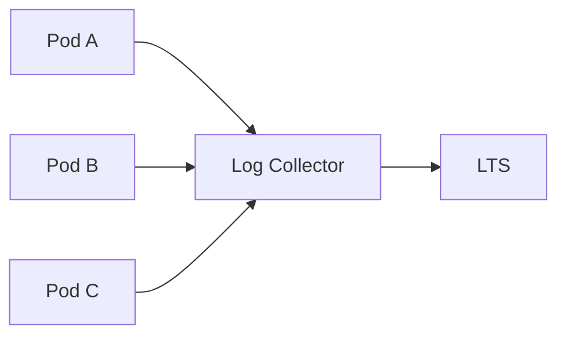
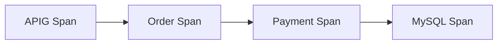
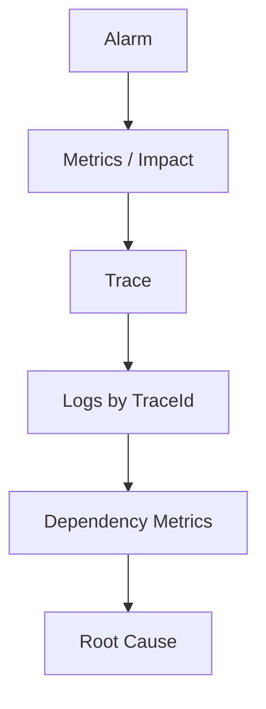
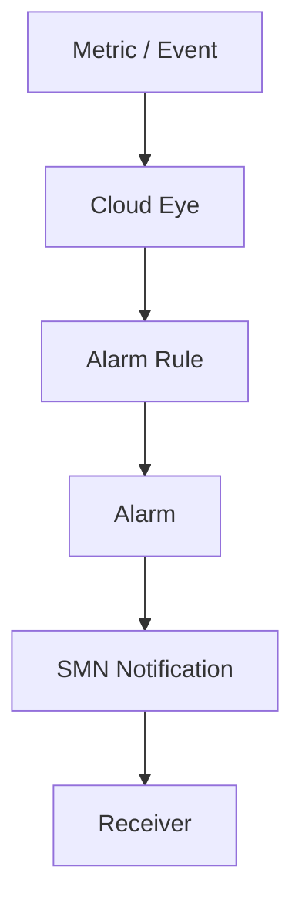
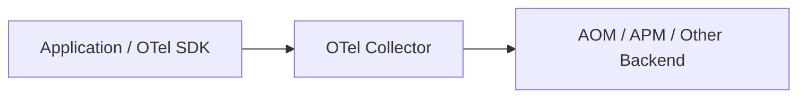

一次请求可能经过 DNS、WAF、ELB、APIG、Ingress、多个微服务、Kafka、Redis
和 MySQL，应用又运行在多个 Pod、Node 和可用区上。故障发生时，只登录某台
服务器执行 `tail -f app.log`，已经很难回答“哪里异常、影响了谁、根因是什么”。

可观测性要建立的不是一堆监控大盘，而是 Metrics、Logs、Traces 之间可以
相互跳转和印证的运行模型。告警负责把异常主动推给人，日志和链路负责解释
异常，SLO 和业务指标则判断系统是否真的在提供可用服务。

本文是云服务系列第十三篇，承接[《对象存储与大文件分片传输机制》](/posts/object-storage-multipart-upload/)，
从数据存储转向运行中的系统。华为云中的 AOM、LTS、Cloud Eye 和 APM 各有
侧重，具体能力与配额需以对应区域的产品文档为准。

## 一、从监控到可观测性

Monitoring（监控）通常回答的是事先已知的问题，例如“CPU 是否超过 80%”。
它依赖预先定义的指标、阈值和看板，适合发现已知模式的异常。

Observability（可观测性）更进一步：当出现一个没有预设规则的问题时，能否
根据系统暴露的数据推断内部状态。监控是可观测性的重要组成部分，但可观测性
还要求数据之间能够关联，能够从现象下钻到具体请求和代码路径。

| 信号 | 回答的问题 | 典型数据 |
|---|---|---|
| Metrics | 系统是否异常、趋势如何 | CPU、RPS、错误率、p99、Lag |
| Logs | 具体发生了什么 | 异常堆栈、业务事件、SQL 错误 |
| Traces | 问题发生在哪条调用路径 | Trace、Span、服务依赖与耗时 |

在华为云的产品组合中，可以用下面的方式理解职责：

| 服务 | 侧重点 |
|---|---|
| AOM | Application Operations Management，应用运维管理与统一可观测性入口 |
| LTS | Log Tank Service，云日志服务的采集、检索、分析与存储 |
| Cloud Eye / CES | 云资源指标、事件监控与告警 |
| APM | Application Performance Management，应用性能管理与调用链 |

这些产品存在能力交集，不能简单画成严格的上下级关系。工具只是载体，设计时
应先确定三件事：需要哪些信号、用什么标识关联、每个信号保留多久。

## 二、Metrics 的数据模型与高基数

一个 Metric 通常由指标名、标签（Label / Dimension）、时间戳和数值组成：

```text
http_requests_total{service="order", method="POST", status="500"} 1024
```

标签用于区分同一指标下的不同对象。适度的标签能支持下钻，例如按服务、接口、
状态码拆分；但标签不是越多越好。把 `userId`、`orderId`、`traceId` 或
`requestId` 直接作为大规模 Metric Label，会产生 High Cardinality（高基数），
显著放大存储、索引和查询压力。

TraceId 非常适合日志与链路关联，却通常不适合作为普通指标标签。指标应该
聚合到可比较的维度，具体请求的细节交给日志和 Trace。

| 类型 | 特征 | 例子 |
|---|---|---|
| Counter | 通常单调递增，进程重启会重置 | `requests_total`、`errors_total` |
| Gauge | 可升可降的瞬时值 | 活跃连接数、内存使用量、队列深度 |
| Histogram | 统计数值分布，可估算分位数 | HTTP 延迟、SQL 耗时 |

### 平均值会掩盖尾延迟

假设 99 个请求耗时 10ms，1 个请求耗时 10 秒。平均值看起来仍然可以接受，
但那个 10 秒请求对真实用户已经是严重故障。因此生产系统更关注 p50、p95、
p99 等分位数，p99 尤其适合暴露 Tail Latency（尾延迟）。

Histogram 通过分桶统计分布，可以估算分位数；分桶边界设计得是否合理，会
直接影响结果的精度。只看平均响应时间，很容易错过少量但严重的慢请求。

### RED、USE 与 Golden Signals

服务接口常用 RED 方法：

- Rate：请求速率；
- Errors：错误率；
- Duration：响应时间，通常看 p95 / p99。

基础设施资源常用 USE 方法：

- Utilization：使用率；
- Saturation：饱和度，例如运行队列、排队长度；
- Errors：错误计数。

Google SRE 中常见的四类 Golden Signals 则是 Latency、Traffic、Errors 和
Saturation。它们适合作为服务健康看板的基础，而不是唯一指标。

## 三、日志：结构化与集中采集

日志的价值不在于“打印得多”，而在于出事时能否按字段稳定检索。相比一行
自由文本，结构化日志更适合集中查询：

```json
{
  "timestamp": "2026-11-11T10:30:01.123Z",
  "level": "ERROR",
  "service": "order-service",
  "environment": "prod",
  "version": "1.4.3",
  "pod": "order-7c9f8b6d5-abcde",
  "traceId": "4bf92f3577b34da6a3ce929d0e0e4736",
  "spanId": "00f067aa0ba902b7",
  "requestId": "req-1001",
  "orderId": "1001",
  "message": "payment timeout"
}
```

公共字段应在团队内统一，例如 `timestamp`、`level`、`service`、
`environment`、`version`、`pod`、`traceId`、`spanId`、`requestId` 和
`message`。不要让 `traceId`、`trace_id`、`traceID` 三种写法并存，否则
查询和告警规则会不断出现遗漏。

### Kubernetes 中为什么需要集中采集

容器中的日志优先写入 `stdout` / `stderr`，由容器运行时和日志采集组件统一
收集。如果只写 Pod 本地文件而没有采集，Pod 删除后日志可能一起消失：



Kubernetes 中常见做法是每个 Node 运行一个 DaemonSet 采集器，收集该节点上
所有容器的日志。业务有 10 个 Pod 时，用户请求落在哪个 Pod 并不确定，逐个
执行 `kubectl logs` 效率很低；集中到 LTS 后，可以用一个 TraceId 跨 Pod
查询整条请求的日志。

如果应用坚持写文件日志，就必须配置 Rotation，否则 `app.log` 可能无限增长，
最终写满 Node 磁盘。日志系统本身也可能成为业务故障的原因。

```text
service = "order-service" AND level = "ERROR" AND traceId = "abc123"
```

日志保留时间也需要设计。近期日志放在高性能检索系统中，历史日志转储到
OBS 做长期归档，是常见的组合。归档日志查询成本更高，不应把所有 DEBUG
日志都无限期保留。

### 日志中的敏感信息

日志和 Trace 经常包含 URL、Header、SQL 和用户数据，因此可观测性平台本身
也是敏感数据系统。密码、Token、私钥、认证 Header 和完整银行卡号不应写入
日志；必要字段应脱敏，例如只保留 `138****1234`。

## 四、Trace 与上下文传播

Trace 描述一次请求经过多个服务的完整路径，Span 表示其中的一次操作。每个
Span 有 SpanId，并通过 Parent Span 建立调用树，所有 Span 共享同一个
TraceId：



HTTP 调用可以使用 W3C Trace Context 传播上下文：

```text
traceparent: 00-4bf92f3577b34da6a3ce929d0e0e4736-00f067aa0ba902b7-01
```

四段分别表示版本、TraceId、Parent SpanId 和 Trace Flags。下游收到后应继续
当前 Trace，而不是新建一个无关的 TraceId。TraceId 标识整条调用链，
RequestId 通常标识一次具体请求；简单系统中两者可能相同，复杂系统中不应
混为一谈。

Kafka 没有普通 HTTP Header，但可以把 Trace Context 放进 Record Header。
Consumer 读取后建立 Consumer Span，HTTP 请求经过 Kafka 到下游服务，仍然
能形成一条跨异步边界的调用链。这与上一篇文章讨论的 Record Header 用法一致。

### 采样与插桩边界

高吞吐系统不可能保存所有完整 Trace。Head Sampling 在请求进入时决定是否
采样；Tail Sampling 在请求结束后根据错误、延迟等信息决定是否保留。后者更
容易保留真正有价值的异常 Trace，但需要把同一 Trace 的 Span 聚合到能够做出
决策的位置，实现成本更高。

Service Mesh 能记录来源、目标、延迟和状态码，但无法理解应用内部业务函数。
应用侧 Instrumentation 可以补充业务 Span 和 SQL Span，二者应配合使用。
Trace 能告诉你数据库调用慢，RDS 的慢查询日志和指标再帮助判断为什么慢。

## 五、三类信号如何关联排障

一个有效的排障路径通常从告警开始，先确定影响范围，再用 Trace 找到慢或
出错的环节，最后用日志和下游指标验证根因：



例如订单接口 p99 从 200ms 上升到 4s：

1. 看板发现 Order API 延迟异常；
2. Trace 显示 MySQL Span 占 3.5s；
3. 用 TraceId 在 LTS 查到 `Lock Wait Timeout`；
4. RDS 指标显示 Active Transaction 和 Lock Wait 上升；
5. 定位到数据库长事务。

另一类故障是 Kafka Consumer Lag 持续增长。Producer Rate 正常，但 Consume
Rate 下降；Consumer 日志出现 `DB connection timeout`，RDS 指标显示连接数
达到上限。继续追查会发现 Consumer 扩容后，所有 Pod 的连接池总和超过了
数据库容量。这与[连接池容量规划](/posts/cloud-database-cache-data-access/)
和[Kafka 消费一致性](/posts/kafka-messaging-consumption-consistency/)直接相关。

这说明可观测性不能只看单个组件。Metrics 发现异常，Trace 缩小路径，Logs
提供上下文，下游指标验证根因，四者缺一不可。

### 从业务 ID 反查技术链路

现实中用户通常不会提供 TraceId，而是提供订单号。日志应支持：

```text
orderId -> 找到日志 -> 提取 traceId -> 查询 Trace
```

这样就把业务实体和技术调用链关联起来。日志中保留 `orderId`、`tenantId`
等业务字段，与保留 `traceId` 同样重要。

### 变更、版本与时间

很多故障发生在变更之后。如果看板能同时展示 Deployment、配置变更、扩缩容
和 Failover 事件，根因判断会快很多：

```text
14:00 release v1.4.3
14:03 error rate ↑
```

日志和指标中保留 `service` 与 `version`，可以快速确认是否只有新版本异常。
跨服务日志还必须使用统一时间戳和时区，并保证节点时间同步；Clock Skew 会
让 Trace 和日志顺序错乱，把简单的因果问题变成难以还原的谜题。

## 六、告警规则、降噪与 On-call

告警的目标是让系统在异常时主动通知人或自动系统，而不是让人一直盯着
Dashboard。一条告警规则通常包含指标、条件、阈值、持续时间、严重级别和
通知方式：

```text
Metric: 5xx rate > 5%
Duration: 5m
Severity: Critical
Route: order-service on-call
```

### 不要为瞬时波动报警

CPU 瞬时到 90% 可能完全正常。如果每个 Spike 都触发通知，会形成大量
Alarm Noise（告警噪声）。更合理的方式是要求条件持续一段时间，例如“5 分钟
平均超过 80%，连续 3 个周期”。

告警质量比数量更重要。如果每天收到 1000 条告警，其中 990 条没有实际价值，
人最终会忽略所有告警，这就是 Alert Fatigue（告警疲劳）。真正值得通知的，
应该是需要人或自动系统采取行动的问题。

| 级别 | 适用场景 | 响应方式 |
|---|---|---|
| Critical | 核心业务不可用、严重安全事件 | 立即通知 On-call |
| Major | 明显降级、关键依赖异常 | 尽快处理 |
| Minor | 局部影响、可延后修复 | 工单或工作时间处理 |
| Warning | 容量风险、趋势预警 | 预防性跟进 |

### 阈值告警与事件告警

Threshold Alarm 判断指标是否超过阈值，例如内存超过 90%。Event Alarm 判断
某个离散事件是否发生，例如 VM Restart、RDS Failover、Node NotReady。
Cloud Eye 同时支持指标告警和事件告警，两类规则应该配合使用。



Cloud Eye 负责判断异常，SMN（Simple Message Notification，消息通知服务）
负责把告警发送到邮件、短信、HTTP 或聊天工具。告警接收人应通过 Notification
Topic 或 Group 管理，而不是把大量规则绑定到某个个人手机号。人员变化时只
维护组，不必逐条修改规则。

### 路由、升级与恢复

告警路由可以按 Service、Severity 和 Environment 决定通知策略。生产环境的
Critical 告警进入 On-call，开发环境的 Warning 只发团队群。每个服务还应有
明确的 Owner，否则告警无法正确路由。

On-call（值班）体系要明确谁主响应、多久 Ack（确认）、未响应时升级给谁：

```text
0 min   -> Primary On-call
10 min  -> Secondary
20 min  -> Team Lead
```

告警只是 Incident Response（故障响应）的起点。异常恢复后应产生 Resolved
状态，才能知道故障持续了多久。如果 CPU 在阈值附近反复波动，可以设置回滞：
超过 80 触发，低于 70 才恢复，减少 Flapping（抖动）。发布或维护期间可以使用 Maintenance
Window 或 Alarm Mask 暂时屏蔽通知，但必须有明确结束时间，不能永久关闭。

### 日志告警与 Incident 关联

日志也可以触发告警，例如“5 分钟内出现 3 次 OutOfMemoryError”。但日志告警
必须做聚合、冷却和去重，否则一个异常可能每秒产生数百条通知。

同一个数据库故障可能同时产生 RDS 连接告警、Order 5xx、Payment 延迟和
Kafka Lag。它们是多个 Alert，却可能属于同一个 Incident。可观测性平台应尽量
按服务依赖、时间和 Trace 关联这些信号，避免每个团队分别处理三个看似独立
的告警。

## 七、SLO、错误预算与业务指标

告警之外，还需要用服务等级指标判断系统是否在兑现承诺。SLI（Service Level
Indicator，服务等级指标）、SLO（Service Level Objective，服务等级目标）和
SLA（Service Level Agreement，服务等级协议）分别表示：

| 概念 | 含义 | 例子 |
|---|---|---|
| SLI | 实际测量值 | 可用性、错误率、p99 延迟 |
| SLO | 内部服务目标 | 99.9% 请求成功且 p99 < 500ms |
| SLA | 面向客户的正式承诺 | 合同中的可用性与赔付条款 |

如果 SLO 是 99.9% 可用性，允许的失败比例就是 0.1%，这部分称为 Error
Budget（错误预算）。错误预算用来平衡可靠性与功能交付：预算充足时可以
加快发布，预算耗尽时则应优先修复稳定性问题。

### 业务指标比资源指标更接近用户

只监控 CPU 和内存是不够的。完全可能出现 CPU 20%、内存 30%，但支付成功率
为 0% 的情况。服务器指标全绿，业务已经不可用。

因此应同时监控订单成功率、支付成功率、登录成功率等业务指标。更高价值的
告警通常基于用户可感知症状：

```text
HTTP 5xx > 5%
Payment Success Rate < 95%
p99 > 3s
```

资源指标更适合用于根因分析和容量预警，而不是单独作为“业务是否正常”的
唯一证据。Symptom-based Alert 能减少“资源正常但用户不可用”的盲区。

## 八、Kubernetes 监控与 Dashboard 分层

Kubernetes 至少需要从 Cluster、Node、Pod 和 Application 四层观察：

| 层次 | 关键指标 |
|---|---|
| Cluster | Node 数量、Pending Pod、调度失败、容量 |
| Node | CPU、内存、磁盘、网络、Node Condition |
| Pod | Restart、OOMKilled、CPU Throttling、Readiness、Pending |
| Application | RPS、错误率、延迟、业务成功率 |

Pod 名称会随重建变化，不适合作为长期业务维度。`service` 和 `version` 更
适合做聚合，Pod、Namespace、Node 等元数据用于定位具体实例。

Dashboard 也应有层次，而不是把所有指标堆在一页：

```text
L1 Business   订单量、支付成功率、可用性
L2 Service    RPS、p99、错误率、依赖延迟
L3 Kubernetes Pod 数、重启、CPU、内存
L4 Infrastructure Node、RDS、Redis、Kafka、VPC
```

L1 用于判断“业务是否正常”，L2 用于定位哪个服务异常，L3 和 L4 用于继续
下钻到运行环境。每一层都应该能跳到下一层，而不是要求人从头开始翻看。

## 九、Telemetry 成本、安全与 Pipeline

可观测性本身也有成本。每天产生 10 TB 日志，即使系统完全正常，也会带来
很高的存储和查询费用。因此 Logs、Metrics、Traces 都需要预算和治理。

### 三类预算

- Logging Budget：哪些日志必须记录、保留哪些字段、Retention 多长、DEBUG
  开启多久；
- Cardinality Budget：`service`、`method`、`status` 通常合理，
  `user_id`、`request_id`、`trace_id` 通常不适合做 Metric Label；
- Trace Sampling Budget：正常请求采样 1%，错误和慢请求保留 100%，在成本
  与排障能力之间平衡。

### OpenTelemetry Collector

OpenTelemetry 提供 API、SDK、Collector 和 OTLP（OpenTelemetry Protocol）
协议，用于统一处理 Metrics、Logs 和 Traces。应用可以把数据发给 Collector，
再由 Collector 批量、过滤、转换、路由和导出到不同后端：



这样应用不必与某个具体可观测性后端深度耦合。华为云 AOM 也提供开放协议
接入能力，可以作为统一的可观测性入口；具体支持范围仍应以文档为准。

如果日志突然暴涨，Collector 也可能处理不过来。Pipeline 需要 Buffer、
Queue、Drop Policy 和 Rate Limit。磁盘即将满时，通常应优先保护业务，而不
因为 DEBUG 日志阻塞应用。

### 可观测性数据的安全与响应闭环

日志和 Trace 可能包含 URL、Header、SQL 和用户数据，平台需要 RBAC、审计、
保留策略和敏感数据脱敏。不是所有能看日志的人都应该看到所有租户的数据。

高优先级告警最好对应 Runbook（处置手册），明确检查步骤，例如 Kafka Lag 告警先看
Consumer Pod、消费速率、数据库依赖和 Partition 分配。部分故障可以自动化
处理，但自动化必须有安全边界：CPU 高就自动扩容，如果根因是无限循环 Bug，
只会增加更多异常实例。

故障期间第一目标是恢复服务，回滚、扩容、关闭功能或切换流量通常比立刻找到
完美解释更重要。恢复后再做 Postmortem（故障复盘），记录时间线、影响、
检测方式、根因、缓解措施和改进项。Postmortem 的目标是改进系统，而不是
寻找个人责任。

## 十、总结

云原生可观测性的本质，不是把所有日志集中到一个平台，而是建立 Metrics、
Logs、Traces 之间可以相互关联的系统运行模型。

Metrics 适合发现趋势、容量问题和触发告警；Logs 适合记录具体事件和错误
上下文；Traces 适合还原一次请求跨服务的完整路径。TraceId 是连接 Trace 与
Log 的关键桥梁，业务 ID 则是用户描述问题与技术链路之间的桥梁。

一个成熟的体系应该能回答四个问题：

1. 系统现在是否健康？
2. 哪里发生了异常？
3. 为什么发生异常？
4. 应该由谁采取什么行动？

对应的排障链路通常是：

```text
Alarm -> Metrics -> Trace -> TraceId -> Logs -> Dependency Metrics -> Root Cause
```

告警不是越多越好。每个高优先级告警都应代表一个需要采取行动的问题，并尽量
附带服务、环境、当前值、阈值、Dashboard 链接和 Runbook。告警需要路由、
升级、恢复确认和降噪，否则只会制造 Alert Fatigue。

监控还必须从 CPU、Memory 继续向上覆盖错误率、延迟、业务成功率和 SLO。
否则就会出现“所有服务器指标都是绿色，但用户已经完全无法下单”的典型盲区。

当 Metrics、Logs、Traces、告警和 Incident Response 被连接起来以后，
可观测性才真正从日志查询工具，变成云原生系统稳定性工程的基础设施。

## 参考资料

- [OpenTelemetry 文档](https://opentelemetry.io/docs/)
- [W3C Trace Context](https://www.w3.org/TR/trace-context/)
- [Google SRE 手册](https://sre.google/sre-book/table-of-contents/)
- [Kubernetes 日志架构](https://kubernetes.io/docs/concepts/cluster-administration/logging/)
- [华为云 AOM 产品文档](https://support.huaweicloud.com/intl/en-us/productdesc-aom2/aom_01_0001.html)
- [华为云 LTS：云服务日志接入](https://support.huaweicloud.com/intl/en-us/usermanual-lts/lts_04_0510.html)
- [华为云 Cloud Eye：产品概述](https://support.huaweicloud.com/intl/es-us/productdesc-ces/es-us_topic_0015479882.html)
