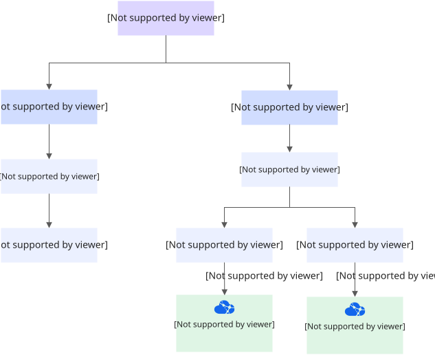
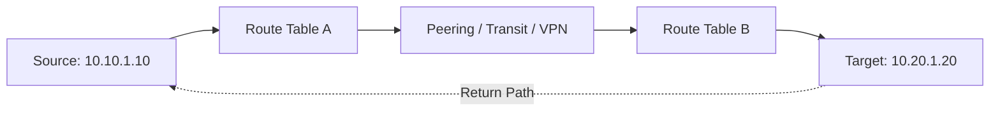
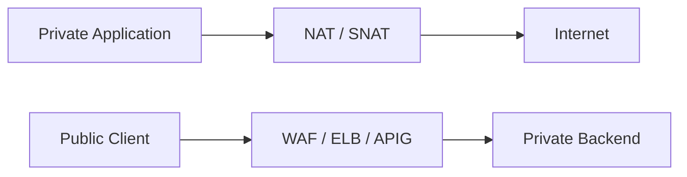
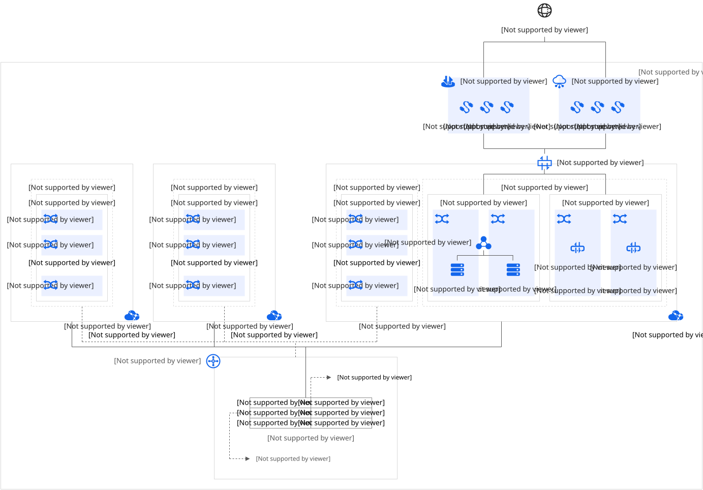
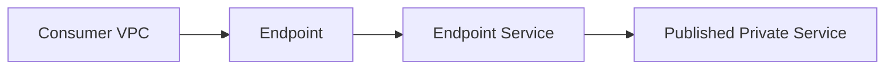
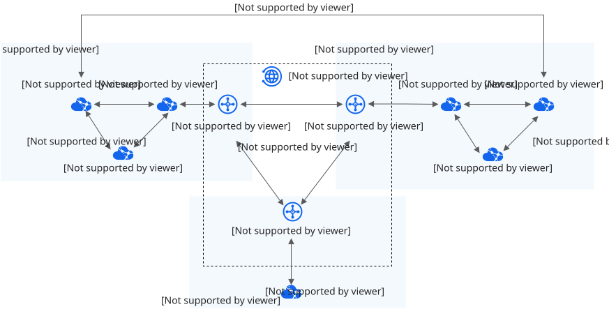
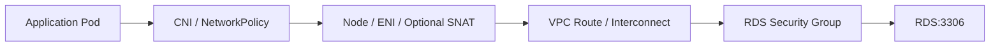

应用部署到云平台以后，访问另一个服务需要满足的条件远不止“知道对方 IP”。
CCE、ECS、RDS、Redis 和 Kafka 之间可能横跨子网、VPC、Region 或本地数据中心，
每一次连接都受到地址、路由、安全策略和服务配置的共同影响。

本文是云服务系列第七篇，承接[《Kubernetes 扩展机制：CRD、Webhook 与 Operator》](/posts/kubernetes-crd-webhook-operator/)，
将视角转向工作负载之间的网络底座。学习时始终围绕一个问题：

> 数据包从哪里出发、经过哪些边界、以什么地址到达目标，响应又如何返回？

下文以 IPv4 为主，结合华为云产品说明通用模型。子网与可用区的关系、ACL 状态性、
公网接入和跨 Region 能力存在厂商差异，实施时应核对目标区域与产品文档。

## 一、VPC、CIDR 与子网构成地址空间

VPC（Virtual Private Cloud）提供逻辑隔离的私有网络空间，包含地址范围、子网、
路由和网络连接关系。不同 VPC 默认隔离，即使属于同一账号，也需要显式建立连接。

Subnet 是 VPC 内进一步划分的地址范围。ENI（Elastic Network Interface）则是
实例接入网络的虚拟网卡，关联子网、私有 IP 和相应安全策略。

### CIDR 表达多大的网段

IPv4 地址长 32 位。CIDR 中的前缀长度表示固定网络位数，理论地址数为：

```text
地址数量 = 2^(32 - 前缀长度)
```

| CIDR | 地址范围 | 理论地址数 |
|---|---|---:|
| `10.10.0.0/16` | `10.10.0.0` 至 `10.10.255.255` | 65,536 |
| `10.10.0.0/20` | `10.10.0.0` 至 `10.10.15.255` | 4,096 |
| `10.10.16.0/24` | `10.10.16.0` 至 `10.10.16.255` | 256 |

前缀越短，网段越大。理论数量也不等于可分配数量：云平台会保留部分地址，具体
可用容量应按产品规则计算。

常见私有 IPv4 地址范围为 `10.0.0.0/8`、`172.16.0.0/12` 和 `192.168.0.0/16`。
它们可以在独立网络中重复使用，但不能因此直接通过互联网路由。

### 地址规划要考虑未来连接

例如在 `10.10.0.0/16` 中划分：

```text
10.10.0.0/20    CCE 节点
10.10.16.0/24   数据库
10.10.17.0/24   中间件
10.10.18.0/24   入口服务
10.10.19.0/24   运维管理
10.10.32.0/19   预留扩展
```

这是地址用途示例，尚未展开多 AZ 部署。实际规划还需覆盖 Pod 地址需求、节点池
扩容、负载均衡、托管服务和故障切换期间的临时容量。

如果两个待互联 VPC 都使用 `10.0.0.0/16`，访问 `10.0.1.20` 时就可能与本地地址
产生歧义。应统一规划云上 VPC、本地 IDC、VPN 客户端和容器网段，尽量避免重叠。
服务级代理或地址转换可以处理部分遗留冲突，但会增加复杂度。



## 二、路由决定去程与回程

路由表描述“目标 CIDR → 下一跳”。下面是概念示例，并非所有厂商通用的配置语法：

```text
Destination       Next Hop
10.10.0.0/16      Local
10.20.0.0/16      VPC Peering
0.0.0.0/0         NAT Gateway
```

目标为 `10.20.1.10` 时，更具体的 `/16` 路由优先于默认路由。普通 IP 路由通常
遵循 Longest Prefix Match，即最长前缀匹配；云平台还可能对 Local、系统路由和
不同来源路由设置额外限制或优先级。

`0.0.0.0/0` 是 IPv4 默认路由，匹配没有更具体路由的目标。添加默认路由只是指定
方向，下一跳本身仍必须具备相应转发、公网接入或地址转换能力。

### 双向可达才能建立连接

TCP 请求需要正向路径，也需要响应的回程路径。VPC-A 有到 VPC-B 的路由，并不能
证明 B 的响应能够回到 A。跨 VPC、VPN、专线或多网卡场景尤其需要检查两端路由。



去程和回程路径不同称为非对称路由，它不一定错误，但可能让有状态防火墙或 NAT
无法关联同一个连接。判断能否接受非对称路径，需要结合实际设备和转发实现。

子网划分也不代表自动安全隔离。同 VPC 子网通常可通过内部路由互通，是否允许
具体连接仍由安全组、ACL 和其他策略决定。

## 三、安全组、ACL 与应用权限分层控制访问

安全组通常在实例或网卡层控制协议、端口、方向和来源。例如，只允许应用网段
访问 RDS 的 MySQL 端口：

```text
Target:    RDS
Direction: Inbound
Protocol:  TCP
Port:      3306
Source:    10.10.0.0/20
```

从应用侧看，同一连接属于 Outbound；从数据库侧看，它属于 Inbound。路由存在
只能说明存在转发路径，不代表安全策略放行，也不代表目标端口有进程监听。

| 机制 | 典型控制范围 | 主要判断依据 |
|---|---|---|
| Security Group | 实例或 ENI | 来源、目标、协议、端口和方向 |
| Network ACL | 子网 | 子网出入流量规则 |
| NetworkPolicy | Kubernetes Pod 网络 | Pod、Namespace、IP 与端口规则 |
| WAF / API 网关 | Web 或 API 入口 | HTTP 内容、身份、请求和业务策略 |
| 应用权限 | 数据库或业务服务 | 账号、Token、证书和授权 |

安全组常采用有状态连接跟踪：允许发起连接后，响应流量通常不需要再添加完全
对称的规则。不过，连接跟踪不能补出缺失的回程路由。

ACL 的状态性必须按厂商判断。华为云的网络 ACL 是有状态的，允许连接的响应流量
不受规则限制，详见[网络 ACL 概述](https://support.huaweicloud.com/usermanual-vpc/acl_0001.html)。
不能把其他平台的无状态 ACL 经验直接套用过来。

内网地址也不代表可信身份。数据库、中间件和管理服务仍需最小授权、TLS、凭证
管理与审计；网络放行和应用授权应各自有清晰边界。

## 四、EIP、NAT 与负载均衡组织公网出入口

EIP 提供可独立管理的公网地址能力。实例能否通过它访问公网，还取决于绑定关系、
路由、安全策略及云平台的公网接入实现。

SNAT 修改源地址，常用于私网资源主动访问互联网；DNAT 修改目标地址或端口，
常用于把公网请求映射到内部服务：

```text
SNAT:
10.10.1.10:临时端口 → 公网出口地址:转换后端口

DNAT:
203.0.113.10:8080 → 10.10.1.20:8080
```

`203.0.113.0/24` 是文档示例地址。NAT 往往也包含端口转换和连接状态维护，多个
工作负载共享出口时还应关注并发连接、端口耗尽、带宽和出口高可用。



NAT 负责地址转换，负载均衡负责流量分发与健康后端选择。公网入口通常集中在
WAF、ELB 或 API 网关，RDS、Redis、Kafka 等内部依赖通过私网访问。

私网服务需要主动访问公网，并不意味着它必须接受公网主动连接。SNAT 出口、
DNAT 映射和公开负载入口应分别设计，避免无意扩大暴露面。

运维访问可以经过 VPN、堡垒机或受控会话服务，使内部主机不必逐台绑定公网 IP。



## 五、跨 VPC 通信要区分网络互联与服务消费

选择方案前，先明确需要连接的是两个地址空间，还是访问某个被提供的服务。

### Peering 与中心路由

VPC Peering 在两个 VPC 之间建立私网路由关系。创建连接后，通常还需在关联路由表
中配置双方目标网段，并放行安全策略。华为云的同 Region 配置流程参见
[VPC 对等连接使用指南](https://support.huaweicloud.com/intl/zh-cn/helppanel-vpc/vpc_help_7001.html)。

两端通信网段重叠会限制或破坏普通路由互通。也不能因 A 与 B、B 与 C 分别存在
Peering，就假定 A 能经 B 访问 C；Peering 通常不提供传递路由能力，需要按产品
限制验证或使用专门的 Transit 架构。

当 VPC 较多时，两两全互联需要 `N × (N - 1) / 2` 条连接。Enterprise Router
等中心路由服务可建立 Hub-and-Spoke 拓扑，集中管理业务 VPC 和共享服务 VPC。
接入同一中心仍需配置路由关联、传播和隔离策略，不等于所有网络自动互通。

### Endpoint 与 Endpoint Service

VPC Endpoint 采用提供方与消费方模型：提供方发布 Endpoint Service，消费方创建
Endpoint，经私网访问被明确暴露的服务。它不要求双方获得全面的网络访问能力。



Interface Endpoint 通常以私有地址的网络接口形式接入；Gateway Endpoint 则通过
路由引导流量。支持的服务、地域、访问控制和域名配置取决于产品能力，不能把所有
Endpoint 当作统一的数据路径。

部分 Endpoint 方案可以支持存在重叠网段的服务访问，但这不代表任意重叠网络都能
直接互联。还需验证后端类型、协议、DNS、连接审批和来源识别方式。华为云对两类
连接的区分见[Endpoint 与对等连接比较](https://support.huaweicloud.com/vpcep_faq/vpcep_04_0004.html)。

| 需求 | 优先评估的模型 | 关键检查 |
|---|---|---|
| 两个 VPC 需要双向 IP 通信 | Peering | CIDR、双向路由、安全策略 |
| 多个 VPC 与共享服务网络连接 | Transit / Enterprise Router | 路由传播、隔离与容量 |
| 只消费一个私有服务 | VPC Endpoint | 支持的服务、协议、DNS 和授权 |
| 历史网络存在地址冲突 | 服务代理、Endpoint 或 NAT | 适用限制、地址转换与可观测性 |

网络互联提供可路由路径，最终可访问范围仍由策略限定，不能把 Peering 理解为必须
放开两个 VPC 的所有端口。



## 六、跨 Region 与混合云连接扩大网络边界

跨 Region 会增加时延、带宽成本和独立故障域，需要评估 Cloud Connect 等跨区域
连接能力。某些云支持跨 Region Peering，某些产品仅支持同 Region，不能统一套用。

本地 IDC 与云 VPC 常通过 Site-to-Site VPN 或 Direct Connect 连接：

| 方案 | 路径特点 | 设计重点 |
|---|---|---|
| VPN | 常通过公网建立 IPsec 加密隧道 | 双隧道、带宽、时延波动、MTU |
| Direct Connect | 经专用连接接入云网络 | 双线路、冗余接入点、路由与故障切换 |
| 跨 Region 云网络 | 使用云厂商跨区域网络能力 | 区域支持、带宽、成本与容灾 |

专线不能自动等同于加密链路，应根据要求配置额外加密。专线也不天然消除单点，
需要覆盖本地出口、运营商线路、云接入点和云内路由的冗余。

混合云不仅需要 IP 互通，还需要双向 DNS 解析、地址不重叠、BGP 或静态路由策略、
故障切换和 MTU 验证。隧道封装会增加报文开销，“小包能通、大请求卡住”时应检查
路径 MTU、分片和相关 ICMP 报文是否被阻断。

## 七、CCE 场景要确认真实源地址

Kubernetes 中常见四类地址承担不同角色：

| 地址 | 含义 |
|---|---|
| Node IP | 节点接入 VPC 的地址 |
| Pod IP | CNI 分配给 Pod 的地址 |
| Service ClusterIP | 集群内部服务虚拟地址 |
| LoadBalancer / 入口地址 | 对外或跨网络暴露的访问入口 |

Pod IP 是否可从 VPC 直接路由、访问外部时是否 SNAT 成 Node IP，都取决于 CNI
和集群配置。ClusterIP 通常由集群内转发机制实现，不能假定集群外主机添加一条
普通 VPC 路由就能访问。

例如 Pod 访问跨 VPC 的 RDS，数据库最终看到的来源可能是 Pod、Node 或 NAT 地址：



如果实际源地址已经转换成 Node IP，只放行 Pod CIDR 就可能无效。排查安全组前，
应从 CNI 配置、流日志、连接日志或抓包确认目标看到的地址。

NetworkPolicy 还需要支持其实现的网络插件，并明确相关 Pod 是否已被策略隔离。
它与云安全组共同影响通信，而非二选一。允许 DNS 查询也是出口隔离设计的重要部分。

代理同样会改变连接语义：七层代理通常终止客户端连接并新建后端连接。HTTP
转发头可以传递客户端信息，但它不等于数据包源 IP，数据库安全组也不会据此判断。
四层负载均衡是否保留源地址则取决于具体实现与配置。

## 八、沿真实路径逐层排查连接故障

先记录实际源工作负载、源地址、目标域名、解析结果、协议、端口和报错时间，再从
发生故障的 Pod 或主机网络环境发起验证。开发电脑能连通，不能证明 Pod 的路径正常。

| 层次 | 关键问题 | 常用验证方式 |
|---|---|---|
| DNS | 域名是否解析到预期私网地址？ | `dig`、`nslookup`，检查应用 DNS 缓存 |
| 地址与路由 | 命中哪个 CIDR，下一跳与回程是否正确？ | 主机路由表、云路由表、互联状态 |
| 安全策略 | 真实来源是否被所有相关策略允许？ | 安全组、ACL、NetworkPolicy、流日志 |
| TCP / UDP | 目标协议与端口是否可达？ | `nc`、抓包、协议对应的探测工具 |
| 监听与 TLS | 服务是否监听正确接口，证书是否匹配？ | `ss`、TLS 握手与服务日志 |
| 应用协议 | 认证、授权与请求本身是否正确？ | 数据库客户端、HTTP 客户端及应用日志 |

Linux 主机上可以进行只读诊断，例如：

```bash
dig db.internal.example.com
ip route get 10.20.16.30
nc -vz -w 3 db.internal.example.com 3306
ss -lnt
curl -v --connect-timeout 3 https://api.example.com/health
```

`ip route get` 只展示本机路由决策，不能代替云端路由检查；`nc` 成功只说明 TCP
连接建立，不证明数据库认证成功；`curl` 测试 HTTPS 时还涉及 DNS、SNI 和证书验证。

### 报错提供线索，不能替代路径证据

- `UnknownHostException` 倾向于名称解析问题；
- `Connection refused` 表示收到主动拒绝，可能来自目标主机或中间设备；
- `Timeout` 可能来自丢包、回程缺失、链路故障或服务无响应；
- `TLS handshake failed` 需要检查证书、协议和握手端点；
- HTTP 401、MySQL Access Denied 表明已到达某个应用协议处理方；
- HTTP 500 也可能由网关产生，不能单凭它证明后端应用已被访问。

`ping` 验证 ICMP：不通可能只是 ICMP 被禁，能通也不能证明 TCP 3306 被允许。
有条件时应结合两端抓包和流日志，判断 SYN 是否发出、目标是否响应、响应是否返回。

云网络设计需要同时建立地址空间、转发路径、安全边界和服务访问关系。每次排障
都把去程、回程和地址变化还原清楚，才能把“访问不了”定位为解析、路由、策略、
传输、TLS 或应用权限中的具体问题，并为后续流量入口和服务治理打好基础。

## 参考资料

- [华为云 VPC 网络规划](https://support.huaweicloud.com/intl/zh-cn/helppanel-vpc/vpc_help_0002.html)
- [华为云 VPC 对等连接使用指南](https://support.huaweicloud.com/intl/zh-cn/helppanel-vpc/vpc_help_7001.html)
- [VPC Endpoint 与对等连接的区别](https://support.huaweicloud.com/vpcep_faq/vpcep_04_0004.html)
- [VPC Endpoint 类型](https://support.huaweicloud.com/intl/zh-cn/productdesc-vpcep/vpcep_01_0006.html)
- [华为云网络 ACL 概述](https://support.huaweicloud.com/usermanual-vpc/acl_0001.html)
