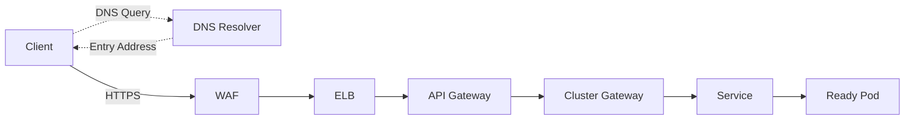
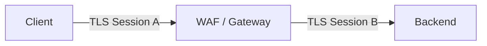
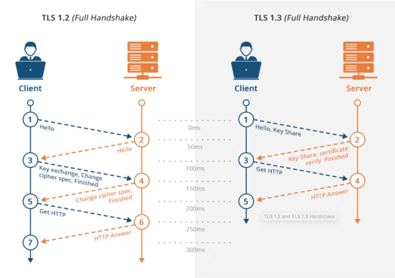
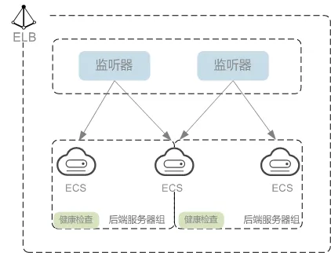
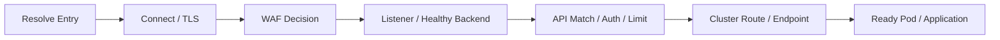

客户端调用一个 API 时，通常先完成域名解析，再建立网络与安全连接，请求随后
经过安全防护、负载均衡、API 治理和集群路由，最终到达业务实例。

本文是云服务系列第八篇，承接[《云网络基础：VPC、子网、路由与跨网络通信》](/posts/cloud-network-vpc-subnet-routing/)，
将上一章的地址与路由模型进一步延伸到应用流量入口。

入口架构应按职责组合，而不是照搬固定产品顺序。一个说明性模型如下：



DNS 不转发 HTTP，TLS 也不是独立的转发设备。WAF、ELB、APIG 和集群入口的组合
及先后关系，取决于产品接入方式与实际需求。有些场景使用其中两三层已经足够。

## 一、DNS、自定义域名与入口迁移

DNS 将域名转换为连接目标。A 记录指向 IPv4 地址，AAAA 记录指向 IPv6 地址，
CNAME 则指向另一个域名。例如：

```text
api.example.com
→ CNAME: api-entry.example.net
→ A: 203.0.113.20
```

这里使用的是文档示例地址。客户端获得地址后，才向目标入口建立连接。TTL 决定
记录可被缓存多久，实际切换还受到递归解析器、操作系统、应用缓存和已有连接影响。

迁移入口时，可以提前降低 TTL，但必须等旧 TTL 的缓存逐渐过期。修改 DNS 后也
应保留旧入口一段时间，验证新旧路径，并为回退预留条件。DNS 多地址或加权解析
可以分散流量，但流量比例受缓存和客户端选择影响，不能等同于逐请求的精确分流。

### 域名接入需要同时配置三件事

把 `api.example.com` 接入 APIG 或 WAF，需要分别核对：

1. DNS 是否指向正确入口；
2. TLS 终止层是否提供与该域名匹配的证书；
3. 网关是否配置了该 Host 的路由与后端。

CNAME 只改变解析路径，通常不会改变客户端发送的 SNI 与 HTTP Host。如果入口只
接受云厂商默认域名，单独修改 DNS 仍可能遇到证书错误或路由不匹配。

## 二、TLS 终止位置决定证书与信任边界

HTTPS 是 HTTP 经 TLS 保护后的通信方式。客户端需要验证证书链、有效期，以及
证书的 Subject Alternative Name 是否匹配目标域名。SNI 让服务器在握手阶段根据
客户端请求的名称选择证书，它与后续 HTTP Host 路由属于不同阶段。

证书可以公开分发，私钥必须受到保护。证书管理还要覆盖续期、轮换、完整证书链
部署和到期告警；通配符 `*.example.com` 通常不覆盖根域名或 `a.b.example.com`。

### 终止、重新加密与透传

| 模式 | 连接关系 | 工程影响 |
|---|---|---|
| TLS Termination | Client HTTPS → Gateway，Gateway HTTP → Backend | 网关可检查 HTTP，后段无 TLS 保护 |
| Re-encryption | Client HTTPS → Gateway，Gateway HTTPS → Backend | 两段独立会话，网关可见明文 |
| TLS Passthrough | 入口转发加密流量，由后端终止 TLS | 入口通常无法按 HTTP 内容治理 |



重新加密应同时验证后端证书、名称与信任链。只开启 HTTPS 而跳过后端证书验证，
无法完整建立服务身份信任。若要求端到端客户端认证，还需区分后端直连 mTLS 与
代理终止后重新建立 mTLS，它们识别的连接主体不同。

证书应部署在实际终止 TLS 的组件上，可能是 WAF、ELB Listener、APIG 或集群
Gateway。多段 TLS 需要分别管理，不能因为公网证书正确就假定回源握手也正确。



## 三、WAF 保护 Web 请求并约束源站暴露

WAF 面向 HTTP 的 URL、Header、Cookie 和 Body 等内容检测攻击，例如 SQL 注入、
XSS、路径穿越与异常扫描。安全组则主要控制来源、协议和端口，二者互为补充。

在反向代理接入模式下，DNS 把业务域名指向 WAF，WAF 再向 Origin 回源。Origin
可以是 ELB、APIG 或应用入口。若源站公网地址仍接受任意来源直连，攻击者就可能
绕过 WAF，应通过可用的网络限制、回源认证或私网接入方式约束入口。

处理合法请求误报时，应结合规则 ID、匹配字段和请求日志缩小例外范围，并验证
规则调整后的覆盖情况。防护模式变化、DNS 绕行和源站暴露属于不同变更，需要
分别记录、验证和回退。

WAF 对 Body 的检查范围、文件上传、流式请求和协议支持存在产品限制。允许大
请求通过，也不等于整个请求体都会被完整检查。WAF 仍需与应用的输入校验、参数化
查询和业务权限控制配合。

## 四、ELB 用监听器、后端组与健康检查分发流量

ELB 将流量分配给一组后端。Listener 定义前端协议和端口，Backend Group 定义
后端集合、算法和健康检查，七层转发规则还可按 Host、Path 等条件选择不同后端组。

```text
Listener: HTTPS :443
Certificate: api.example.com
Rule: Host=api.example.com, Path=/orders
Backend Group: order-service
Backend Protocol / Port: HTTP :8080
```

前端与后端协议、端口可以不同。四层负载均衡主要处理 TCP/UDP 连接与报文，七层
负载均衡可以按 HTTP 请求属性路由，HTTPS 内容检查则需要在相应位置解密。

### 算法需要匹配流量特征

| 策略 | 选择依据 | 需要留意 |
|---|---|---|
| 加权轮询 | 按权重分配连接或请求 | 处理成本相差较大时可能不均衡 |
| 加权最少连接 | 活跃连接数及权重 | 连接数不直接等于 CPU 或请求负载 |
| 源 IP Hash | 以来源 IP 建立稳定映射 | 共享 NAT 或代理会造成流量集中 |

算法名称、适用协议和分配粒度依实现而异。HTTP/2 可以在一条连接中复用多个请求，
因此“最少连接”不必然意味着最少工作量。华为云提供的具体策略见
[流量分配策略文档](https://support.huaweicloud.com/intl/zh-cn/usermanual-elb/elb_ug_jt_0003.html)。

会话保持也不能代替状态管理。把会话放在外部存储或使用适当 Token 机制，可以
减少后端故障、扩缩容和重新分配造成的影响。

### 健康检查与摘流

TCP 检查主要验证能否建连，HTTP 检查还可验证路径和响应状态。检查路径、Host、
协议、端口和来源放行都应与后端实际配置一致。

ELB Health Check 判断它直接连接的后端是否可用；Kubernetes Readiness 判断 Pod
是否具备接收 Service 流量的条件。如果 ELB 后面是 Ingress，ELB 检查成功并不能
证明每个业务 Pod 都健康。

下线时需要停止新流量、等待存量请求，再结束进程。ELB 的连接排空、EndpointSlice
更新、Readiness、应用优雅退出和终止期限是异步协作，不能假定摘流一发生，所有
代理和长连接就立即停止使用旧实例。




## 五、API 网关管理调用身份与 API 流量

APIG 以 Method、Path、调用者、租户和版本等 API 维度组织治理，常见能力包括
鉴权、限流、配额、参数映射、请求转换和监控。七层 ELB 可能也具备部分相似能力，
产品选型应比较实际功能与治理需求，而不是只凭名称判断。

API 网关可以验证 Token、签名、API Key 或接入自定义授权，但应用仍需检查资源
所有权、租户边界和业务操作权限。入口身份校验成功，不代表调用者有权读取任意
订单或执行任意支付操作。

### 限流与配额

Rate Limit 限制短时间请求速率，Quota 限制较长周期的调用总量。常用实现包括：

| 算法 | 特点 |
|---|---|
| 令牌桶 | 按速率补充令牌，以桶容量容纳突发 |
| 漏桶 | 常用于平滑输出，具体实现可包含排队或丢弃 |
| 固定窗口 | 简单，但窗口交界处可能出现突发 |
| 滑动窗口 | 更贴近最近一段时间的流量，维护成本较高 |

多实例网关还要明确限流是单实例、本地近似，还是跨实例共享计数。按 IP 限流时，
企业 NAT 或上游代理可能把多个用户合并为同一来源。限流阈值应结合后端容量、
调用者身份、突发预算和业务优先级设置，并监控拒绝比例。

### 可信 Header 与身份传播

网关可添加 Request ID、租户标识、`Forwarded` 或 `X-Forwarded-For`。后端只能
信任经过约定代理链验证的信息，入口应清理或规范客户端可伪造的身份 Header。
网络源 IP、转发头和认证身份是不同证据，不应互相替代。

网关适合通用治理和适度协议映射。订单计算、库存扣减、支付状态等领域行为仍应
由业务服务维护，避免网关策略成为难以测试和回滚的隐式业务系统。

## 六、Kubernetes 入口连接云网关与业务服务

Ingress Resource 声明 Host 和 Path 规则，Controller 负责把规则落实到代理或云
负载均衡数据面。它不一定额外引入一层 Pod 代理：有些实现直接配置云 ELB，并由
ELB 转发到节点或 Pod。

例如，一个以独立集群代理承接流量的 Ingress 规则可以写成：

```yaml
apiVersion: networking.k8s.io/v1
kind: Ingress
metadata:
  name: order-entry
  namespace: production
spec:
  ingressClassName: example-ingress
  rules:
    - host: api.example.com
      http:
        paths:
          - path: /orders
            pathType: Prefix
            backend:
              service:
                name: order-service
                port:
                  number: 80
```

`example-ingress` 必须替换为集群实际支持的 IngressClass；Service 应位于同一
Namespace。TLS 终止、回源协议、路径重写和来源信任需按 Controller 能力配置。
Prefix 匹配本身不表示自动把 `/orders` 从转发路径中删除。

### Gateway API 与 API 网关产品

Gateway API 是 Kubernetes 的网络 API 模型，主要资源包括：

- GatewayClass：由基础设施提供方定义实现类型；
- Gateway：声明监听器、地址和 TLS 等入口配置；
- HTTPRoute：声明应用请求匹配与后端路由。

这些资源需要对应 CRD 和 Controller 实现，支持范围应核对兼容性声明。Gateway API
规范不自动提供商业 APIG 的全部鉴权、开发者门户或计费能力，详见
[Gateway API 概览](https://gateway-api.sigs.k8s.io/docs/concepts/api-overview/)。

APIG 与集群入口可以同时存在，但要明确哪一层管理外部 API，哪一层维护集群路由。
若一层已满足需求，就没有必要为了完整画图继续堆叠代理。

## 七、超时、重试与大小限制必须跨层协调

入口治理容易出问题的地方，是多个组件分别设置规则，却没有统一的请求预算。

### 区分三种超时

| 类型 | 含义 | 典型影响 |
|---|---|---|
| Connect Timeout | 建立上游连接的等待时间 | 后端不可达时快速失败 |
| Response / Request Timeout | 等待响应或完成请求的期限 | 慢请求、长耗时操作 |
| Idle Timeout | 连续没有数据传输的时长 | Keep-Alive、WebSocket、SSE |

产品对“响应超时”的定义可能是首字节、两次读取间隔或整次请求，需要按文档核对。
因此不能把各层不同类型的 Timeout 简单取最小值。

对于可比较的请求期限，应从客户端预算向下分配：下游尽早失败，上游留出传输和
错误返回时间。例如总预算 20 秒，服务处理预算 12 秒，数据库操作预算 5 秒。
这些数字仅是示意，实际还需扣除排队、重试、多个下游调用和连接建立的时间。

客户端或网关超时，也不代表后端事务已经停止。写操作应支持幂等键、结果查询和
适当的取消传播，避免用户重试后重复创建或扣款。

### 重试不能逐层放大

假设客户端、网关和应用 HTTP 客户端各最多发起 3 次尝试，最坏情况下可能放大为
27 次下游调用。应限制总尝试次数与时间预算，使用退避、抖动，并只重试适合恢复的
故障。非幂等请求需要业务层去重保证。

长连接和流式接口还需核对协议支持、缓冲、心跳、空闲超时和排空时长。SSE 流量
虽仍使用 HTTP，也可能因代理缓冲而迟迟无法到达客户端。

### Body、Header 与文件上传

WAF、APIG、Ingress 和应用都可能限制请求体、Header、URL 或解压后的内容大小。
对于测量方式一致的 Body 限制，整条链路受最小值约束；压缩、转换和缓冲可能让
不同层看到不同大小。

具体数值受实例类型和配置影响，应以对应产品限制为准，例如
[华为云 APIG 请求体限制](https://support.huaweicloud.com/intl/zh-cn/apig_faq/apig-faq-180606013.html)。
大型文件可采用后端签发限时上传授权、客户端直传对象存储的模式，并配合对象大小、
权限、完整性校验与后处理，减少网关和应用中转压力。

## 八、通过日志与路径证据定位入口故障

域名、证书和路由应分别验证：域名决定连接地址，TLS 验证入口身份，Host 和 Path
决定应用路由。测试指定入口地址时，可以保留域名进行 HTTPS 验证：

```bash
dig api.example.com

curl -v --connect-timeout 3 --max-time 10 \
  --resolve api.example.com:443:203.0.113.20 \
  https://api.example.com/orders

openssl s_client -connect api.example.com:443 \
  -servername api.example.com \
  -verify_hostname api.example.com -verify_return_error
```

示例地址需替换为待验证入口。`--resolve` 保留域名对应的 Host、SNI 和证书校验，
同时将连接定向到指定地址。工具参数应核对本地版本，不能用跳过证书校验来证明
HTTPS 配置正确。

### 状态码只能提供初步线索

| 现象 | 常见方向 | 还需确认 |
|---|---|---|
| TLS 错误 | 证书链、名称、信任或协议 | 哪一段 TLS 握手失败 |
| 401 / 403 | 鉴权、授权、WAF 拒绝 | 哪一层生成响应、命中何种规则 |
| 413 / 431 | Body 或 Header 限制 | 是否发生解压、转换或 Cookie 膨胀 |
| 429 | 限流或配额 | 作用维度、实例范围、重试提示 |
| 502 | 回源通信或响应异常 | 协议、端口、TLS、连接重置 |
| 503 | 无健康后端、过载或主动不可用 | ELB 后端与 Service Endpoint 是否可用 |
| 504 | 某个代理等待上游超时 | 超时类型、真实耗时与下游完成状态 |

相同状态码可以来自不同层，具体映射也因产品而异。先确定响应生成者，再判断
是否已经转发，避免把所有 5xx 都归因于业务代码或某一个网关。

### 建立跨层关联

可信入口应维护请求标识，并按统一约定传播 Trace Context。记录 Host、Path、
路由、后端、响应码、总耗时与上游耗时，再结合 WAF 规则日志、网关访问日志、
集群 Events 和应用日志还原路径。请求标识用于关联，不用于授权，也不要在日志中
记录完整 Token 或敏感 Body。

网关总耗时与上游耗时的差值有助于寻找排队、连接或代理处理开销，但指标口径应
一致。异步消息链路需要显式传播上下文，才能继续关联消费者处理过程。



入口迁移和策略发布应验证 DNS、证书、域名、路由、回源和观测能力，再逐步切流。
DNS 权重、后端权重与 API 路由分流的粒度不同，回退还要考虑旧连接和缓存。

把各层职责、超时语义与信任边界记录清楚，才能让入口既能保护系统，也能在更新、
故障和流量变化时保持可解释的行为。后续讨论服务网格时，这套入口模型还会进一步
延伸到服务之间的东西向通信。

## 参考资料

- [华为云 ELB 流量分配策略](https://support.huaweicloud.com/intl/zh-cn/usermanual-elb/elb_ug_jt_0003.html)
- [华为云 APIG 请求体大小限制](https://support.huaweicloud.com/intl/zh-cn/apig_faq/apig-faq-180606013.html)
- [Gateway API 资源概览](https://gateway-api.sigs.k8s.io/docs/concepts/api-overview/)
- [Gateway API 简单入口部署](https://gateway-api.sigs.k8s.io/guides/getting-started/simple-gateway/)
