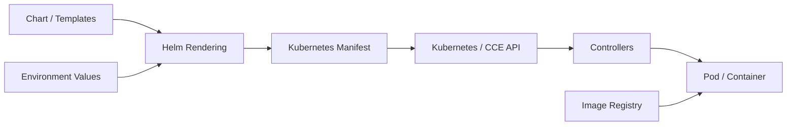
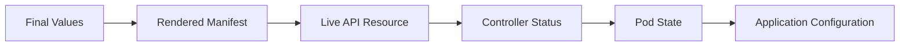

一个 Java 服务部署到 Kubernetes，往往需要 Deployment、Service、ConfigMap、
Ingress 等多个资源。同一应用进入开发、测试和生产环境后，还会出现副本数、
资源规格、域名和服务地址等差异。

如果为每个环境复制一套 YAML，模板修改就需要同步到多个文件，环境之间也容易
出现难以解释的差异。Helm 把一组资源组织成可复用、可参数化、可版本化的应用包，
让通用部署结构与环境配置分别维护。

本文是云服务系列第五篇，承接[《Kubernetes 资源调度与高级调度体系》](/posts/kubernetes-scheduling-system/)。
此前讨论的镜像、资源和调度，在这里通过配置渲染与发布管理连接起来：



Helm 生成并提交期望状态，Kubernetes 负责持续协调实际状态。本文示例使用 Helm 3、
Helm 4 共通的基础命令；等待、失败回滚等选项应以所用客户端的 `--help` 为准。

## 一、Chart、Values、Template 与 Release

Helm 是 Kubernetes 的应用包管理工具，其核心对象可以归纳为四个：

| 对象 | 表达的内容 |
|---|---|
| Chart | 应用部署包，包含元数据、默认配置和资源模板 |
| Values | 渲染模板时使用的参数 |
| Template | 带变量与控制结构的 Kubernetes 资源描述 |
| Release | 某个 Chart 在特定集群、Namespace 中的安装实例及其历史 |

典型目录如下：

```text
order-service/
├── Chart.yaml
├── values.yaml
├── values.schema.json
├── templates/
│   ├── deployment.yaml
│   ├── service.yaml
│   ├── configmap.yaml
│   └── _helpers.tpl
└── charts/
```

`Chart.yaml` 描述包本身：

```yaml
apiVersion: v2
name: order-service
description: Order Service Helm Chart
type: application
version: 1.3.0
appVersion: '1.4.2'
```

`version` 是 Chart 版本，模板和默认配置变化时应按兼容性更新；`appVersion` 是
应用版本元数据。它不会自动设置容器镜像，除非模板显式引用 `.Chart.AppVersion`。

同一个 Chart 可以在不同 Namespace 创建同名 Release，也可以使用不同 Release
名称安装多次。需要确保资源命名包含适当的 Release 信息，避免多个实例相互冲突。

Chart 也可以通过 `Chart.yaml` 声明依赖，使用 `charts/` 保存子 Chart。依赖版本
应受控，并通过 `Chart.lock` 和 `helm dependency build` 重建已锁定的依赖集合。
Chart 可以打包分发到 Chart Repository 或 OCI Registry，与容器镜像分别版本化。

<!-- 图片占位：Chart 文件结构与多环境 Release 关系图。展示同一个 Chart 配合
DEV、TEST、PROD Values，形成各自 Namespace 中的 Release。 -->

## 二、Values 合并决定最终配置

`values.yaml` 提供默认参数，这些参数只有被模板引用后才会进入 Kubernetes 资源：

```yaml
replicaCount: 3
image:
  repository: registry.example.com/order-service
  tag: '1.4.2'
service:
  port: 80
  targetPort: 8080
config:
  logLevel: INFO
  timeout: '3000'
```

生产环境文件只覆盖差异：

```yaml
# values-prod.yaml
replicaCount: 6
config:
  timeout: '5000'
```

在这种显式提供配置的命令中，优先级由低到高为：Chart 默认值、依次传入的 `-f`
文件、命令行覆盖参数。多个 `-f` 中，后面的文件覆盖前面的同名配置：

```bash
helm template order-service ./order-service \
  -f values-common.yaml \
  -f values-prod.yaml \
  --set-string image.tag=1.4.3
```

Map 通常递归合并，List 通常整体替换，因此不能假定新增一份环境文件会自动追加
列表元素。镜像 Tag、编号和带前导零的字符串宜使用引号或 `--set-string`，避免
类型推断改变含义。

升级已有 Release 时，还要明确历史 Values 的复用策略。`--reuse-values` 会把旧值
带入新一轮合并，可能保留已经过时的配置。生产流水线应固定 Chart 版本并显式提供
完整的环境覆盖来源；需要从新 Chart 默认值开始时，可使用 `--reset-values`。
覆盖与复用选项的准确语义见 [Helm upgrade 文档](https://docs.helm.sh/docs/helm/helm_upgrade/)。

Values 应暴露确实存在环境差异的部署参数。频繁变化的促销规则、运营策略等业务
配置通常应进入配置中心或业务系统，以免每次调整都要执行部署。

## 三、模板渲染生成标准 Kubernetes Manifest

Helm 使用 Go Template 语法，并提供字符串、对象和 YAML 处理函数。常用内置对象
包括 `.Values`、`.Release`、`.Chart` 和 `.Capabilities`。

下面是一组相互配合的最小模板。示例镜像路径需要替换为可访问的真实镜像。

### Deployment 模板

```yaml
# templates/deployment.yaml
apiVersion: apps/v1
kind: Deployment
metadata:
  name: {{ .Release.Name }}
spec:
  replicas: {{ .Values.replicaCount }}
  selector:
    matchLabels:
      app.kubernetes.io/instance: {{ .Release.Name | quote }}
  template:
    metadata:
      labels:
        app.kubernetes.io/instance: {{ .Release.Name | quote }}
    spec:
      containers:
        - name: order-service
          image: "{{ .Values.image.repository }}:{{ .Values.image.tag }}"
          ports:
            - name: http
              containerPort: {{ .Values.service.targetPort }}
          envFrom:
            - configMapRef:
                name: {{ .Release.Name }}-config
```

### 配置与访问入口

```yaml
# templates/configmap.yaml
apiVersion: v1
kind: ConfigMap
metadata:
  name: {{ .Release.Name }}-config
data:
  LOG_LEVEL: {{ .Values.config.logLevel | quote }}
  API_TIMEOUT: {{ .Values.config.timeout | quote }}
```

```yaml
# templates/service.yaml
apiVersion: v1
kind: Service
metadata:
  name: {{ .Release.Name }}
spec:
  selector:
    app.kubernetes.io/instance: {{ .Release.Name | quote }}
  ports:
    - port: {{ .Values.service.port }}
      targetPort: http
```

一个 Values 集合同时驱动多个资源。`helm template` 执行后，`{{ ... }}` 表达式被
替换，Kubernetes 接收到的就是标准 Manifest。上述示例只展示参数映射，生产服务
还应补充资源配置、探针、安全上下文与更新策略。

### 函数、缩进和公共模板

| 表达式 | 用途与注意事项 |
|---|---|
| `if` / `range` | 条件生成资源或遍历参数；进入新的作用域后注意 `.` 的含义 |
| `quote` | 把环境变量和 ConfigMap 值输出为字符串 |
| `default` | 对空值使用默认值；`false`、`0` 也会被视为空值 |
| `toYaml` | 把 Map 或 List 转为 YAML |
| `nindent` | 先换行再缩进，便于嵌入多行对象 |
| `include` | 调用命名模板，并将结果继续传给其他函数 |

例如容器资源配置可写成：

```yaml
          resources:
            {{- toYaml .Values.resources | nindent 12 }}
```

`_helpers.tpl` 适合集中定义公共名称、Selector 和 Label。命名模板通常使用带 Chart
前缀的名称，例如 `order-service.labels`，减少子 Chart 间的命名冲突。模板逻辑应
保持简洁，复杂计算和环境分支会显著提高排错成本。

## 四、参数如何在 Kubernetes 中生效

流水线可以在完成镜像构建后执行：

```bash
helm upgrade --install order-service ./order-service \
  --namespace production \
  --create-namespace \
  --reset-values \
  -f values-prod.yaml \
  --set-string image.tag=1.4.3
```

这里 `image.tag` 的完整路径是：

```mermaid
flowchart LR
    Parameter["image.tag=1.4.3"] --> Values["Final Values"]
    Values --> Render["Template Rendering"]
    Render --> Manifest["Deployment Manifest"]
    Manifest --> API["API Server"]
    API --> Template["Updated Pod Template"]
    Template --> RS["New ReplicaSet"]
    RS --> Pod["Scheduled Pod"]
    Pod --> Runtime["Pull / Start Image"]
```



Helm 更新 Deployment 的 Pod Template 后，Controller 创建新的 ReplicaSet，
Scheduler 为 Pod 选择 Node，kubelet 再驱动容器运行时拉取镜像。这与
[上一章的调度流程](/posts/kubernetes-scheduling-system/)接在一起。

不同参数落在不同资源或字段中，并不都会触发 Pod 重建：

| 参数 | 典型落点 | 典型影响 |
|---|---|---|
| `image.tag` | Deployment Pod Template | 创建新 ReplicaSet 并滚动更新 |
| `resources` | Pod Template 中的容器配置 | 触发更新，影响后续调度与运行 |
| `replicaCount` | Deployment `spec.replicas` | 扩缩容，通常不生成新模板 Revision |
| `service.port` | Service `spec.ports` | 更新访问入口，通常不重建 Pod |
| `config.logLevel` | ConfigMap `data` | 更新配置，应用是否读取还取决于注入方式 |

CCE 提供标准 Kubernetes API，Helm 通过集群上下文和访问凭证与其交互。涉及云 ELB、
存储等资源时，仍需满足对应控制器和云平台的配置要求。

<!-- 图片占位：Helm 参数到 Kubernetes 字段的映射图。将镜像、副本、资源、Service
端口和 ConfigMap 分成独立分支，并标明哪些变化会触发 Pod Template 更新。 -->

## 五、配置更新与 Pod 重建需要显式关联

ConfigMap 更新成功，并不代表容器已经读取新配置。环境变量在容器启动时注入，
已有进程不会自动获得新值；常规 Volume 投射的文件可延迟更新，但 `subPath` 挂载
等方式有例外，应用也必须支持重新加载文件。

对于只在启动时读配置的应用，可以在 Deployment 的 Pod Template 上加入配置校验和：

```yaml
  template:
    metadata:
      annotations:
        checksum/config: {{ include (print $.Template.BasePath "/configmap.yaml") . | sha256sum }}
```

当渲染后的 ConfigMap 变化，校验和随之变化，Pod Template 便会触发滚动更新。
这一方式适用于 Chart 自己渲染的配置；外部 Secret Manager 独立轮换凭证时，还需要
额外的重载或重启机制。

Secret 不宜直接写入普通 Values 或通过命令行传明文。命令历史、流水线日志、渲染
输出以及 Release 存储都可能保留这些内容。Chart 更适合引用既有 Secret 名称，
由专门的凭证系统管理敏感值。校验和也不能替代访问控制，低熵秘密的哈希仍有猜测风险。

<!-- 图片占位：配置更新生效对比图。对比“只改 ConfigMap，现有环境变量不变”与
“checksum 改变 Pod Template，新 Pod 启动读取新配置”的两条路径。 -->

## 六、Release 生命周期与回滚边界

常用操作围绕 Release 展开：

```bash
helm install order-service ./order-service -n production
helm upgrade order-service ./order-service -n production -f values-prod.yaml
helm history order-service -n production
helm rollback order-service 2 -n production
helm status order-service -n production
helm uninstall order-service -n production
```

这些命令分别展示安装、更新、查看历史、回滚、检查状态与卸载。执行前应明确集群
上下文、Namespace 和目标 Revision。

Chart Version、Image Version 和 Release Revision 是三个不同维度。一次升级可能
只改 Service 或 ConfigMap，从而增加 Helm Revision，却不改变 Deployment 的模板
Revision。回滚到旧记录也会产生新的 Helm Revision，而不是删除后续历史。

Helm 可以等待一部分资源就绪，并在配置的失败策略下尝试回滚；等待和回滚的具体
选项随主版本有所区别。Release 标记为 `deployed` 仍不等于业务功能通过验证，还需
检查 Readiness、接口冒烟测试、错误率和关键业务指标。

回滚也有明确边界：它恢复历史 Release 管理的资源声明，不能自动恢复数据库数据、
撤销外部系统操作或逆转数据库迁移。旧镜像和配置必须仍然可用，新旧版本还需要
兼容共享数据结构。[Helm rollback 文档](https://docs.helm.sh/docs/helm/helm_rollback/)
说明了回滚命令与等待选项。

### Hooks 与部署后测试

Hooks 可以在 `pre-install`、`pre-upgrade`、`post-upgrade` 等阶段运行 Job，
常用于初始化或数据库迁移。Hook 资源需要单独规划删除策略、TTL、重试和幂等性，
不能假定它们与普通 Release 资源拥有完全相同的回收行为。

数据库迁移尤其应采用兼容的演进方式，避免旧 Pod 尚未退出时就破坏旧 Schema。
`helm test` 可执行 Chart 提供的测试任务，但需要主动触发，且不能取代完整业务验证。

## 七、Chart 验证、持续交付与配置治理

Chart 的质量门禁可以分成三层：参数合法、Manifest 合法、运行行为符合预期。

`values.schema.json` 可以约束参数类型与范围，例如副本数必须是非负整数：

```json
{
  "$schema": "https://json-schema.org/draft-07/schema#",
  "type": "object",
  "required": ["replicaCount"],
  "properties": {
    "replicaCount": { "type": "integer", "minimum": 0 }
  }
}
```

在 CI 中先进行静态检查与渲染：

```bash
helm lint ./order-service -f values-prod.yaml
helm template order-service ./order-service \
  --namespace production \
  -f values-prod.yaml
```

随后对渲染结果执行 Kubernetes Schema 校验和组织策略检查，在合适环境执行服务端
验证，最后进行发布与业务验证。`helm template` 的本地成功不能证明目标集群的
CRD、准入策略、权限、存储和运行容量均满足要求。

生产流程应记录 Git Commit、Chart Version、Image Digest、Values 版本和 Release
Revision，使线上状态能够追溯。环境间晋级同一镜像制品，环境差异由 Values 表达。

如果长期通过 `kubectl edit` 修改 Helm 管理的资源，Git、Release 记录与实际集群
状态就可能分离。后续升级如何处理手工改动还受 Helm 版本和更新策略影响，应把
正式修订回写到配置来源，避免依赖某次手工操作留下的状态。

GitOps 可以持续协调 Git 中的 Chart 与 Values，但不同工具的 Helm 集成方式不同：
有些只使用 Helm 渲染后由自身管理资源，有些会真正执行 Helm Release 操作。
因此不能假定所有 GitOps 部署都会生成可由 Helm CLI 管理的 Release 历史。

## 八、沿参数链路定位“没有生效”

参数看似没生效时，可以按以下顺序检查：



| 层次 | 检查方法 | 要回答的问题 |
|---|---|---|
| Values | `helm get values --all` | 实际保存了哪些参数，是否被覆盖？ |
| Release Manifest | `helm get manifest` | 已发布模板是否引用了正确参数？ |
| 本地渲染 | `helm template` | 待发布的 Chart 与 Values 会生成什么？ |
| API Resource | `kubectl get ... -o yaml` | 集群实际字段是否符合声明？ |
| Controller | Deployment 状态与 Events | 新 ReplicaSet、期望副本和可用副本是否正常？ |
| Pod 与应用 | Events、日志、探针与配置读取 | 镜像是否拉取成功，进程是否真正使用新值？ |

例如 `helm get manifest` 中的镜像正确，而 Pod 处于 `ImagePullBackOff`，问题已经
进入镜像访问层；ConfigMap 数据正确但进程仍使用旧环境变量，则需要检查重建与
配置加载策略。逐层核对可以区分渲染、发布、运行和应用行为四类问题。

<!-- 图片占位：Helm 参数不生效的排障决策图。以 image.tag 与 config.logLevel
为例，分别沿 Values、Manifest、API Resource、Pod 和应用读取路径定位断点。 -->

Helm 把 Chart、环境参数与应用版本转化为 Kubernetes 资源，并记录 Release 历史。
参数真正生效，还要经过控制器协调、调度、容器运行和应用配置读取。掌握这条链路，
才能判断一次升级改变了什么、是否需要重建 Pod，以及发生问题时应从哪一层恢复。

## 参考资料

- [Helm Chart 格式](https://helm.sh/docs/topics/charts/)
- [Helm 模板指南](https://helm.sh/docs/chart_template_guide/)
- [Helm upgrade 命令](https://docs.helm.sh/docs/helm/helm_upgrade/)
- [Helm rollback 命令](https://docs.helm.sh/docs/helm/helm_rollback/)
