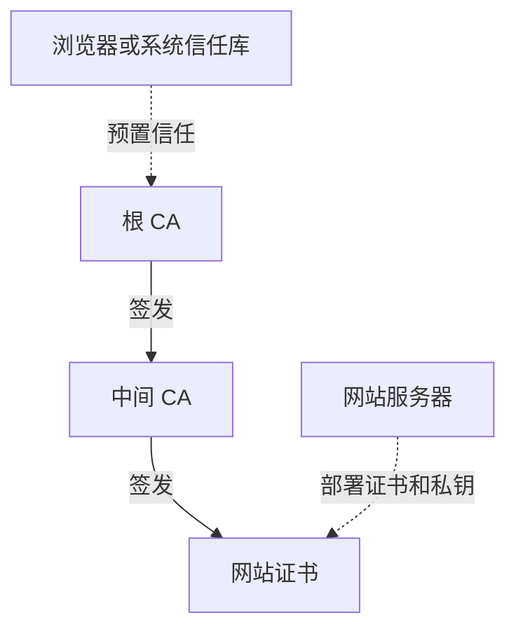
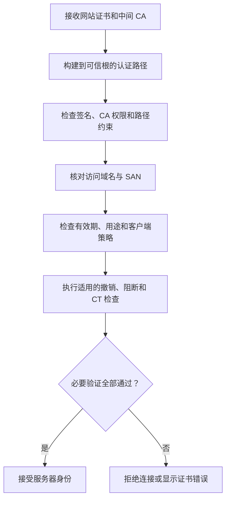
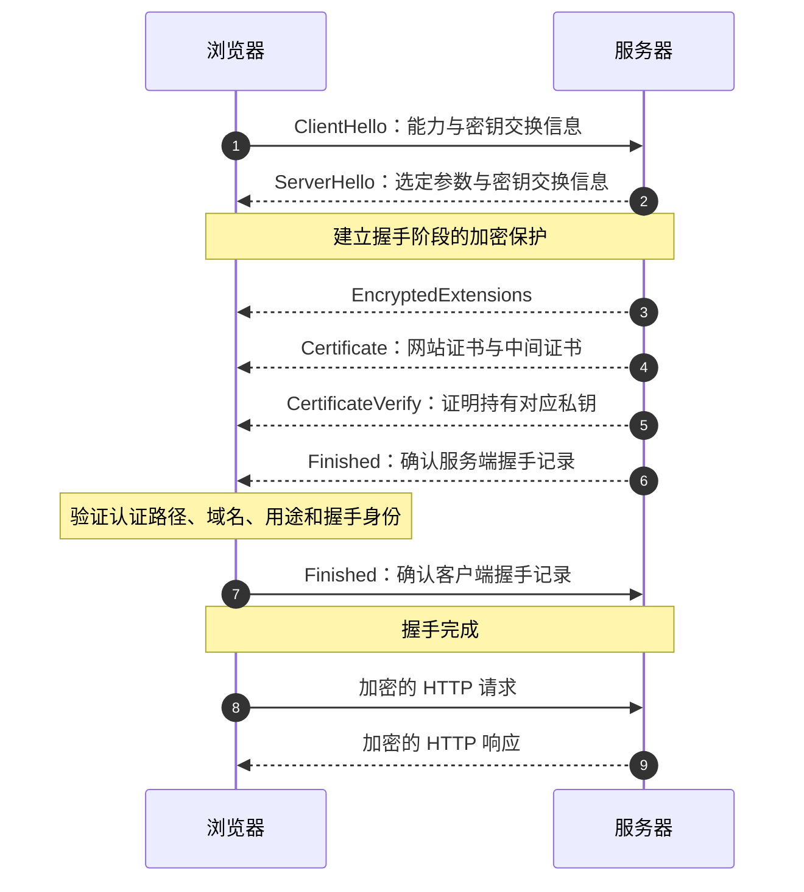

HTTPS 不只是给 HTTP 增加一层加密。浏览器还必须确认通信对象有资格代表目标
域名，否则数据即使经过加密，也可能被安全地发送给冒充目标网站的服务器。数字
证书负责绑定身份与公钥，CA 信任链负责说明这种绑定为何可信，TLS 握手再把经过
验证的身份关联到当前连接。

本文以 2026 年 eMudhra 中间 CA 证书事件为引子，梳理 X.509 证书、根 CA 与
中间 CA、浏览器的认证路径验证以及 TLS 1.3 的连接建立过程。重点放在证书体系
和工程实践，不展开密码学算法的数学原理。

## 信任从哪里开始

### eMudhra 中间 CA 事件

2026 年 10 月 17 日，一名安全研究员向 Apple、Google、Microsoft、Mozilla 和
eMudhra 报告：8 张 eMudhra 中间 CA 证书对应的私钥可以从公开证书中恢复。
研究者随后复现发现，其中一些私钥对应的数值只是 `4`、`56`、`115` 这样的小
整数，搜索空间小到可以在极短时间内遍历。

这并不表示攻击者破解了 HTTPS 使用的密码学算法。问题在于密钥生成过程产生了
异常弱的密钥，使公开公钥不再具备预期的单向安全性。如果仍受客户端信任的中间
CA 私钥被他人掌握，攻击者就可能以该 CA 的名义签发欺诈证书。

Mozilla 收到报告后通过 OneCRL 阻断相关证书，并更新 NSS 信任列表；eMudhra
在确认问题后撤销了 8 张中间证书。根据 eMudhra 截至 2026 年 10 月 30 日的
调查，这些中间 CA 没有签发公开信任的终端实体证书，也没有证据表明弱密钥已在
披露前遭到利用。

:::important[事件边界]
这起事件暴露的是 CA 密钥管理和信任体系风险，并不表示互联网上的 HTTPS 流量
普遍被破解。技术上具备欺诈签发能力，也不等于已经发生实际攻击。
:::

### HTTPS、TLS 与证书各自负责什么

HTTP 是应用层请求与响应协议；TLS（Transport Layer Security）在通信双方之间
建立受保护的连接；HTTPS 则是通过 TLS 传输 HTTP 的机制。

| 安全目标 | TLS 提供的能力 | 证书的作用 |
| --- | --- | --- |
| 身份认证 | 确认通信对端的身份 | 把域名等身份与公钥绑定，并提供可验证的信任路径 |
| 机密性 | 防止第三方直接读取应用数据 | 参与连接认证，实际数据由 TLS 会话密钥保护 |
| 完整性 | 检测传输内容是否被篡改 | 参与可信连接的建立，后续完整性由 TLS 记录层保护 |

证书不是网页数据的加密容器，也不承担 HTTPS 的全部工作。它最重要的职责是声明
“谁拥有哪个公钥”，并让客户端验证这项声明。

普通网站通常只让浏览器验证服务器证书，称为单向 TLS 认证。企业内部系统等
场景还可能要求客户端提交自己的证书，即双向 TLS（mTLS）。

## 证书如何表达可信身份

### 从根 CA 到网站证书

CA（Certificate Authority，证书颁发机构）是有权签发数字证书的实体。CA 按照
相应规则验证申请者的身份或域名控制权，再对证书签名。CA 指机构或签发实体，
CA 证书则记录该实体的身份、公钥和授权约束。

公开 Web PKI 中常见三类证书：

| 类型 | 主要职责 | 信任来源 |
| --- | --- | --- |
| 根 CA 证书 | 充当信任锚点，通常签发下级 CA | 被操作系统、浏览器或应用信任库接受 |
| 中间 CA 证书 | 承接授权并签发下级 CA 或网站证书 | 由上级 CA 签发，可追溯到可信根 |
| 网站证书 | 声明服务器代表的域名及公钥 | 由可信链中的 CA 签发并通过客户端验证 |



实际认证路径可能包含多级中间 CA，也可能因为交叉签名存在不止一条可选路径。
基本原则没有变化：客户端必须把网站证书连接到自己认可的信任锚点。

#### 为什么不直接使用根 CA

根 CA 是整个层级的信任基础。公开信任的 CA 通常让根私钥处于高度隔离状态，
由中间 CA 承担日常签发，以减少根密钥的使用频率、分隔业务权限，并把部分事故
限制在特定中间 CA 之下。

这种分层无法让中间 CA 事故只影响它自己。中间 CA 具备签发权，其私钥泄露的
影响范围通常远大于普通网站私钥泄露。

#### 根证书为何值得信任

根证书通常是自签名证书，但自签名不等于可信。它成为信任锚点，是因为浏览器、
操作系统或应用的信任库明确接受它，而不是因为它“自己给自己签名”。

不同浏览器、Java 运行环境、容器镜像和操作系统可能使用不同信任库。同一条
证书链在一个客户端上通过，不代表所有客户端都会接受。

### X.509 证书保存了什么

现代 HTTPS 普遍使用 X.509 v3 证书。它是可被机器解析的结构化身份声明，其中
最值得关注的字段和扩展包括：

| 字段或扩展 | 含义 | 验证重点 |
| --- | --- | --- |
| Serial Number | 由签发 CA 分配的序列号 | 与签发方共同标识证书及撤销记录 |
| Subject / Issuer | 证书主体与签发者 | 辅助描述身份并构建认证路径 |
| Validity | `Not Before` 与 `Not After` | 当前时间是否处于有效期内 |
| Subject Public Key Info | 主体公钥与算法参数 | 提供身份认证使用的公钥，不包含私钥 |
| Signature | 签发者对证书内容的签名 | 验证内容完整性及签发关系 |
| Subject Alternative Name | 域名、IP 等身份标识 | 现代 HTTPS 域名匹配的主要依据 |
| Basic Constraints | 是否为 CA 及路径长度限制 | 判断证书能否继续签发证书 |
| Key Usage / Extended Key Usage | 证书和密钥的允许用途 | 区分证书签发、服务器认证等用途 |
| SKI / AKI | 主体及上级密钥标识 | 辅助定位签发者和构建路径 |
| AIA / CRL Distribution Points | CA、状态查询和撤销列表位置 | 为链获取和状态检查提供线索 |

#### SAN 与域名匹配

下面的证书声明了两个 DNS 名称：

```text
Subject: CN=www.example.com

X509v3 Subject Alternative Name:
    DNS:www.example.com
    DNS:api.example.com
```

现代浏览器主要根据 Subject Alternative Name（SAN）判断证书是否适用于当前
域名，不应再依赖旧式 Common Name（CN）匹配。

`*.example.com` 这样的通配符通常只覆盖一层子域名，例如
`api.example.com`，不能直接覆盖 `example.com` 或 `a.b.example.com`。

#### CA 证书与网站证书的边界

网站证书的 `Basic Constraints` 通常为 `CA:FALSE`。中间 CA 证书必须具备相应
CA 约束，并允许证书签名用途。因此，获得一张合法网站证书不等于获得为其他域名
签发证书的权限。客户端不仅验证签名，还要验证证书角色、用途和路径约束。

#### 公开证书不包含私钥

X.509 证书包含公钥，不包含对应私钥。服务器必须独立保护私钥，并在 TLS 握手
中证明自己确实掌握它。

| 文件名或格式 | 常见用途 |
| --- | --- |
| `.crt` / `.cer` / `.pem` | 保存证书；编码方式需查看内容，不能只看扩展名 |
| `privkey.pem` / `.key` | 保存私钥，必须严格保护 |
| `chain.pem` | 保存一个或多个中间 CA 证书 |
| `fullchain.pem` | 通常依次包含网站证书和所需中间 CA 证书 |
| `.p12` / `.pfx` | PKCS#12 容器，可能包含证书、链和私钥 |

这些名称是工程约定，不是 TLS 标准规定的固定文件名。

## 浏览器与 TLS 如何完成认证

### 浏览器验证认证路径

服务器提交证书链后，浏览器不会因为“看到了一张证书”就信任它，而是构建并
验证一条通往本地信任锚点的认证路径。



#### 签名正确不代表证书一定可信

客户端至少需要确认以下条件：

- 证书链能连接到本地接受的信任锚点；
- 每一级签名关系有效，CA 具备相应签发权限；
- 所访问域名与证书 SAN 匹配；
- 证书处于有效期内，并允许服务器认证用途；
- 证书没有被客户端策略撤销、阻断或判定为不合规。

撤销检查在不同浏览器、证书和网络环境中不一定采用同一种机制。“证书没有过期”
只能说明时间条件满足，不能单独证明它仍然可信。

#### 服务器通常不发送根证书

服务器通常发送网站证书及必要的中间 CA 证书。根证书由客户端信任库提供，服务
器没有必要把它作为链的一部分发送。缺少中间证书则可能让无法自动补全链的客户
端验证失败。

### TLS 1.3 把身份绑定到当前连接

下面展示使用证书进行服务器认证的完整 TLS 1.3 握手。TLS 1.2 的消息与顺序
不同；会话恢复也可能省略常规证书交换，因此它不是每个 HTTP 请求都重复执行的
固定流程。



#### `ClientHello` 与 `ServerHello`

浏览器先通过 `ClientHello` 提供支持的 TLS 参数和密钥交换信息。普通 HTTPS
还会通过 SNI 告知期望访问的主机名，让同一服务端为不同域名选择证书。SNI 只
帮助选证书，不能证明服务器有资格代表该域名。

服务器通过 `ServerHello` 选定参数。TLS 1.3 在此后建立握手阶段的保护，后续
常规认证消息，包括 `Certificate`，都受到握手密钥保护。这一点与 TLS 1.2
常见的握手观察结果不同。

#### `Certificate`、`CertificateVerify` 与 `Finished`

`Certificate` 提交网站证书和通常所需的中间证书。复制真实网站的公开证书并不
能完成冒充，因为攻击者还需要证明自己持有对应私钥。

`CertificateVerify` 使用证书对应私钥对握手记录进行签名，既证明私钥持有，
也把身份认证与本次握手关联起来。`Finished` 对握手记录提供完整性验证和密钥
确认。双方完成验证后，才使用派生的会话密钥保护应用数据。

证书主要参与连接建立阶段的身份认证，不会给每份 HTML 或 JSON 单独“盖章”。

### HTTPS 的保护边界

连接建立后，请求路径、请求头、请求体、Cookie 和响应内容都会受到 TLS 保护。
IP 地址、连接时间和流量规模等元数据通常仍可观察；DNS 查询和主机名是否暴露，
还取决于加密 DNS、ECH 等其他机制。

HTTPS 证明的也不是网站经营者一定诚实：

| 判断 | 是否成立 | 原因 |
| --- | --- | --- |
| 连接通过 TLS 保护且服务器身份验证成功 | 通常成立 | 前提是客户端完成必要验证 |
| 有 HTTPS 的网站一定合法可信 | 不成立 | 钓鱼网站也能为自己控制的域名申请证书 |
| 公开网站证书等于公开私钥 | 不成立 | 证书只包含公钥，私钥应独立保存 |
| 证书未过期就一定可信 | 不成立 | 仍需检查链、用途、撤销和客户端策略 |
| 普通网站私钥可以签发任意域名证书 | 不成立 | 网站证书通常没有 CA 权限 |
| 可信中间 CA 私钥泄露可能影响多个网站 | 成立 | 它可能在授权范围内签发欺诈证书 |

如果站点使用 CDN 或反向代理，浏览器与代理之间的 HTTPS 也不能自动证明代理
到源站的链路采用 HTTPS。这一段需要独立配置和验证。

## 证书的工程生命周期

### 签发、部署与更新

公开网站常用 DV（Domain Validation）证书。CA 通过 DNS 记录或 HTTP 挑战
确认申请者对域名的控制权。OV、EV 会增加组织身份验证，但不会因此使用更强的
TLS 数据加密算法。签发和续期通常可以通过 ACME 自动化。

部署时需要同时处理网站证书、对应私钥和必要的中间证书：

- 提供完整中间证书链，避免部分客户端无法构建认证路径；
- 严格限制私钥访问，不把它写入源码仓库或公开镜像；
- 确认证书 SAN 覆盖真实服务域名；
- 自动续期并监测到期时间、链变化和客户端兼容性；
- 私钥泄露或错误签发后及时替换并申请撤销。

CRL 发布撤销列表，OCSP 提供状态查询能力，浏览器还可以通过集中阻断列表和信任
库更新快速响应。Certificate Transparency（CT）把证书签发记录写入可审计日志，
有助于发现异常签发，但它本身不是撤销机制。

Astro 等静态站点不需要为了 HTTPS 自行开发后端。CDN、静态托管服务或反向
代理通常可以管理面向用户的证书，但仍需确认自定义域名、自动续期和回源策略。

### 使用 OpenSSL 检查证书

浏览器的证书查看器可以展示主体、签发者、SAN、有效期和证书层级。需要从命令
行观察服务器发送的链时，可以使用：

```bash
openssl s_client \
  -connect example.com:443 \
  -servername example.com \
  -showcerts \
  -verify_return_error </dev/null
```

`-servername` 指定 SNI，`-showcerts` 展示服务器提交的证书。输出不一定包含客户
端本地信任库中的根证书。

将 PEM 证书保存为 `site.crt` 后，可以进一步查看关键字段：

```bash
openssl x509 -in site.crt -noout \
  -subject -issuer -dates -ext subjectAltName

openssl x509 -in site.crt -noout -text
```

排查时不要只确认“服务器有证书”，而要沿客户端实际验证路径检查域名、链条、
用途、有效期、客户端信任库和状态策略。

### 重新理解 HTTPS 的可信性

HTTPS 证书体系依赖一条连续的信任关系：根 CA 提供信任锚点，中间 CA 承担受
授权的签发，网站证书把域名身份与公钥绑定，浏览器验证完整认证路径，TLS 握手
再把通过验证的身份与当前连接关联起来。

eMudhra 事件说明，即使证书结构合法、TLS 协议正常，CA 的密钥管理失误仍会
动摇身份认证。HTTPS 的安全性来自协议、密钥生成、CA 运营、客户端策略和事件
响应共同运作。理解这些边界后，证书错误就不再只是地址栏上的一个警告，而是一
条可以逐层定位的信任链问题。

### 参考资料

- [Mozilla：eMudhra 中间证书私钥事件响应](https://blog.mozilla.org/security/2026/10/20/protecting-firefox-users-following-the-compromise-of-emudhra-intermediate-certificates/)
- [eMudhra：证书安全事件持续更新](https://emudhra.com/en/post/certificate-security-incident)
- [Mozilla Bug 2083449：eMudhra 中间证书私钥泄露](https://bugzilla.mozilla.org/show_bug.cgi?id=2083449)
- [Scott Helme：eMudhra 弱 CA 私钥复现](https://scotthelme.co.uk/eight-bits-of-trust-emudhras-ca-keys-cracked-in-milliseconds/)
- [RFC 5280：Internet X.509 PKI Certificate and CRL Profile](https://www.rfc-editor.org/rfc/rfc5280.html)
- [RFC 8446：The Transport Layer Security Protocol Version 1.3](https://www.rfc-editor.org/rfc/rfc8446.html)
- [RFC 9162：Certificate Transparency Version 2.0](https://www.rfc-editor.org/rfc/rfc9162.html)
