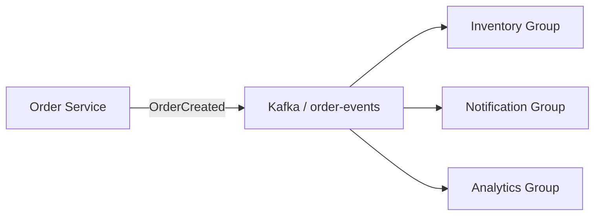
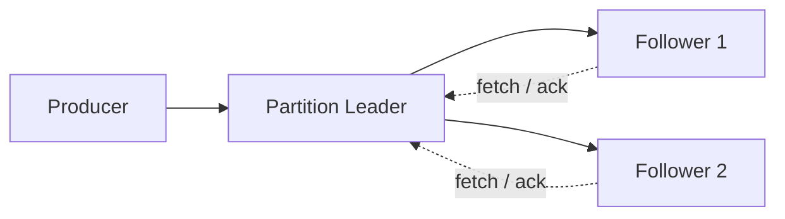
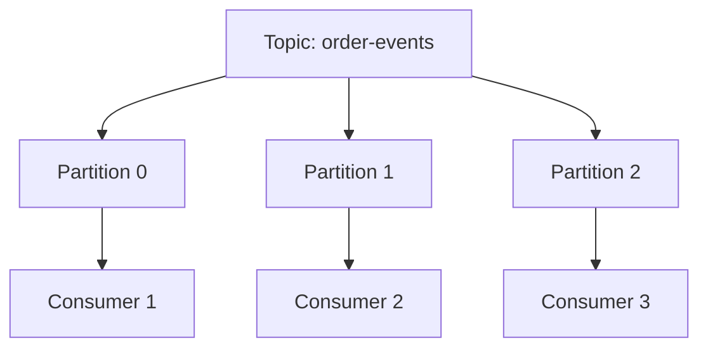
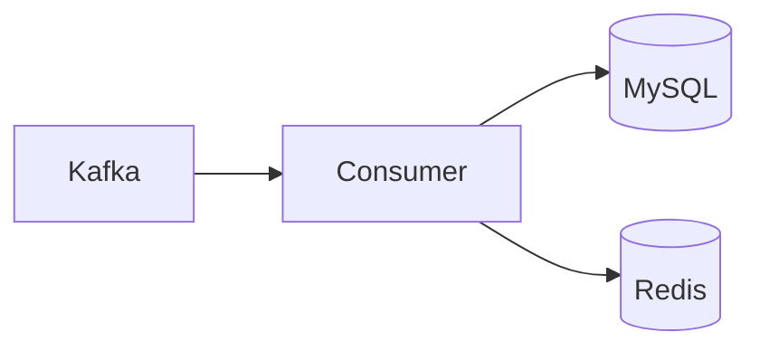
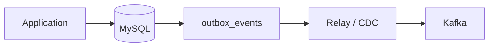

订单创建后发送通知、支付成功后累加积分、用户行为进入分析系统。如果这些动作
都串进同步调用，上游就会被下游的延迟和故障拖住。Kafka 在服务之间放入一层
可持久化、可重复消费的日志，用异步换取解耦、削峰和更灵活的消费者扩展。

但异步不是免费的。消息写入后是否真的可靠，消费者处理到哪一步，Offset 应该
什么时候提交，重复消息会不会造成二次扣款，这些问题共同构成了 Kafka 的消费
一致性。理解 Kafka 的关键，不是记住几个参数，而是看清消息从生产到业务生效
之间的每个失败窗口。

本文是云服务系列第十一篇，承接[《云数据库、缓存与数据访问体系》](/posts/cloud-database-cache-data-access/)，
从应用继续向下讨论事件流。内容以 Apache Kafka 的通用模型为主，托管 Kafka
的具体版本、默认参数和监控能力仍需对照云厂商文档。



## 一、Kafka 是分布式提交日志

很多人把 Kafka 理解成一个先进先出队列。更准确的模型是分布式提交日志
（Distributed Commit Log）：消息按顺序追加到 Partition，读取不会删除消息，
而是由 Retention Policy 决定保留多久。

| 概念 | 作用 |
|---|---|
| Broker | Kafka 集群中的服务器节点，存储 Partition 并处理读写 |
| Topic | 一类消息的逻辑名称，例如 `order-events` |
| Partition | 实际存储、顺序和并行消费的单位 |
| Replica | Partition 的副本，分布在不同 Broker |
| Offset | 消息在某个 Partition 内的位置编号 |

Broker 负责接收 Producer 请求、响应 Consumer Fetch，并参与副本复制。一个
Topic 可以拆成多个 Partition，分散到多个 Broker，从而获得水平扩展和故障
容忍能力。

传统队列通常在消息被消费后删除，Kafka 则保留到时间或容量阈值到达。因此同一
条消息可以被多个 Consumer Group 独立消费，也可以在 Retention 窗口内重新
读取。这是 Kafka 能做事件回放、数据同步和多个下游订阅的基础。

Kafka 的高吞吐来自多项设计的叠加：Partition 顺序追加减少随机 I/O，Batch
和压缩降低网络与磁盘开销，Page Cache 承接大量读写，Zero-copy 类机制减少
数据拷贝，多 Partition 提供并行度。这些优化适合大规模顺序事件流，但不改变
它不擅长随机查询的事实。

### Event 与 State 的边界

Kafka 保存的是“发生了什么”，数据库保存的是“现在是什么状态”：

```text
Kafka:    OrderCreated -> OrderPaid -> OrderShipped
MySQL:    order 1001, status = SHIPPED
```

Kafka 不擅长 `SELECT * FROM orders WHERE id = 1001` 这类随机查询，也不负责
关系约束和事务更新。它适合顺序事件流，MySQL 适合当前状态和关系查询。两者
不是替代关系。

托管 Kafka 可以减少 Broker 生命周期、存储、升级和部分高可用运维，但不会
替应用处理 Topic 设计、消费幂等、Schema 兼容和 Offset 提交时机。

## 二、Topic、Partition 与顺序

Topic 是逻辑分类，Partition 才是物理日志。每个 Partition 内部按 Offset
顺序追加：

```text
Partition 0

Offset 100  OrderCreated
Offset 101  OrderPaid
Offset 102  OrderShipped
```

Kafka 只保证同一个 Partition 内的顺序，不保证 Topic 全局顺序。若把订单
`1001` 的三个事件写入同一个 Partition，消费者就能按发生顺序处理；如果它们
散落到不同 Partition，跨 Partition 的先后关系不再有保证。

### Key 决定消息进入哪个 Partition

Producer 可以为消息设置 Key。默认分区器会对 Key 做哈希，再映射到某个
Partition，因此相同 Key 通常进入同一个 Partition：

```text
Key = orderId
orderId=1001 -> Partition 2
```

这使“同一业务实体的局部有序”成为可能。代价是 Key 分布不均时会产生热点：

```text
key=global
```

即使 Topic 有 100 个 Partition，所有消息仍可能集中到一个 Partition，形成
Hot Partition。Partition 负载严重倾斜则称为 Partition Skew。

为了全局严格有序而只使用一个 Partition，会同时限制 Producer 吞吐、Consumer
并行度和横向扩展能力。多数系统追求的是业务实体级顺序，而不是所有消息的
绝对顺序。

### Partition 数量决定消费并行度

同一个 Consumer Group 中，一个 Partition 同一时刻只能分配给一个 Consumer。
因此：

```text
6 Partitions + 6 Consumers -> 每个 Consumer 一个 Partition
6 Partitions + 3 Consumers -> 每个 Consumer 两个 Partition
3 Partitions + 5 Consumers -> 2 个 Consumer 空闲
```

Partition 数量是 Consumer Group 有效并行度的上限。创建 Topic 时需要同时
考虑当前吞吐、未来扩容和 Broker 数量：

```bash
kafka-topics.sh --bootstrap-server localhost:9092 \
  --create --topic order-events \
  --partitions 6 --replication-factor 3
```

Partition 也不是越多越好。大量 Partition 会增加元数据、文件句柄、Leader
选举、副本复制和 Controller 管理成本，Rebalance 也更重。Partition 数量可以
增加，但不能减少；增加后 Key 到 Partition 的映射可能变化，已有 Key 的顺序
保证需要重新评估。

Topic 粒度同样需要平衡。把所有事件塞进一个 `global-topic`，会让保留策略、
权限和消费边界互相耦合；每个业务动作都单独建 Topic，又会导致 Topic 和
Partition 数量膨胀。通常按领域、生命周期和消费边界划分。

## 三、Producer 如何可靠写入

Producer 发送的 Record 包含 Key、Value、Headers 和 Timestamp。Kafka 只处理
字节数组，因此应用对象需要先序列化为 JSON、Avro 或 Protobuf，Consumer 再
反序列化。Producer 和 Consumer 对消息结构的理解必须兼容，否则新增字段、
改类型或删字段都可能让消费端失败。成熟系统通常用 Schema Registry 管理
Schema 版本和兼容性，而不是让每个服务各自猜测。

Producer 不会为每条消息单独发一次网络请求。它会先把多条 Record 放入 Batch，
再批量发送，以减少网络往返、提高吞吐：

```properties
linger.ms=5
batch.size=16384
compression.type=lz4
```

`linger.ms` 允许 Producer 最多等待一段时间聚合同一 Batch，是延迟与吞吐的
权衡。压缩可以减少网络带宽和磁盘占用，代价是 CPU。

### acks 决定什么算写入成功

| 配置 | 行为 | 风险 |
|---|---|---|
| `acks=0` | 发送后不等待 Broker 确认 | 延迟最低，丢失风险最高 |
| `acks=1` | Leader 写入成功即返回 | Leader 故障时，未复制的数据可能丢失 |
| `acks=all` | 等待所有 ISR 副本确认 | 可靠性最高，延迟相对增加 |

`acks=all` 等待的是当前 ISR（In-Sync Replicas，同步副本集合）中的副本，
不是所有配置的 Replica。Follower 长期跟不上 Leader 会被移出 ISR，此时可靠
副本数量已经下降。

### Replication Factor 与 min.insync.replicas

每个 Partition 有一个 Leader 和若干 Follower。Producer 和 Consumer 主要与
Leader 交互，Follower 从 Leader 复制日志。Leader 故障时，一个合适的 Follower
可以被提升为新的 Leader，这是 Partition 级故障切换。



高可靠写入的常见组合是：

```text
replication.factor = 3
min.insync.replicas = 2
acks = all
```

它表示至少要有 2 个同步副本参与确认，写入才算成功。一个 Broker 故障时，
仍有机会继续写入；在上面的组合下，如果 ISR 只剩 1 个副本，写入会被拒绝。
这是用可用性换取持久性的典型取舍，也是 Kafka 宁愿报错也不默默接受弱副本
写入的原因。

### 幂等 Producer 与重试

Producer 因网络超时重试时，可能并不知道 Broker 是否已经写入成功。如果没有
去重机制，同一条 Record 可能被写入两次。

幂等 Producer 通过 Producer ID 和序列号，让 Broker 识别同一 Producer 的
重复写入。较新的 Java 客户端通常默认开启幂等，但仍应核对客户端版本和配置。
它主要解决单个 Producer 会话内的重复写入，不等同于业务端到端 Exactly Once。

```properties
enable.idempotence=true
acks=all
```

幂等 Producer 需要 `acks=all`、有限重试和合理的 `max.in.flight.requests.per.connection`。
如果为了吞吐随意放开并发请求数，仍可能影响顺序保证，具体限制应结合客户端
版本文档确认。

### Kafka Transaction 的边界

Kafka 支持事务性写入，把多个 Partition 的 Produce 和 Offset 提交放在同一个
Kafka 事务中。典型场景是：

```text
Read Topic A
-> Process
-> Write Topic B
-> Commit Offset
```

配合 `isolation.level=read_committed`，Consumer 不会读到未提交或已中止事务
的消息。这使 Kafka-to-Kafka 的流处理可以获得 Exactly Once 效果。

但 Kafka Transaction 不能把 MySQL 更新和 Kafka Offset 变成一个本地 ACID
事务。它们属于两个独立系统，跨系统一致性仍要依靠幂等、Outbox 或补偿设计。

## 四、Consumer Group、Offset 与投递语义

Consumer 采用 Pull 模型，主动从 Broker 拉取消息，因此可以根据自身处理能力
决定何时 Fetch。Consumer Group 则把多个 Consumer 组织起来，共同消费一个
Topic。



同一个 Group 内，一个 Partition 同一时刻只分配给一个 Consumer；不同 Group
之间互相独立。因此 Kafka 同时具备两种效果：

- 同 Group 内是队列式负载分担；
- 不同 Group 间是发布订阅，各自收到全量事件。

`group.id` 是消费组的身份。把 GroupId 配错，Consumer 可能从一个全新进度
开始，看起来就像“消息没有被处理”。

### Offset 是 Group 级消费进度

Offset 表示某条消息在 Partition 中的位置，只在当前 Partition 内有意义。
Partition 0 的 Offset 10 和 Partition 1 的 Offset 10 是两条不同的消息。它
不是全局唯一的业务消息 ID，不适合直接作为幂等键；去重应使用 `eventId` 之类
的稳定业务标识。

消费进度按 Group、按 Partition 记录，通常保存在 Kafka 内部主题
`__consumer_offsets` 中。同一个 Partition 上，不同 Group 可以有完全不同的
Offset：

```text
notification-group: offset = 1000
analytics-group:    offset = 500
```

Consumer Lag 是“最新 Offset”与“已提交 Offset”的差距：

```text
Lag = Latest Offset - Committed Offset
```

Lag 持续增加说明消费速度跟不上生产速度。可能原因包括 Consumer 太慢、
Partition 不够、下游数据库慢、Consumer 故障或分配不均。Kafka 集群健康
不代表业务消费健康，Lag 是必须单独监控的指标。

### 自动提交与手动提交

自动提交通过 `enable.auto.commit=true` 周期性提交 Offset。它简单，但业务
一致性控制较弱。典型风险是：

```text
Poll 消息
-> Offset 被自动提交
-> 业务处理
-> 应用崩溃
```

如果崩溃发生在提交之后、处理完成之前，Kafka 认为消息已经消费，业务却
没有完成，形成业务视角的消息丢失。

手动提交把决定权交给应用：

```properties
enable.auto.commit=false
auto.offset.reset=earliest
max.poll.records=100
```

典型顺序是“处理成功后再提交”：

```text
Poll
-> Process Business
-> Success
-> Commit Offset
```

`commitSync` 等待 Broker 确认，行为明确但增加延迟；`commitAsync` 不阻塞，
吞吐更高，但错误处理和提交顺序更复杂。异步提交失败时通常不能简单重试，
因为后续提交可能已经覆盖了旧位置。

`auto.offset.reset` 只在没有已提交 Offset 或 Offset 超出保留范围时生效，
不是每次启动都重置。`earliest` 从仍保留的最早消息开始，`latest` 从最新位置
开始。

### 三种投递语义

| 语义 | 典型顺序 | 结果 |
|---|---|---|
| At Most Once | 先提交 Offset，再处理 | 最多一次，可能丢消息 |
| At Least Once | 先处理，再提交 Offset | 至少一次，可能重复 |
| Exactly Once | 事务或幂等端到端设计 | 效果一次，成本和边界复杂 |

At Least Once 是 Kafka 业务系统中最常见的实际语义：处理成功但提交前崩溃，
重启后会从旧 Offset 重新投递，同一条消息可能再次处理。与其追求“绝不重复”，
不如保证重复处理不会产生重复业务副作用。

Exactly Once 需要区分 Kafka 内部语义和业务端到端语义。Kafka 事务可以保证
Kafka 读写和 Offset 的原子性，但无法自动覆盖外部数据库、HTTP 调用和缓存
更新。端到端 Exactly Once 通常还需要幂等 Consumer、事务性 Outbox 或支持
幂等的 Sink。

## 五、Kafka 与数据库之间的一致性

最典型的业务 Consumer 会读取 Kafka、更新 MySQL、可能再写 Redis：



Poll 到消息只说明数据已经进入进程，不代表业务完成；Offset 提交也只表示该
Group 的消费位置前移，不是全局业务事务状态。核心问题不是“消息有没有收到”，
而是 Offset 与数据库事务如何协调。

### 两个失败窗口

| 操作顺序 | 失败点 | 结果 |
|---|---|---|
| 先更新数据库，再提交 Offset | 提交 Offset 失败 | 消息重复消费 |
| 先提交 Offset，再更新数据库 | 数据库更新失败 | 消息丢失，业务未处理 |

第二种更危险。因此工程上通常选择“业务事务成功后再提交 Offset”，再通过
幂等处理重复：

```text
Consume
-> Validate
-> Business Transaction
-> Success
-> Commit Offset
```

这不会消除重复，只是把问题转移到可控制的幂等设计上。

### Inbox 与唯一约束

幂等的基本做法是给每个事件一个稳定的业务标识，例如 `eventId`，并记录它
是否已经处理。更可靠的方式是把去重记录和业务修改放在同一个数据库事务：

```sql
BEGIN;

INSERT INTO processed_events(event_id, processed_at)
VALUES ('evt-10001', NOW());

UPDATE orders
SET status = 'PAID'
WHERE id = 1001;

COMMIT;
```

如果 `event_id` 上存在唯一索引，重复消息插入会失败，整个事务回滚，业务
不会被重复执行：

```sql
CREATE UNIQUE INDEX uk_processed_event
ON processed_events(event_id);
```

这就是 Inbox Pattern。它把“是否处理过”变成数据库可以原子判断的事实，
而不是应用内存中的临时状态。应用捕获重复键后，应把该消息视为已处理并提交
Offset，而不是把它当成需要无限重试的故障。

### Outbox 解决双写问题

Producer 侧也有类似问题。创建订单时：

```text
INSERT orders 成功
Kafka Send 失败
```

数据库里有订单，但没有 `OrderCreated` 事件。反过来，Kafka 发送成功但数据库
事务回滚，下游会收到一个实际不存在的订单。这称为 Dual Write Problem。

Transactional Outbox 把业务数据和待发送事件写入同一个数据库事务：

```sql
BEGIN;

INSERT INTO orders(id, user_id, status)
VALUES (1001, 2001, 'CREATED');

INSERT INTO outbox_events(event_id, topic, payload)
VALUES ('evt-10001', 'order-events', '...');

COMMIT;
```

随后由独立 Relay 或 CDC 组件读取 `outbox_events` 并投递到 Kafka：



数据库事务保证业务数据与待发送事件同时存在或同时不存在。Relay 可能重复
投递，因此下游仍需按 `eventId` 去重。Outbox 解决的是“事件不丢”，不是
“事件只发一次”。

CDC（Change Data Capture，变更数据捕获）可以读取 MySQL Binlog 等数据库
变更日志，再把变化发送到 Kafka。它常用于 Outbox Relay、数据同步和分析
管道，但同样要处理顺序、重复和 Schema 演进。

### 事件本身要可追踪

一个便于幂等、审计和回放的事件，至少应包含：

```json
{
  "eventId": "evt-10001",
  "eventType": "ORDER_CREATED",
  "occurredAt": "2026-11-11T10:00:00Z",
  "traceId": "abc123",
  "payload": {}
}
```

`eventId` 用于去重，`occurredAt` 表示业务发生时间，`traceId` 用于跨异步
边界追踪。不要用消费时间代替业务发生时间：消息积压两小时后才处理，当前
时间已经不是事件发生时间。

事件命名也应表达已经发生的事实，例如 `OrderCreated`、`PaymentSucceeded`，
而不是 `CreateOrder`、`DoPayment`。后者更像 Command（命令），语义是“请做
某事”，和 Event 的“某事已经发生”不是一回事。

## 六、重试、死信与消费失败

Producer Retry 和 Consumer Retry 不是同一层。前者是写入 Kafka 失败后的
重试，后者是业务处理失败后的重新处理。

Consumer 处理失败时，可以考虑：

- 有限重试；
- 延迟重试；
- 转入 Retry Topic；
- 转入 Dead Letter Topic；
- 暂停分区并告警。

如果一条消息因为数据损坏永远失败，而 Consumer 每次重启都从原位重试，它会
一直阻塞后续消息。Dead Letter Topic（DLT，死信主题）用于隔离多次处理仍
失败的消息：

```text
order-events
-> Consumer
-> Retry 3 times
-> Still Failed
-> order-events-dlt
```

重试应使用 Backoff，而不是失败后立即无限重试：

```text
1s -> 5s -> 30s -> 5min
```

否则可能形成 Retry Storm，把已经故障的下游打得更严重。使用 Retry Topic 时，
`main-topic`、`retry-5s`、`retry-1m`、`dlt` 的层级和保留时间要一起设计，
避免重试消息过期后悄悄消失。

### 批量消费的提交边界

Consumer 一次 Poll 可能拿到多条消息。批量处理提高吞吐，但让提交边界更
复杂：

```text
Record 1 Success
Record 2 Success
Record 3 Failed
Record 4 Not Processed
```

此时不能把整个 Batch 的 Offset 直接提交到最后，否则 Record 3 会被跳过。
可以选择逐条提交、整批成功才提交、失败后 Seek 回退，或交给框架的 Ack Mode
处理。核心原则是：

> Offset 不能超过尚未可靠完成的业务消息。

### 顺序与并发

如果需要保持 Partition 内顺序，同一 Partition 的消息不能随意无序并发处理。
可以按 Partition 分配 Worker：

```text
P0 -> Worker 0
P1 -> Worker 1
P2 -> Worker 2
```

不同 Partition 并行，Partition 内串行，既获得并行能力，又保持局部顺序。
为了让单条消息处理更快而在 Partition 内开线程池，必须自行保证提交顺序和
失败回退，否则 Offset 可能先于前一条消息完成。

## 七、Rebalance、Retention 与 Kubernetes 运行

### Rebalance 的代价

Consumer 加入、离开或 Partition 数量变化，都可能触发 Rebalance，重新分配
Partition Ownership。Rebalance 期间 Consumer 可能短暂停止消费；如果频繁
发生，吞吐会明显下降。

常见触发原因包括 Consumer Crash、频繁启停、处理时间过长、Heartbeat 失败
和网络抖动。Consumer 需要向 Group Coordinator 定期发送 Heartbeat，长时间
没有心跳会被认为离开 Group。

`max.poll.interval.ms` 控制两次 Poll 之间的最大间隔。如果 Consumer 拉取
消息后处理太久，超过这个时间没有再次 Poll，Kafka 会认为它无法正常消费并
触发 Rebalance。因此不要在 Consumer 线程里执行生成视频、等待人工审批之类
的超长任务，更合适的做法是快速接收任务并交给内部 Worker。

较新的客户端支持 Cooperative Sticky 等增量分配策略，减少全量停顿；静态
成员 `group.instance.id` 也能降低滚动重启造成的 Rebalance 次数。具体能力
取决于客户端和 Broker 版本。

### Retention、Segment 与 Compaction

Kafka 不会因为消息被消费就删除它，而是按 `retention.ms` 或
`retention.bytes` 保留。Partition Log 会拆成多个 Segment，旧 Segment 到
达阈值后被删除。

如果 Consumer 停止的时间超过 Retention，它原来需要的旧消息可能已经不存在。
恢复后只能按 `auto.offset.reset` 选择最早或最新位置，无法无缝续读。

Kafka 还支持 Log Compaction：对每个 Key 保留最新状态，适合配置、CDC 和
状态重建。Compacted Topic 中的 `Value=null` Record 是 Tombstone，表示该
Key 被删除。Compaction 是后台过程，不保证立即完成，也不等同于普通
Retention。

Retention 内的消息可以重置 Offset 后重新消费，这叫 Replay。Replay 可用于
修复 Consumer Bug、重建搜索索引或重算分析数据，但必须考虑副作用：重放
`PaymentSuccess` 时，如果 Consumer 会再次给用户加钱，后果非常严重。

### Kubernetes 中的 Consumer

Consumer 通常以 Deployment 运行，多个 Pod 使用同一个 `group.id`，由 Kafka
自动分配 Partition。Rolling Update 期间旧 Pod 离开、新 Pod 加入，会触发
Rebalance，因此发布本身就会影响消费稳定性。

Pod 收到 `SIGTERM` 后，应尽量：

1. 停止获取新消息；
2. 完成正在处理的消息；
3. 提交 Offset；
4. 关闭 Consumer；
5. 离开 Group。

这可以减少重复消费和 Rebalance 冲击。终止宽限期必须覆盖上述步骤，否则
进程会在提交前被强制结束。

Consumer Lag 可以作为 HPA 的扩缩容指标，但扩容受 Partition 数量限制。
10 个 Partition 即使扩到 100 个 Pod，同一 Group 中也只有约 10 个 Consumer
真正获得 Partition。Partition 只能增加不能减少，增加后 Key 的映射可能变化，
这两点都应在容量规划时提前考虑。

### 监控与容量

| 层次 | 关键指标 |
|---|---|
| Broker | Under Replicated Partitions、Offline Partitions、ISR、磁盘、网络、请求延迟 |
| Producer | 发送速率、错误率、重试、Batch 大小 |
| Consumer | Lag、消费速率、Rebalance 次数、处理错误 |

Under Replicated Partition 表示副本数低于配置值，副本健康度已经下降；
Offline Partition 表示没有可用 Leader，属于严重故障。Kafka 依赖磁盘保留
消息，磁盘接近满时 Broker 风险很高。

容量不能只看每天写入多少原始数据。Replication Factor 为 3 时，仅副本层面
就需要约 3 倍空间，还要乘以 Retention 天数并预留安全余量，压缩可以降低
实际占用但不能作为唯一依赖。

Kafka 是 Backpressure Buffer，不是无限缓冲区。Producer 100k msg/s、
Consumer 50k msg/s 时，Lag 会持续增长；短时峰值可以靠积压吸收，但生产速率
长期高于消费速率，最终仍会遇到 Retention、磁盘和业务时效问题。

## 八、安全、追踪与排障

生产 Kafka 通常不能匿名明文开放。常见安全机制包括：

- TLS：加密客户端与 Broker 的通信，并验证 Broker 证书；
- SASL：完成客户端身份认证；
- ACL：限制某个 Principal 能读写哪些 Topic 和 Group。

`SASL_SSL` 是常见组合：TLS 提供安全通道，SASL 负责认证。Java 客户端中，
TrustStore 保存“我信任谁”的 CA 证书，KeyStore 保存“我是谁”的客户端证书
与私钥。mTLS 要求 Broker 同时验证客户端证书。

### 分层定位连接失败

“Kafka 连不上”可能发生在不同层：

| 层次 | 典型问题 | 观察点 |
|---|---|---|
| DNS / TCP | 地址错误、端口不通、网络策略 | 解析结果、连接超时、SYN 响应 |
| TLS | CA、证书、主机名、过期时间 | `SSLHandshakeException` |
| SASL | 用户名、密码、SCRAM 凭证、机制 | `SASL Authentication Failed` |
| ACL | 没有 Topic 写权限或 Group 读权限 | `TopicAuthorizationException` |
| 协议/应用 | 消息过大、序列化错误、版本不兼容 | Broker 错误码、客户端日志 |

不要把所有异常都归因于“Kafka 挂了”。先确认失败发生在握手、认证、授权还是
业务处理层，才能缩小范围。

### 用 Header 传播追踪上下文

Kafka 消息可以携带 Record Header，把 `traceId`、`eventType`、
`schemaVersion`、`correlationId` 等元数据传给 Consumer。Consumer 读取后
继续使用同一个 Trace Context，就能把 HTTP 请求、Kafka 生产和下游消费串成
一条跨异步边界的调用链。

但不要无限制地把业务数据塞进 Header。Kafka 消息应该偏小，适合传事件元数据
和业务 Payload；大文件应放对象存储，消息里只保留 Object Key 或 URL。对象
存储的模型、分片上传和临时授权，将在
[《对象存储与大文件分片传输机制》](/posts/object-storage-multipart-upload/)
中展开。单条消息过大会增加 Broker 内存、网络和 Consumer Fetch 压力，甚至被
直接拒绝；调整大小限制时，要同时核对 Producer、Broker 和 Topic 配置。

## 九、总结

Kafka 的本质不是简单的消息队列，而是以 Partition Log 为核心、支持持久化、
水平扩展和独立消费进度管理的事件流系统。

Topic 是逻辑分类，Partition 是存储、顺序和并行度的核心单位。Offset 表示
消息在 Partition 中的位置。Producer 写入 Leader，Replica 和 ISR 提供冗余，
`acks`、`replication.factor` 与 `min.insync.replicas` 共同决定写入可靠性。

Consumer Group 让多个 Consumer 分担消费压力，同组内一个 Partition 同一
时刻只由一个 Consumer 负责，不同 Group 可以独立消费同一份事件。

Offset 提交是消费一致性的核心。自动提交简单，但可能在业务完成前推进进度；
手动提交可以把“业务成功”与“消费进度”关联起来。实际系统中最常见的组合是：

```text
At Least Once
+ Idempotent Consumer
```

处理顺序通常是“消费、业务事务、成功、提交 Offset”，重复消息由 `eventId`、
唯一约束或 Inbox 表兜底。Producer 侧的双写问题则由 Outbox、CDC 和 Relay
解决。

Kafka 的 Exactly Once 能力可以解决 Kafka 内部的部分事务性处理，但不能
天然让 Kafka 与 MySQL 形成一个跨系统 ACID 事务。托管 Kafka 解决的是基础
设施运维，不解决业务幂等和端到端一致性。

一条消息的完整可靠性链可以概括为：


其中任何一个边界都可能失败。专业地使用 Kafka，不能只问“消息有没有发进去”，
还要同时确认：Partition 和 Key 是否合理、写入是否可靠、Consumer 是否追得上、
Offset 是否在正确的时机提交、重复消息是否幂等、失败消息是否被隔离、Lag 是否
持续增长，以及 Kafka 与数据库之间的一致性边界是否设计清楚。

## 参考资料

- [Apache Kafka 文档](https://kafka.apache.org/documentation/)
- [Kafka Producer 配置](https://kafka.apache.org/documentation/#producerconfigs)
- [Kafka Consumer 配置](https://kafka.apache.org/documentation/#consumerconfigs)
- [Kafka 设计文档](https://kafka.apache.org/documentation/#design)
- [Kafka 事务与 Exactly Once](https://kafka.apache.org/documentation/#transactions)
- [Kafka Log Compaction](https://kafka.apache.org/documentation/#compaction)
