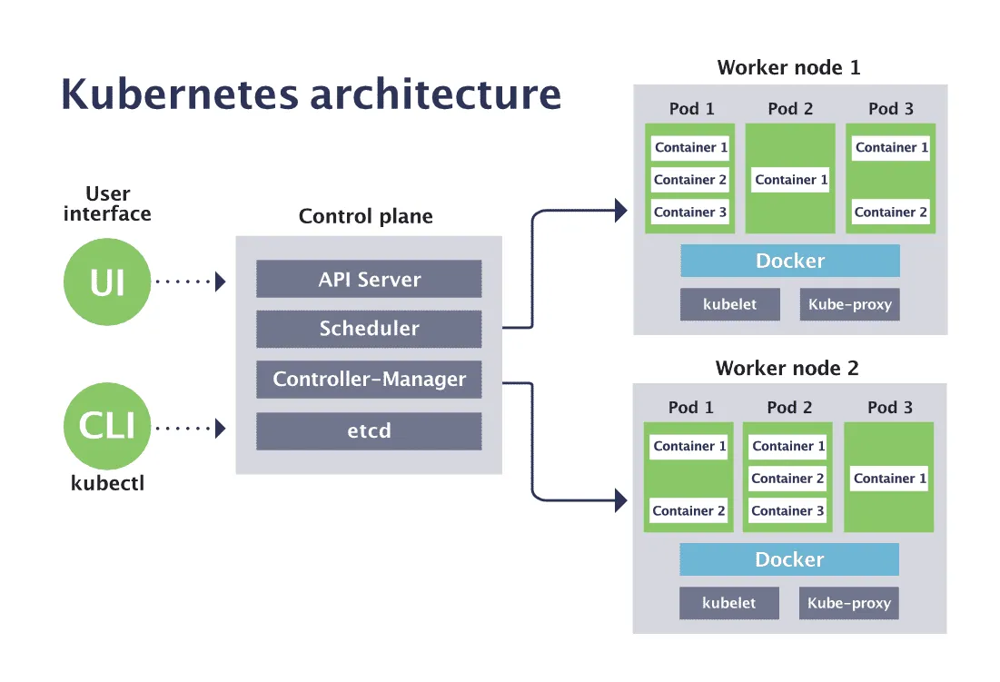

容器镜像解决的是“应用如何被标准化封装和分发”，Kubernetes 解决的是镜像进入
集群后的问题：应用如何被调度、运行、访问、扩缩容、升级和恢复。

如果只使用容器运行时，团队仍然需要人工决定容器运行在哪台服务器、异常后如何
重启、多个实例如何发现彼此、如何接入流量，以及节点故障后如何迁移。Kubernetes
把这些能力抽象为标准资源，并通过控制器持续维护系统状态。

因此，理解 Kubernetes 的关键不是记住 YAML 字段，而是理解一句话：

> 资源对象描述期望状态，控制器持续推动实际状态向期望状态收敛。

本文是云服务系列第三篇，承接[《容器镜像与云原生持续交付体系》](/posts/container-image-cloud-native-delivery/)，
关注制品进入 Kubernetes 之后的完整运行机制。

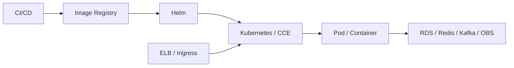

## 一、声明式 API 与协调循环

命令式操作描述“执行哪些步骤”，声明式配置描述“系统最终应该是什么样子”。
例如：

```yaml
spec:
  replicas: 3
```

这不是一次“创建三个 Pod”的命令，而是要求系统持续保持三个副本。如果实际只有
两个，控制器补充一个；如果实际有四个，控制器移除一个。

### 资源对象的共同结构

Kubernetes 几乎所有能力都通过 API Resource 表达：

```yaml
apiVersion: apps/v1
kind: Deployment
metadata:
  name: order-service
  namespace: production
  labels:
    app: order-service
spec:
  replicas: 3
status: {}
```

| 字段 | 作用 |
|---|---|
| `apiVersion` | 指定资源使用的 API 组与版本 |
| `kind` | 指定 Deployment、Service 等资源类型 |
| `metadata` | 描述名称、命名空间、标签和注解 |
| `spec` | 用户声明的期望状态 |
| `status` | 控制器记录的当前实际状态 |

用户通常只维护 `spec`，控制器观察 `status` 并执行 Reconciliation Loop：

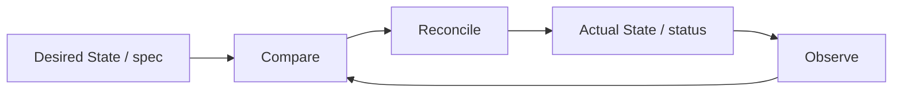

### API Server、etcd 与 Controller

`kubectl apply` 或 Helm 并不会直接启动容器。请求首先进入 kube-apiserver，经过
认证、授权、准入和数据校验后，资源状态保存到 etcd。Controller 通过 API 观察
资源变化并创建或更新下游对象。

etcd 保存的是 Kubernetes 控制面状态，不是业务数据库。API Server 是资源访问
入口，etcd 是状态存储，Controller 则负责让现实逐渐符合声明，三者职责不能混淆。

<!-- 图片占位：Kubernetes 控制面协调机制。建议展示 kubectl/Helm 请求进入
API Server，经认证、授权和准入后写入 etcd，再由 Controller 持续比较 spec 与
status 的过程。 -->
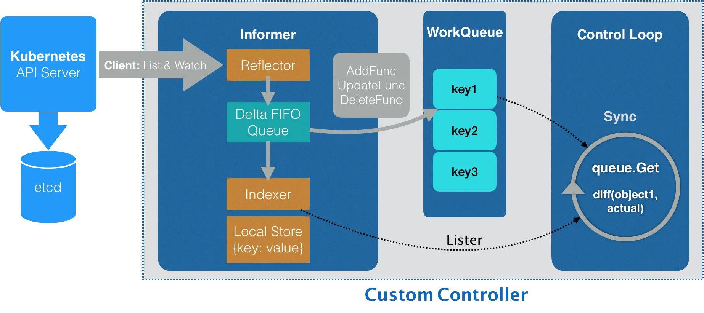

## 二、Pod 如何成为运行中的容器

Pod 是 Kubernetes 最基本的调度与运行单元。Kubernetes 调度的是 Pod，而不是
单个 Container。

一个 Pod 通常只有一个业务容器，也可以包含多个紧密协作的容器。Pod 内的容器
共享网络命名空间、Pod IP、端口空间和挂载的 Volume，因此可以通过 `localhost`
通信，但不能同时监听相同端口。

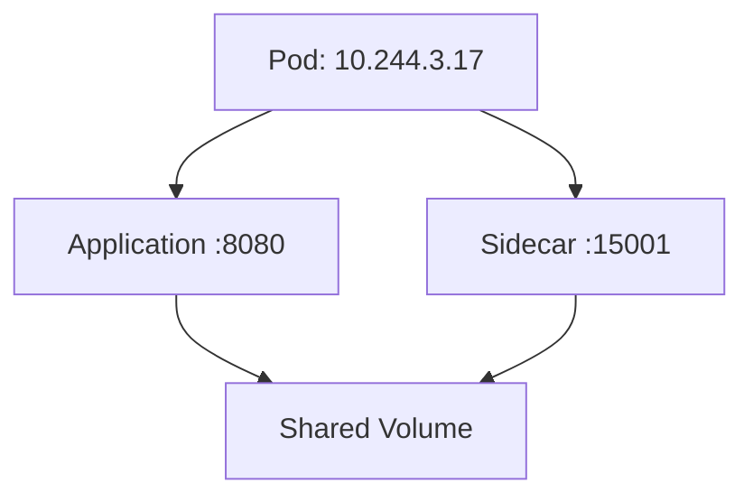

Sidecar 适合代理、日志处理和配置同步等与主程序生命周期紧密相关的能力，但不应
把所有辅助组件都塞进一个 Pod。只有需要共享网络、存储或生命周期的容器才适合
组合在一起。

### 从 PodSpec 到 Container

Pod 创建时通常还没有绑定 Node。kube-scheduler 根据资源请求、节点状态、亲和
与反亲和、Taint 和 Toleration 等约束选择节点。节点上的 kubelet 获取 PodSpec，
再通过 CRI 调用 containerd 等运行时拉取镜像并启动容器。

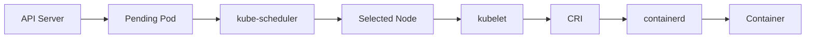

Pod 会经历 `Pending`、`Running`、`Succeeded`、`Failed` 或 `Unknown` 等阶段，
但它不是虚拟机式的永久身份。Pod 可以被删除、重建或迁移，名称和 IP 也可能
改变。业务不能依赖某个 Pod 长期存在，这一前提贯穿服务发现、自愈和滚动更新。

## 三、工作负载控制器管理不同类型的应用

生产系统通常不直接创建裸 Pod，因为裸 Pod 消失后没有上层控制器负责补充。
工作负载应该根据生命周期和身份要求选择控制器。

| 资源 | 核心能力 | 典型场景 |
|---|---|---|
| Deployment | 管理可替换副本、滚动更新与回滚 | Java API、Web 服务等无状态应用 |
| StatefulSet | 提供稳定名称、有序操作和独立存储 | 数据库、需要稳定成员身份的集群 |
| DaemonSet | 在符合条件的每个 Node 上运行实例 | 日志、监控、网络和安全 Agent |
| Job | 保证一次性任务执行完成 | 数据迁移、批处理、初始化 |
| CronJob | 按计划周期创建 Job | 定时清理、报表和备份任务 |

### Deployment、ReplicaSet 与 Pod

Deployment 是无状态服务最常用的资源，但它并不直接管理 Pod，而是通过
ReplicaSet 维护副本数量：

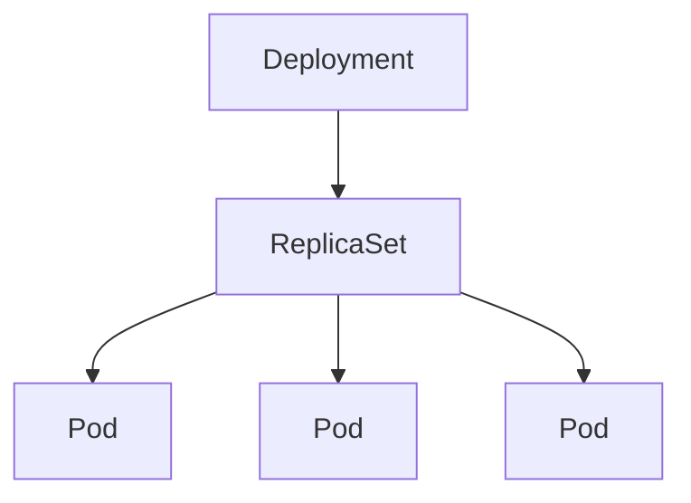

Deployment 中的 `template` 是 Pod Template。镜像、标签、资源限制或探针等
模板内容发生变化时，Deployment 会创建新的 ReplicaSet，并逐步替换旧 Pod。

```yaml
apiVersion: apps/v1
kind: Deployment
metadata:
  name: order-service
  namespace: production
spec:
  replicas: 3
  selector:
    matchLabels:
      app: order-service
  template:
    metadata:
      labels:
        app: order-service
        version: v1
    spec:
      containers:
        - name: order-service
          image: registry.example.com/order-service:1.4.2
          ports:
            - containerPort: 8080
```

Deployment 依靠 Label 与 Selector 关联 Pod，而不是依赖 Pod 名称。Label 用于
分类和选择；Annotation 用于保存说明、外部系统参数等不参与 Selector 的元数据。

资源之间还可以通过 OwnerReference 表达所有权。Deployment、ReplicaSet 与 Pod
形成所有权链，便于级联删除和垃圾回收。Finalizer 则阻止资源在必要清理完成前
被彻底删除，这些机制也是后续理解 CRD 与 Operator 的基础。

## 四、Service 与 Ingress 建立稳定访问路径

Pod IP 会变化，Service 为一组符合 Selector 的 Pod 提供稳定入口。Pod 创建、
删除或 Ready 状态变化时，EndpointSlice 会同步更新可接收流量的后端地址。

```yaml
apiVersion: v1
kind: Service
metadata:
  name: order-service
  namespace: production
spec:
  selector:
    app: order-service
  ports:
    - name: http
      port: 80
      targetPort: 8080
  type: ClusterIP
```

`port: 80` 是 Service 对外提供的端口，`targetPort: 8080` 是应用容器监听的端口。
常见 Service 类型包括：

| 类型 | 访问范围与用途 |
|---|---|
| ClusterIP | 默认类型，只提供集群内部稳定入口 |
| NodePort | 在每个节点暴露固定端口，常作为其他入口方案的底层能力 |
| LoadBalancer | 与云负载均衡集成，对集群外暴露服务 |

CoreDNS 为 Service 提供域名解析。同一 Namespace 的应用通常可以直接访问
`http://order-service`，跨 Namespace 可使用
`order-service.production.svc.cluster.local`。应用应使用 Service Name，而不是
记录 Pod IP。

Ingress 负责根据 Host 和 Path 把 HTTP/HTTPS 流量路由到不同 Service。Ingress
Resource 只保存规则，真正处理请求的是 Ingress Controller：

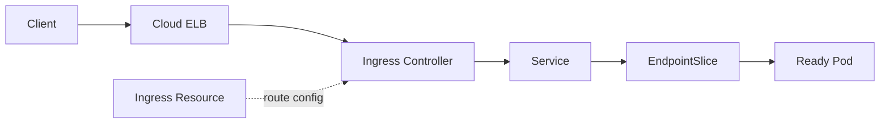

这条链路也划清了边界：云 ELB 提供外部负载入口，Ingress Controller 执行七层
路由，Service 提供稳定服务抽象，Pod 才真正运行应用。

<!-- 图片占位：Kubernetes 南北向与东西向流量示意图。左侧展示 Client 经 ELB、
Ingress、Service 到 Pod 的南北向链路，右侧展示两个 Service 之间通过 CoreDNS
和 EndpointSlice 通信的东西向链路。 -->

## 五、配置、Secret 与存储必须和镜像分离

ConfigMap 保存非敏感配置，例如日志级别、超时和功能开关；Secret 保存密码、
Token、证书和密钥。它们都可以作为环境变量或文件挂载到容器中，使同一镜像在
不同环境使用不同配置。

Kubernetes Secret 的价值是把敏感信息独立管理并施加访问控制，并不意味着数据
天然拥有保险箱级安全。生产环境仍需结合 RBAC、etcd 静态加密、KMS、外部
Secret Manager 和最小权限原则。

配置更新是否立即生效取决于注入方式：

- 环境变量只在容器启动时读取，修改后通常需要重建 Pod；
- Volume 挂载的文件可以被更新，但应用是否重新加载取决于自身实现；
- Secret 或 ConfigMap 发生变化，不代表应用状态必然自动刷新。

因此，配置发布经常触发 Rolling Restart。此时镜像版本可以不变，但 Deployment
Revision 会变化。

### Volume 与持久化边界

容器可写层和 Pod 都是临时的。Volume 为 Pod 内容器提供存储挂载，其中
`emptyDir` 与 Pod 同生命周期，适合缓存和容器间临时共享，不适合长期数据。

持久存储通过 PV 和 PVC 解耦工作负载与底层磁盘：

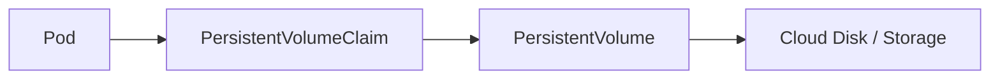

PVC 描述工作负载需要什么存储，PV 表示实际持久存储资源，StorageClass 还可以
支持动态供应。对于数据库等有状态服务，持久卷只能保存数据，备份、复制、恢复和
一致性仍需要应用或托管服务自身保证。

## 六、资源管理与健康检查决定运行质量

Kubernetes 能调度 Pod，不代表它知道应用需要多少资源或何时能够接收流量。
生产工作负载至少要设计 Resources 和 Probes。

### requests 与 limits

```yaml
resources:
  requests:
    cpu: 500m
    memory: 512Mi
  limits:
    cpu: '1'
    memory: 1Gi
```

- `requests` 是调度和资源保障的主要依据；
- `limits` 约束容器最多可以使用的资源；
- CPU 超限通常导致 Throttling；
- Memory 超限可能导致 OOMKilled。

requests 过低会让节点过度承诺，导致运行时资源争抢；过高则造成 Pod 难以调度
和资源浪费。limits 也不应机械设置，需要结合应用内存模型、并发和负载测试确定。

### 三类 Probe 解决不同问题

| Probe | 回答的问题 | 失败后的典型行为 |
|---|---|---|
| Startup | 应用是否已经完成启动 | 启动成功前抑制其他探针 |
| Readiness | 当前是否可以接收流量 | 从 Service 后端移除，不一定重启 |
| Liveness | 应用是否陷入不可恢复状态 | kubelet 重启容器 |

```yaml
startupProbe:
  httpGet:
    path: /health/startup
    port: 8080
  failureThreshold: 30
  periodSeconds: 5

readinessProbe:
  httpGet:
    path: /health/ready
    port: 8080
  periodSeconds: 5

livenessProbe:
  httpGet:
    path: /health/live
    port: 8080
  periodSeconds: 10
```

`Running` 只说明容器进程已经启动，不等于 `Ready`。大型 Java 应用可能仍在
加载配置、建立连接或预热缓存。Readiness Probe 能防止流量过早进入，Startup
Probe 则避免慢启动应用被 Liveness Probe 反复杀死。

探针设计必须克制。Liveness 不应依赖偶发抖动的外部服务，否则下游故障可能引发
整个集群大规模重启；Readiness 可以更敏感，但也要防止短暂波动导致所有实例
同时摘流。

## 七、滚动更新、自愈与优雅终止

Kubernetes 的 Self-Healing 来自多个层次的协作：容器退出时 kubelet 按策略重启；
Pod 消失时 ReplicaSet 创建替代者；节点故障后控制面在条件满足时重新调度工作负载。
它不是某一个开关提供的单一能力。

### 滚动更新依赖 Readiness

Deployment 默认采用 RollingUpdate。假设副本数为 3：

```yaml
strategy:
  type: RollingUpdate
  rollingUpdate:
    maxSurge: 1
    maxUnavailable: 0
```

`maxSurge: 1` 允许更新期间临时增加一个 Pod，`maxUnavailable: 0` 要求始终保留
三个可用副本。只有新 Pod 通过 Readiness Probe 后，控制器才会逐步移除旧 Pod：

```text
V1 V1 V1
V1 V1 V1 + V2
V1 V1 V2
V1 V2 V2
V2 V2 V2
```

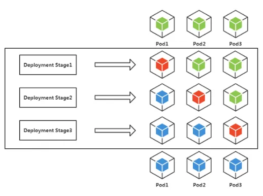

Deployment 会为 Pod Template 变化记录 Revision，可以回滚到旧模板。但回滚镜像
和 Pod 配置并不会自动撤销数据库 Schema、消息格式或外部状态变化，因此发布设计
还必须保证上下游兼容。

### Pod 随时可能被替换

Rolling Update、Node Drain、自动伸缩和节点维护都会正常终止 Pod。应用收到
`SIGTERM` 后，应该停止接收新请求、完成进行中的工作、关闭连接并刷新必要数据。

```yaml
spec:
  terminationGracePeriodSeconds: 30
  containers:
    - name: order-service
      lifecycle:
        preStop:
          exec:
            command: ['sh', '-c', 'sleep 5']
```

`preStop` 可以为摘流或清理提供准备时间，`terminationGracePeriodSeconds` 定义
优雅退出期限；超时后进程可能被强制终止。具体时长应覆盖业务请求和关闭流程，
而不是照搬固定数值。

## 八、隔离、伸缩与高可用

Namespace 提供逻辑资源边界，资源身份实际上是 `Namespace + Name`。但 Namespace
本身不自动提供完整的网络、安全和资源隔离，还需要组合：

- RBAC 控制谁能操作哪些资源；
- NetworkPolicy 限制工作负载间网络访问；
- ResourceQuota 限制 Namespace 的 CPU、Memory、Pod 等总量；
- LimitRange 约束单个 Container 或 Pod 的默认值与范围。

高可用也不是把 `replicas` 设置为 3 就结束。如果三个副本位于同一个 Node 或
同一个 AZ，单点故障仍可能让它们同时失效。需要通过 Pod Anti-Affinity、Topology
Spread Constraints、多个 Node 和多个 AZ 分散故障域，并配置合理的中断预算。

Kubernetes 体系中常见三个伸缩层次：

| 机制 | 调整对象 | 解决的问题 |
|---|---|---|
| HPA | Pod 副本数量 | 根据指标横向增加或减少实例 |
| VPA | Pod requests 等资源规格 | 调整单个实例的资源需求 |
| Cluster Autoscaler | Node 数量 | Pod 因集群容量不足无法调度时扩容节点 |

三者存在联动，配置不当也可能相互干扰。例如 HPA 依赖 CPU 利用率时，requests
会影响指标计算；VPA 修改 requests 又可能改变 HPA 的判断。因此自动伸缩必须建立
在准确资源画像、稳定指标和容量边界之上。

## 九、一个 Java 服务的完整资源模型

一个生产环境中的 `order-service` 通常不是单个 YAML，而是一组协作资源：

```text
Namespace:  production
Deployment: order-service，3 个副本
Service:    order-service，ClusterIP
Ingress:    api.example.com/orders
ConfigMap:  非敏感运行配置
Secret:     数据库和外部服务凭证
PVC:        可选的持久存储声明
```

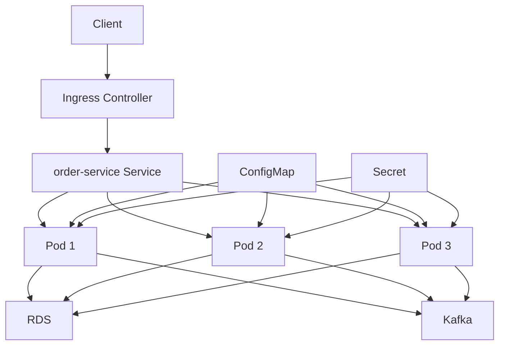

从提交 Deployment 到请求抵达业务进程，完整控制链和流量链在这里汇合：

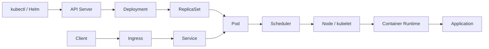

第一条链描述应用如何被创建和维持，第二条链描述请求如何到达应用。理解两条链
分别经过哪些资源和组件，是排查 Kubernetes 问题最有效的起点。

CCE 是华为云提供的托管 Kubernetes 服务。Pod、Deployment、Service、ConfigMap、
Secret 和 StatefulSet 等仍然是 Kubernetes 标准资源；CCE 主要负责托管控制面，
并集成 VPC、ELB、云存储、监控和集群生命周期能力。正确的学习顺序是先理解标准
资源与控制机制，再理解云平台如何托管和扩展它们。

## 总结

Kubernetes 不是一个简单的容器启动工具，而是一套围绕声明式资源模型建立的
分布式应用编排与状态协调系统：

```text
Desired State
      ↓
API Resource
      ↓
Controller / Scheduler / kubelet
      ↓
Actual State
      ↓
持续观察与协调
```

Pod 是最基本的调度与运行单元；Deployment、StatefulSet、DaemonSet 和 Job 管理
不同生命周期的工作负载；Service 与 Ingress 建立稳定访问路径；ConfigMap、Secret
和 Volume 分离配置与状态；Resources、Probes、滚动更新和优雅终止共同决定应用的
运行质量。

真正掌握 Kubernetes，意味着能够从一个资源的 `spec` 出发，沿着控制器和所有权
关系找到实际 Pod，再沿着 Service、EndpointSlice 与 Ingress 还原请求路径。
当这两条链路清晰之后，大部分部署、流量和故障问题都会拥有明确的排查方向。
