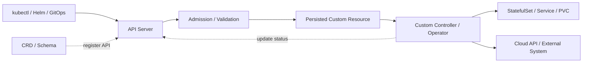
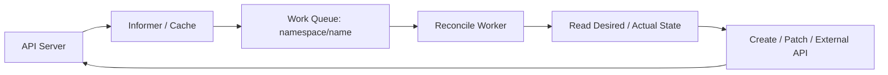
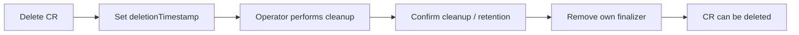

Deployment 知道如何维护 Pod 副本，StatefulSet 提供稳定身份和存储关联，但它们
并不知道一个数据库集群如何初始化、备份、故障切换和升级。企业系统还需要表达
DatabaseCluster、TrainingJob、BackupPolicy 等领域对象，并自动执行相应的运维逻辑。

Kubernetes 的 API 和 Controller 架构允许把这些对象纳入同一套声明式模型：
用户提交期望状态，API 保存资源，控制器持续推动实际状态收敛。

本文是云服务系列第六篇，承接[《Helm 应用包管理与 Kubernetes 配置渲染机制》](/posts/helm-application-package-template-rendering/)，
从应用配置发布进一步进入 API 扩展与持续生命周期管理。

## 一、先明确扩展体系的职责边界

CRD、Webhook 和 Operator 经常同时出现，但它们承担不同职责：

| 机制 | 主要职责 | 典型用途 |
|---|---|---|
| CRD | 注册新的 API 资源类型及 Schema | 定义 DatabaseCluster 类型 |
| Custom Resource，简称 CR | 保存某种类型的具体实例 | 描述 order-db 的期望配置 |
| Admission Webhook | 在请求准入阶段修改或校验对象 | 注入 Sidecar、执行自定义规则 |
| Conversion Webhook | 转换同一 CRD 的不同 API 版本 | 把旧字段映射到新版本结构 |
| Custom Controller | 观察资源并持续协调实际状态 | 创建、更新、恢复下游资源 |
| Operator | 把领域运维知识编码进控制器 | 数据库备份、恢复与升级 |



CRD 本身不会创建数据库或执行扩容，它提供数据模型和 API。Controller 才实现
行为；Operator 则进一步把复杂软件的运维流程组织为可持续执行的控制逻辑。

<!-- 图片占位：Kubernetes 扩展体系总览。区分 API 定义、请求准入和运行期协调三个
区域，展示 CRD、Custom Resource、Webhook、Operator 与下游资源之间的关系。 -->

## 二、用 CRD 定义一个可校验的领域 API

CRD 是资源类型定义，CR 是该类型的实例。CRD 对象本身属于集群级资源，
`spec.scope` 决定其自定义资源实例是 Namespaced 还是 Cluster 范围。

下面定义一个教学用 `Database` API。Schema 声明字段类型、默认值和基本约束，
同时启用独立的 `/status` 子资源：

```yaml
apiVersion: apiextensions.k8s.io/v1
kind: CustomResourceDefinition
metadata:
  name: databases.database.example.com
spec:
  group: database.example.com
  scope: Namespaced
  names:
    plural: databases
    singular: database
    kind: Database
    shortNames: [db]
  versions:
    - name: v1alpha1
      served: true
      storage: true
      subresources:
        status: {}
      schema:
        openAPIV3Schema:
          type: object
          required: [spec]
          properties:
            spec:
              type: object
              required: [engine, storage]
              properties:
                engine:
                  type: string
                  enum: [mysql]
                replicas:
                  type: integer
                  minimum: 1
                  maximum: 9
                  default: 3
                storage:
                  type: string
                  pattern: '^[1-9][0-9]*Gi$'
            status:
              type: object
              properties:
                observedGeneration:
                  type: integer
                  format: int64
                readyReplicas:
                  type: integer
                  minimum: 0
```

这是受限的示例 API，`storage` 只接受整数 Gi 格式，不等于完整的 Kubernetes
Quantity 语法。实际 API 还需要明确字段兼容性、不可变字段、存储扩容规则等约定。

注册 CRD 并等待其建立后，可以创建实例：

```yaml
apiVersion: database.example.com/v1alpha1
kind: Database
metadata:
  name: order-db
  namespace: default
spec:
  engine: mysql
  replicas: 3
  storage: 200Gi
```

此时 `kubectl get databases` 已能查询对象，但在控制器安装之前，数据库实例并不会
凭空出现。API 可用和领域行为可用，是两个独立阶段。

### Schema、默认值与 CEL

类型、枚举、范围和简单默认值应优先放入 CRD Schema。跨字段或更新约束可以考虑
`x-kubernetes-validations` 中的 CEL，例如在 `spec` 层约束副本数为奇数：

```yaml
x-kubernetes-validations:
  - rule: 'self.replicas % 2 == 1'
    message: replicas must be an odd number
```

这个规则只有在领域协议确实要求奇数成员时才合理，不能套用到所有数据库或缓存
集群。CEL 的能力与版本要求应对照目标集群验证，详见
[CRD 校验文档](https://kubernetes.io/docs/tasks/extend-kubernetes/custom-resources/custom-resource-definitions/)。
能在 Schema 或 CEL 表达的规则，通常不必额外引入远程 Webhook。

## 三、Controller 用协调循环实现行为

Controller 通常通过 Informer / Cache 观察资源，把对象键加入 Work Queue，
Worker 再读取当前状态并执行 Reconcile：



事件只是触发协调的线索。可靠的控制器根据当前状态决策，而不依赖“上一次收到的是
Create 还是 Update”。这种 Level-Triggered 模型使重复事件、进程重启和部分步骤
失败后仍然有机会重新收敛。

一个简化的协调流程如下：

```text
读取 Custom Resource
  不存在：结束
  正在删除：进入 Finalizer 清理流程

确保所需 Finalizer 已持久化
读取 Kubernetes 子资源和外部资源状态
根据 spec 计算下一步需要完成的动作
幂等创建或更新资源
只在状态变化时更新 status
对暂时失败执行退避重试，对异步任务安排再次观察
```

### 幂等、重试与并发

网络超时不代表外部操作没有成功。创建云数据库超时后，下一次协调应使用稳定的
幂等键或资源标识查询结果，避免重复创建。Leader Election 也不能保证外部副作用
恰好执行一次，业务操作仍需具备幂等性。

缓存可能暂时落后于 API Server，更新还可能遇到 `resourceVersion` 冲突。控制器
应使用适当的 Patch、重读与重试，避免覆盖他人修改，也不要把旧缓存误认为刚执行
的写入失败。

临时错误适合退避重试；无效配置应通过 Conditions 反馈，等待用户修改。持续无差别
重试会占满队列并增加 API 和云服务压力。

### status 表达进度与结果

生产 API 通常在前述基础 Schema 上扩展 `status.conditions`，并使用标准 Condition
结构描述 Ready、Progressing 或 Degraded 等状态。Condition 应包含类型、状态、
Reason、Message、LastTransitionTime，以及适当的 ObservedGeneration。

`metadata.generation` 标识期望状态的代际，控制器维护的 `observedGeneration`
说明状态对应哪一代配置。两者相等仅说明控制器已处理该代配置，是否成功仍应查看
Conditions。`resourceVersion` 用于对象更新与并发控制，应视为不透明值。

status 有助于展示结果和记录稳定的外部资源标识，但不能替代对真实系统的观察。
仅在状态确实变化时写入，也能避免状态更新反复触发无意义的协调。

## 四、Admission Webhook 管理请求准入

认证确认“请求者是谁”，授权判断“能否执行操作”，Admission 检查“对象是否符合
规则，以及是否需要修改”。它位于请求写入持久存储之前的同步路径上。

| 类型 | 行为 | 典型场景 |
|---|---|---|
| Mutating Admission Webhook | 返回修改补丁，也可拒绝请求 | 注入 Envoy、Agent 或默认配置 |
| Validating Admission Webhook | 允许或拒绝，不修改对象 | 校验自定义领域规则或组织策略 |

概念上可将写入过程理解为认证与授权、变更准入、对象校验、验证准入和持久化。
多个 Mutating Webhook 的调用顺序不应成为业务依赖，它们还可能被重新调用，因此
Mutation 必须幂等。例如 Sidecar 已存在时，应检查并保留它，而不是重复注入。

Webhook 通常通过 Service 暴露 HTTPS 接口，使用 AdmissionReview 请求和响应。
`MutatingWebhookConfiguration` 或 `ValidatingWebhookConfiguration` 注册匹配规则、
Service、TLS 信任、超时和失败策略。API Server 必须能访问该服务，并信任其证书。

### 失败策略要区分调用错误与主动拒绝

`failurePolicy: Fail` 表示调用失败时拒绝匹配请求，`Ignore` 表示调用失败时跳过该
Webhook。**如果 Webhook 成功返回明确拒绝，`Ignore` 也不会放行。**这一区别见
[动态准入控制文档](https://kubernetes.io/docs/reference/access-authn-authz/extensible-admission-controllers/)。

生产设计应控制匹配范围、设置短且合理的超时、部署多副本并监控调用延迟。Webhook
应快速完成判断，外部网络依赖和长耗时操作会直接影响 API 可用性。

还需避免启动依赖死锁：如果 Webhook 不可用会阻止创建它自身恢复所需的 Pod，
故障就很难自动解除。应设计必要的范围排除、恢复流程与证书轮换机制。

策略可通过 Namespace Selector、Object Selector 等限制范围，但如果用户能自由
修改用于豁免的 Label，强制策略就可能被绕过。统一治理也可评估目标集群支持的
ValidatingAdmissionPolicy，或 Gatekeeper、Kyverno 等策略引擎。

<!-- 图片占位：请求准入链路图。展示原始 Pod 经 Mutating Webhook 注入 Sidecar，
再经 Validating Webhook 校验；单独标出超时、主动拒绝和 failurePolicy 的分支。 -->

## 五、多版本 API 与 Conversion Webhook

随着资源模型演进，一个 CRD 可以同时提供 `v1alpha1`、`v1beta1`、`v1` 等版本。
版本名称体现发布方的成熟度与兼容性约定，不会自动替开发者保证兼容。

`served: true` 表示该版本可通过 API 访问，一个 CRD 在配置上只能指定一个
`storage: true` 版本。若版本字段不同，例如旧版 `size` 对应新版 `replicas`，
就需要可靠的转换逻辑。

Conversion Webhook 负责版本表达转换，与 Admission Webhook 职责不同。它可能在
读取或写入转换时被调用，因此不能执行数据库创建等业务副作用，也不应承担策略
校验。转换应尽量保留语义并支持往返，避免旧客户端更新对象时丢失新字段。

修改 storage version 也不会自动重写所有历史对象。迁移时需考虑已有存储版本、
对象重写、客户端兼容和 Webhook 可用性，再逐步停止提供旧版本。具体流程参见
[CRD 版本管理文档](https://kubernetes.io/docs/tasks/extend-kubernetes/custom-resources/custom-resource-definition-versioning/)。

## 六、Operator 把领域运维知识写入控制器

Operator 通常围绕 Custom Resource 实现领域控制循环。例如数据库扩容可能需要：

```text
创建新实例
→ 初始化配置
→ 加入复制拓扑
→ 等待数据同步
→ 检查健康与复制延迟
→ 开放流量
→ 更新 Ready 状态
```

这些步骤中的前置条件、失败恢复和状态检查，才是 Operator 的主要价值。仅生成
StatefulSet 和 Service，并不能证明数据库具备自动故障切换或可靠备份能力。

Operator 本身通常是运行在 Deployment 中的控制器应用，通过 ServiceAccount 和
RBAC 访问 API。多个副本可以通过 Leader Election 提高可用性，但仍须设计操作
幂等、并发和外部 API 限流。

它也可以管理集群外系统：CR 描述云数据库需求，控制器调用云 API 创建实例，再将
实例 ID、Endpoint 和状态记录到 CR 中。此时 Kubernetes 成为统一控制入口，外部
资源身份、凭证、配额和生命周期仍然必须明确管理。

### 与 Helm 的协作

| 维度 | Helm | Operator |
|---|---|---|
| 核心模型 | 模板渲染与 Release | Watch、Observe、Reconcile |
| 执行时机 | 发布操作期间 | 持续运行 |
| 状态来源 | Chart 与 Values | CR spec 及真实系统状态 |
| 主要能力 | 安装和升级资源声明 | 运行期领域生命周期管理 |

Helm 可以安装 Operator，再由 Operator 管理 CR 对应的系统。应明确每个资源和字段
的管理者，避免 Helm 与 Operator 同时写入同一个 StatefulSet 配置。

普通无状态 API 通常使用 Helm、Deployment 和 Service 即可。数据库、中间件、
备份平台或具有长期运维状态机的系统，更适合评估 Operator。

<!-- 图片占位：数据库 Operator 生命周期状态机。覆盖创建、初始化、运行、扩容、
备份、升级和删除，并展示每个阶段的失败重试与状态反馈。 -->

## 七、删除流程、所有权与资源保护

集群内部子资源可以通过 OwnerReference 关联 CR，由 Garbage Collector 按删除
策略回收。所有权必须遵守 Scope 规则，例如 Namespaced 子资源不能跨 Namespace
引用一个 Namespaced Owner。集群外云资源则需要控制器显式清理或保留。

Finalizer 为异步清理提供机会：



控制器应先持久化 Finalizer，再创建需要清理的外部资源。删除时根据策略完成备份、
释放或保留，并确认结果后移除自己的 Finalizer。清理逻辑同样要能重试，并将外部
资源已经不存在视为可接受结果。

Finalizer 不是数据保护策略本身。如果 Operator 长期不可用或凭证失效，资源会停留
在 Terminating；手工移除 Finalizer 可能留下外部孤儿资源。应预先设计 Retain / Delete
策略、清理超时告警和人工接管流程。

删除 CRD 的影响远大于删除某个 CR，它可能使这一类型的所有实例被删除。Operator
升级、卸载和灾难恢复方案必须单独规划 CRD 与数据资源的生命周期。

<!-- 图片占位：带 Finalizer 的 CR 删除时序图。区分 Kubernetes 子资源垃圾回收和
外部云资源清理，并标明 Operator 失效时 CR 保持 Terminating 的原因。 -->

## 八、从开发到生产的验证与排障

Kubebuilder、Operator SDK 和 controller-runtime 可以提供 Manager、Cache、Client、
Reconciler、Webhook Server 与 Leader Election 等基础设施，开发重点仍然是领域
模型和控制逻辑。

验证至少应覆盖重复协调、进程重启、外部请求超时、并发冲突、升级与删除中断。
API Schema 和准入测试证明请求是否允许，集成与端到端测试则要证明真实系统能够
达到目标状态，以及部分失败后能够继续恢复。

Operator 应采用最小权限，分别规划 CR、`/status`、Finalizer 和子资源的访问权限。
避免把所有组件都授予 `cluster-admin`，并对高风险删除操作设置明确的领域保护。

当 CR 长期不就绪时，可以沿以下链路排查：

| 层次 | 关键检查 |
|---|---|
| API 定义 | CRD 是否 Established，目标版本是否 served，Schema 是否接受字段 |
| 请求准入 | 是否被拒绝，Webhook TLS、连通性和超时是否正常 |
| Controller | 是否 Watch 目标 Namespace，Leader 和 RBAC 是否正常 |
| 协调过程 | 队列深度、错误率、退避、缓存与资源冲突 |
| 下游资源 | StatefulSet、PVC、Pod 或云 API 是否完成操作 |
| 状态反馈 | Conditions、ObservedGeneration、Events 与日志是否一致 |

Watcher 事件只负责触发，控制器必须重新观察真实状态。若外部系统不会通过 Watch
通知变化，还要通过轮询或其他事件接入安排下一次协调，不能假设所有漂移都会自动
触发处理。

CRD 提供领域 API，Admission 在写入前执行规则，Controller 在写入后持续协调，
Operator 则把领域流程编码到这条控制链中。围绕 API、状态和控制循环建立清晰的
责任边界，才能把 Kubernetes 扩展成可维护的数据库、中间件或云资源控制平台。

## 参考资料

- [Custom Resources](https://kubernetes.io/docs/concepts/extend-kubernetes/api-extension/custom-resources/)
- [CRD 定义与校验](https://kubernetes.io/docs/tasks/extend-kubernetes/custom-resources/custom-resource-definitions/)
- [CRD 版本与转换](https://kubernetes.io/docs/tasks/extend-kubernetes/custom-resources/custom-resource-definition-versioning/)
- [动态准入控制](https://kubernetes.io/docs/reference/access-authn-authz/extensible-admission-controllers/)
- [Admission Webhook 实践](https://kubernetes.io/docs/concepts/cluster-administration/admission-webhooks-good-practices/)
- [Operator Pattern](https://kubernetes.io/docs/concepts/extend-kubernetes/operator/)
