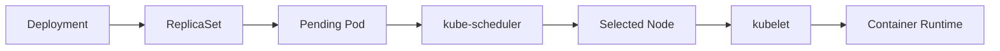
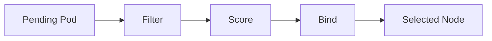
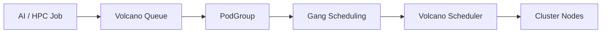

创建 Deployment 后，Controller 会按照期望副本数创建 Pod，但新的 Pod 通常还
没有确定运行在哪台 Node 上。Kubernetes 已经知道“需要运行这个 Pod”，接下来
还要回答：

> 集群中有很多 Node，这个 Pod 应该运行在哪里？

这个过程称为 Scheduling，默认由 kube-scheduler 负责。它需要综合 CPU、内存、
GPU、节点状态、拓扑位置、存储、亲和性、污点和优先级等条件，从候选 Node 中
选择一个合适位置。

上一篇[《Kubernetes 核心资源模型与应用运行机制》](/posts/kubernetes-core-resource-model/)
建立了 Pod 从声明到运行的控制链。本文继续深入其中的调度阶段，并讨论普通微服务
与 AI、HPC、批处理任务在调度模型上的差异。



Scheduler 只负责为 Pod 选择 Node，不负责启动 Container。绑定完成后，目标 Node
上的 kubelet 才会通过容器运行时拉取镜像并启动容器。

## 一、调度的核心过程：Filter、Score 与 Bind

新 Pod 处于 `Pending` 并不一定表示故障。它可能尚未被调度，也可能正在拉取
镜像或等待 Volume 挂载。只有当调度器找不到满足条件的 Node 时，才属于
Unschedulable。

默认调度过程可以简化为三个阶段：



### Filter：排除不能运行的节点

Filter 检查硬约束。只要某个插件判断 Node 不满足要求，该 Node 就会被排除。
典型条件包括：

- 可分配 CPU、Memory 和扩展资源是否足够；
- Node 是否可调度并处于可用状态；
- Node Label、Node Affinity 是否匹配；
- Taint 是否有对应 Toleration；
- Volume、端口和拓扑约束是否能够满足。

如果 Filter 后没有可行节点，Pod 会继续 Pending，并等待资源或集群状态变化。

### Score：在可行节点中选择更优位置

通过 Filter 的 Node 都能运行 Pod，但并不一定同样合适。Score 插件会考虑资源
利用、亲和偏好、拓扑分布和镜像本地性等因素，并对结果归一化、加权，最终选择
综合得分较高的节点。

### Bind：确认 Pod 与 Node 的关系

选出 Node 后，调度器通过 Bind 把 Pod 绑定到节点。此后 PodSpec 中会记录目标
Node，kubelet 才开始后续运行流程。

现代 kube-scheduler 基于 Scheduling Framework 构建，把一次调度拆成可插拔的
扩展点，例如 QueueSort、PreFilter、Filter、PostFilter、Score、Reserve、Permit
和 Bind。PostFilter 可以在没有可行节点时执行抢占等补救逻辑。

<!-- 图片占位：kube-scheduler Scheduling Framework 全流程图。建议展示调度队列、
Scheduling Cycle、Binding Cycle，以及 Filter 无可行节点时进入 PostFilter 的分支。 -->

## 二、requests 是调度器的资源承诺

资源配置中最容易混淆的是 requests 与 limits：

```yaml
resources:
  requests:
    cpu: '2'
    memory: 4Gi
  limits:
    cpu: '4'
    memory: 8Gi
```

Scheduler 判断 Node 能否容纳 Pod 时主要依据 requests，而不是此刻的真实使用量，
也不是 limits。

假设一台 Node 可分配 8 Core，已有 Pod 的 CPU requests 总和为 6.5 Core，那么
requests 为 2 Core 的新 Pod 无法调度到该节点，即使旧 Pod 此刻的实际 CPU 使用
很低。requests 表示集群已经对工作负载作出的资源承诺。

Scheduler 计算的基础是 Node Allocatable：

```text
Node Capacity
- 操作系统与系统守护进程预留
- kubelet 与容器运行时预留
= Node Allocatable
```

可继续调度的资源近似为：

```text
Node Allocatable - 已调度 Pod 的 requests
```

requests 过大会降低利用率，让空闲资源无法被新 Pod 使用；过小则可能把大量高
消耗工作负载放到同一节点，引发资源竞争。合理值应来自历史指标、压测和容量目标，
而不是随意填写。

limits 主要约束运行时上限。CPU 超出 limit 通常被 Throttling，内存超出 limit
则可能触发 OOMKilled。它们会影响应用运行质量，但不是判断能否调度的主要依据。

### 总量充足不代表能够调度

资源必须在同一个 Node 上同时满足。假设 Node A 剩余 8 CPU、1 GiB Memory，
Node B 剩余 1 CPU、32 GiB Memory，而 Pod 需要 4 CPU、8 GiB Memory。集群总量
看似充足，但没有任何单个 Node 能容纳该 Pod，这就是 Resource Fragmentation。

## 三、Node Affinity 控制 Pod 去哪里

Node Label 用键值描述节点属性，例如：

```text
disk=ssd
workload=compute
accelerator=nvidia
topology.kubernetes.io/zone=az1
```

最简单的定向调度方式是 `nodeSelector`：

```yaml
spec:
  nodeSelector:
    disk: ssd
```

它表示 Pod 只能进入具有 `disk=ssd` Label 的 Node。Node Affinity 则支持更丰富的
集合运算，并区分硬约束和软偏好：

```yaml
affinity:
  nodeAffinity:
    requiredDuringSchedulingIgnoredDuringExecution:
      nodeSelectorTerms:
        - matchExpressions:
            - key: disk
              operator: In
              values: [ssd]
    preferredDuringSchedulingIgnoredDuringExecution:
      - weight: 100
        preference:
          matchExpressions:
            - key: topology.kubernetes.io/zone
              operator: In
              values: [az1]
```

- `required...` 不满足就不能调度，参与 Filter；
- `preferred...` 满足则获得更高分，参与 Score；
- `IgnoredDuringExecution` 表示运行后 Label 变化通常不会自动驱逐现有 Pod。

硬约束只应用于真正不能妥协的条件，例如 GPU 任务必须进入具有对应设备的节点。
“最好位于某个 AZ”这类需求更适合软偏好，否则短暂容量不足就可能造成长期 Pending。

## 四、Pod 关系与拓扑分布决定故障隔离

Node Affinity 描述 Pod 与 Node 的关系；Pod Affinity 和 Anti-Affinity 描述 Pod
与其他 Pod 的空间关系。

Pod Affinity 可以让频繁通信的组件尽量位于同一拓扑域，减少跨区延迟。Pod
Anti-Affinity 则常用于把同一服务的副本分散到不同节点，降低单节点故障的影响。

`topologyKey` 决定在哪一级拓扑上判断关系：

- `kubernetes.io/hostname` 表示 Node；
- `topology.kubernetes.io/zone` 表示 AZ；
- 也可以使用组织维护的其他稳定拓扑 Label。

### Topology Spread 更适合控制均衡分布

Anti-Affinity 强调“不要在一起”，Topology Spread Constraints 更直接地表达
“副本在多个拓扑域中应尽量均衡”。例如让 6 个副本均匀分布到 3 个 AZ：

```yaml
topologySpreadConstraints:
  - maxSkew: 1
    topologyKey: topology.kubernetes.io/zone
    whenUnsatisfiable: DoNotSchedule
    labelSelector:
      matchLabels:
        app: order-service
  - maxSkew: 1
    topologyKey: kubernetes.io/hostname
    whenUnsatisfiable: ScheduleAnyway
    labelSelector:
      matchLabels:
        app: order-service
```

`maxSkew` 限制不同拓扑域之间的数量差异；`DoNotSchedule` 是硬约束，无法满足时
拒绝调度；`ScheduleAnyway` 是软约束，允许调度但尽量减少偏差。

上例把跨 AZ 分布作为硬要求，把节点级均匀作为软偏好。实际设计需要考虑某些 AZ
暂时没有容量时，是宁可少一个副本，还是接受不完美分布。可用性和可调度性之间
始终存在权衡。

<!-- 图片占位：六个 order-service Pod 跨三个 AZ、多个 Node 的拓扑分布图。
建议对比“全部集中在一个 AZ”和“每个 AZ 两个副本”的故障影响。 -->

## 五、Taint 与 Toleration 建立专用节点池

Affinity 从 Pod 角度描述“我想去哪里”，Taint 从 Node 角度描述“哪些 Pod 不应
进来”。例如 GPU 节点可以添加：

```text
workload=gpu:NoSchedule
```

只有声明对应 Toleration 的 Pod 才有资格进入：

```yaml
tolerations:
  - key: workload
    operator: Equal
    value: gpu
    effect: NoSchedule
```

需要特别注意：Toleration 只表示“可以容忍”，不表示“一定调度到该节点”。专用
节点池通常采用双向约束：

```text
Node Label + Pod Node Affinity
→ 任务必须进入专用节点

Node Taint + Pod Toleration
→ 普通任务不能占用专用节点
```

<!-- 图片占位：GPU 专用节点池隔离图。建议展示普通 Pod 被 NoSchedule 拦截，
GPU Pod 同时凭借 Node Affinity 和 Toleration 进入 GPU Node Pool。 -->

常见 Taint Effect：

| Effect | 行为 |
|---|---|
| `NoSchedule` | 阻止新的、不容忍该污点的 Pod 进入 |
| `PreferNoSchedule` | 尽量阻止，但资源紧张时仍可能调度 |
| `NoExecute` | 阻止新 Pod，并可能驱逐现有且不容忍的 Pod |

Kubernetes 也会用 Taint 表示 Node NotReady、Unreachable 等状态，从而参与故障
处理。节点维护时，`cordon` 只禁止新 Pod 进入；`drain` 会在遵守中断规则的前提下
驱逐可迁移 Pod，使它们在其他节点重新调度。

## 六、Priority 与 Preemption 处理资源竞争

当多个 Pending Pod 竞争有限资源时，PriorityClass 可以表达工作负载的重要程度。
高优先级 Pod 会更早获得调度机会；如果没有可行节点，PostFilter 阶段还可能通过
Preemption 驱逐部分低优先级 Pod，为其腾出资源。

抢占不是容量扩展，也不保证高优先级 Pod 立即运行。调度器仍需确认移除受害 Pod
后所有硬约束都能满足，Pod 的优雅终止也需要时间。

Priority 应用于真正具有恢复顺序或业务重要性差异的工作负载，例如集群关键组件、
核心在线服务和可延迟离线任务。所有服务都声明最高优先级会让优先级失去意义，
频繁抢占还可能引发调度抖动和级联不稳定。

## 七、如何分析 Pending 与设计生产调度规则

`Pending / Unschedulable` 表示容器可能根本没有启动；`CrashLoopBackOff` 则表示
Pod 已完成调度，但容器启动后不断退出。排障前必须先判断问题处在哪个阶段。

Pod 长期 Pending 的常见原因包括：

- Insufficient CPU、Memory 或 GPU；
- Node Selector、Affinity 没有匹配节点；
- Taint 缺少对应 Toleration；
- PVC 与 Node 的存储拓扑冲突；
- Host Port 已被占用；
- Node 被 cordon 或处于不可调度状态；
- 多个硬约束分别合理，但组合后没有交集。

排查时应先查看 Pod Events，再按 Filter 逻辑逐项验证，而不是直接检查应用日志。

### Bin Packing 与 Spread

调度策略通常在两个方向之间取舍：

- Bin Packing 尽量把 Pod 集中到部分节点，提高利用率并释放整台节点用于缩容；
- Spread 把副本分散到节点和 AZ，提高故障隔离能力。

普通生产服务可以先保障同一应用跨 Node、跨 AZ 分布，再在不破坏故障域的前提下
提高装箱率。关键原则是先区分 Hard Constraint 与 Soft Constraint：

| 类型 | 适用问题 | 典型配置 |
|---|---|---|
| Hard | 不满足就不能正确运行 | GPU 型号、存储区域、合规边界 |
| Soft | 不满足仍可运行，只是不够理想 | 优先同区、节点均衡、镜像本地性 |

约束不是越多越好。Required Affinity、DoNotSchedule、Taint 和存储拓扑叠加后，
很容易让所有 Node 都被过滤。生产设计必须在 Availability、Cost 和 Schedulability
之间取得平衡。

一个跨三 AZ 的在线服务通常可以考虑：

```text
准确的 requests
+ 必要的 Node Affinity
+ 跨 AZ Topology Spread
+ 节点级软分布
+ PodDisruptionBudget
```

这能抵御单 Pod、单 Node 和单 AZ 故障，但前提是三个 AZ 确实都有足够容量。

## 八、Volcano 扩展成组与批处理调度

默认 kube-scheduler 很适合长期运行的微服务，因为每个 Pod 独立开始工作就能增加
一部分服务能力。但分布式训练、MPI 和大型批处理任务可能要求多个 Worker 同时
获得资源。

假设一个训练任务需要 8 个 Pod，而当前只能容纳 4 个。逐 Pod 调度会让 4 个 Pod
占据 CPU、Memory 或 GPU，却因为其他成员未启动而无法计算。Gang Scheduling
采用“All or Nothing”思路：资源足以满足最小成员数时整体进入运行，否则整组等待。

Volcano 是构建在 Kubernetes 之上的批处理调度系统，面向 AI、Big Data、HPC
和 Batch 场景。它从比单 Pod 更高的层次理解工作负载：

- Volcano Job 描述批处理任务及其 Task；
- PodGroup 表示需要协同调度的一组 Pod；
- `minMember` 或最小可用成员数定义任务启动门槛；
- Queue 对多团队资源提供 Guarantee、Weight、Priority 和容量治理；
- Gang Scheduling 决定整组是否具备启动条件。



<!-- 图片占位：默认逐 Pod 调度与 Volcano Gang Scheduling 对比图。左侧展示四个
Pod 已占资源、四个仍 Pending 导致任务无法开始；右侧展示资源满足 minMember 后
整组 Pod 同时进入运行。 -->

Volcano 不是所有集群都需要。普通 Web、Java API 和微服务通常继续使用默认
kube-scheduler；只有工作负载确实存在成组启动、队列公平或大规模异构资源调度
需求时，才需要引入批处理调度系统。

## 总结

Kubernetes 调度不是简单寻找“CPU 和内存还有空余”的服务器，而是在资源容量、
拓扑关系、业务约束、故障域、优先级和运行策略之间执行多约束决策：

```text
Pending Pod
→ Queue
→ Filter：能不能运行
→ Score：在哪里运行更合适
→ Reserve / Permit
→ Bind：确认目标 Node
→ kubelet 启动容器
```

其中，requests 定义调度器需要预留的资源；Node Affinity 描述 Pod 与 Node 的关系；
Pod Affinity 和 Topology Spread 描述副本之间的空间关系；Taint 与 Toleration 管理
专用节点准入；Priority 和 Preemption 处理资源竞争。

对于普通微服务，核心问题是“每个 Pod 应该去哪里”；对于 AI、HPC 和批处理任务，
调度还要回答“一组 Pod 能否整体获得足够资源并开始运行”。理解这两个层次，才能
在保证可调度性的同时，设计真正跨节点、跨可用区并且符合业务优先级的运行平台。
