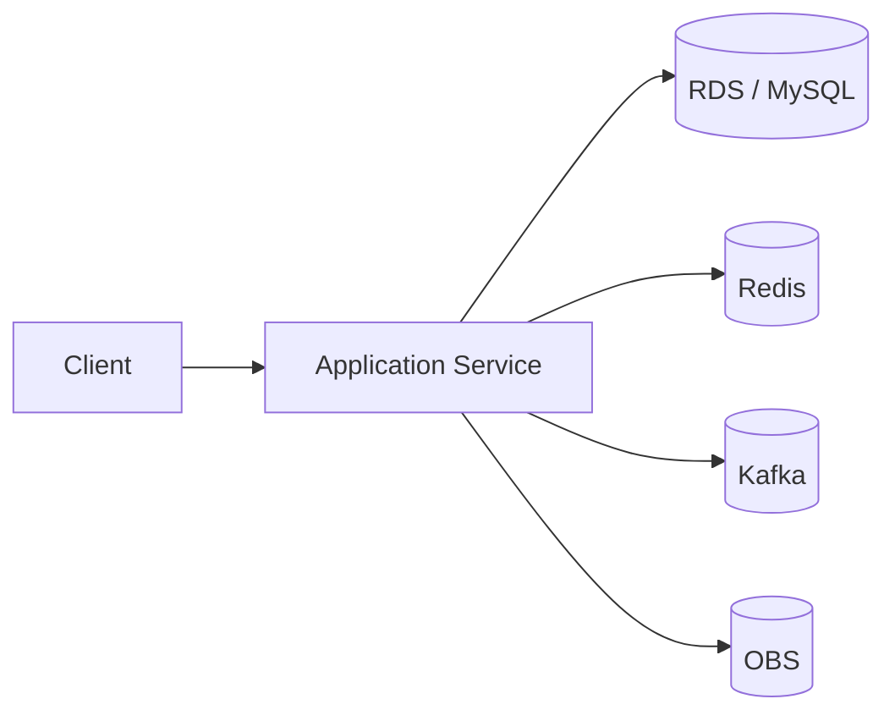
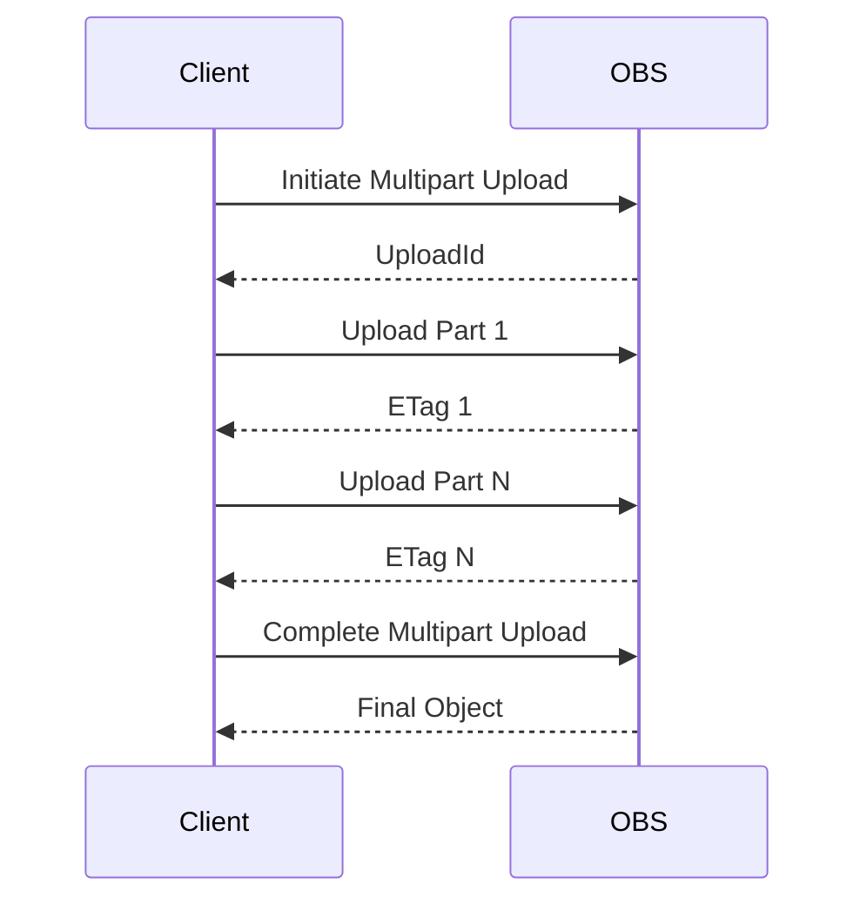
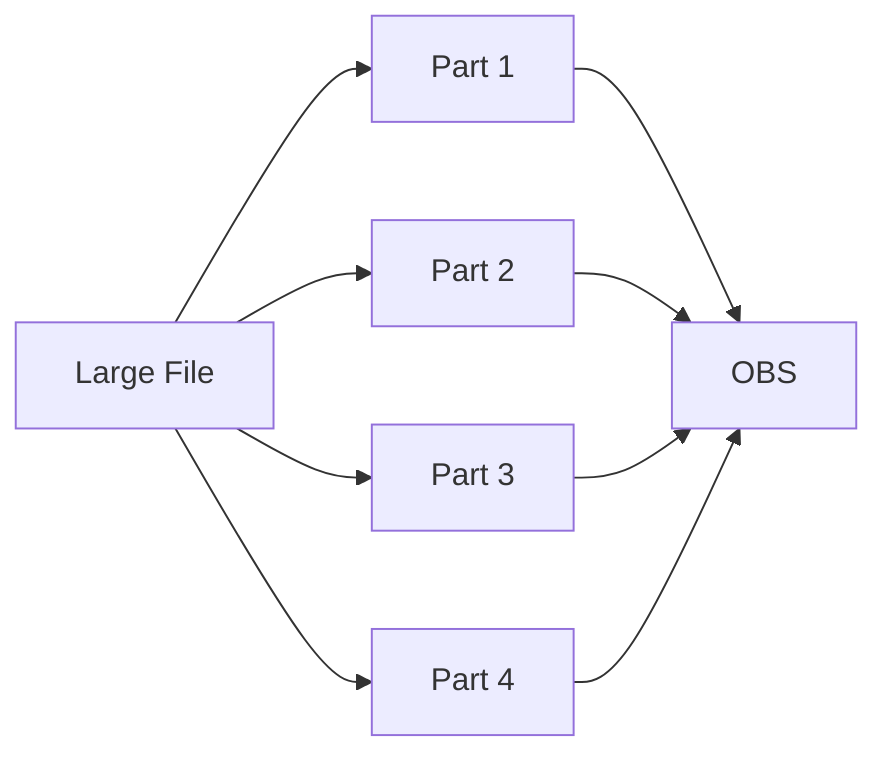
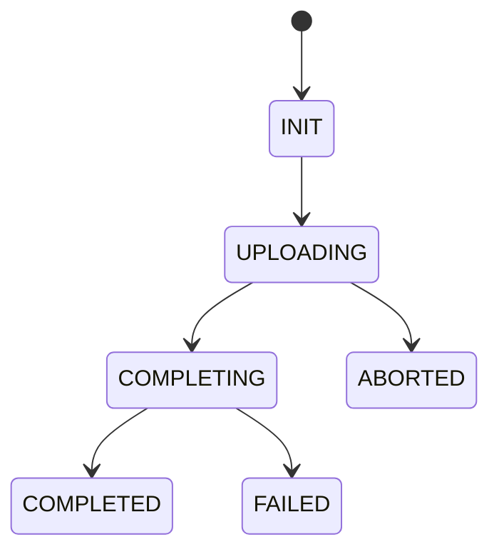
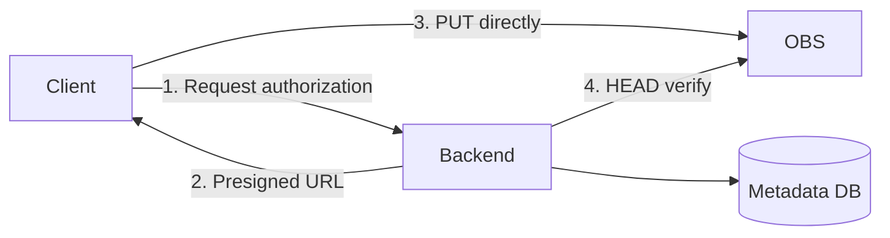
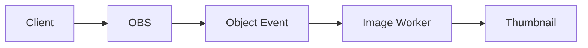

图片、视频、安装包、备份文件不适合塞进 MySQL 的一行记录，也不适合作为
Redis 的缓存值或 Kafka 的消息体。它们体积大、按完整对象读写、数量多且
生命周期长，需要另一类存储系统。

对象存储通过 Bucket、Object Key 和 HTTP API 管理这些非结构化数据。在
华为云中对应 OBS（Object Storage Service，对象存储服务），在本地开发或
兼容 S3 API 的环境中常用 MinIO。理解对象
存储的重点不是“如何上传一个文件”，而是对象模型、分片上传会话、临时授权，
以及数据库与对象存储之间的状态如何保持一致。

本文是云服务系列第十二篇，承接[《Kafka 分布式消息与消费一致性体系》](/posts/kafka-messaging-consumption-consistency/)，
从事件流继续讨论大对象的保存与传输。不同厂商的 Part 大小、有效期和事件
语义存在差异，实施时应核对目标服务的文档。



## 一、对象存储是数据层的另一类边界

前面的数据组件分别解决不同问题：

| 系统 | 主要职责 |
|---|---|
| MySQL | 结构化业务状态、事务和关系查询 |
| Redis | 高频缓存和临时数据 |
| Kafka | 事件流与异步消息 |
| OBS | 图片、视频、归档、备份等非结构化对象 |

对象存储不是“云上的一块远程硬盘”。块存储向服务器提供块设备，文件存储
提供 NFS/POSIX 类文件系统语义，对象存储则通过 HTTP API 访问：

```text
PUT Object
GET Object
DELETE Object
HEAD Object
```

因此，数据库不应把数据文件放到对象存储上当作块设备使用，应用也不应假设
对象可以像本地文件一样随机修改某几个字节。对象存储面向完整对象的写入和
替换；读取虽然支持 Range，但不支持原地改写。

## 二、Bucket、Object、Key 与 Metadata

Bucket 是对象的逻辑容器，例如 `user-uploads`、`product-images` 或
`system-backups`。Object 是基本数据单位，通常包含：

```text
Object
├── Key
├── Data
├── Metadata
└── System Attributes
```

Object Key 在 Bucket 内唯一标识一个对象：

```text
users/1001/avatars/8f3c.jpg
```

这里的 `users/1001/` 看起来像目录，但它通常只是 Key 字符串的一部分。
对象存储没有传统文件系统那种真实目录层级，所谓目录只是 Prefix（前缀）的
可视化表现。重命名对象通常也不是一次原子操作，而是复制到新 Key 再删除
旧对象。

Metadata 描述对象属性：

```text
Content-Type: image/jpeg
Content-Length: 502134
Content-Disposition: attachment
```

`Content-Type` 告诉客户端对象是什么类型，`Content-Disposition` 决定浏览器
直接展示还是下载。还可以保存自定义 Metadata，例如 `x-meta-user-id` 和
`x-meta-source`。

Key 应由服务端按规则生成，而不是直接信任用户上传的文件名：

```text
users/{userId}/avatars/{uuid}.jpg
```

原始文件名、大小、内容类型和所有者更适合保存在数据库里。这样既能避免
重名覆盖，也能防止用户通过构造 `../` 之类的路径影响对象布局。

## 三、OBS、MinIO 与统一抽象

MinIO 是兼容 S3 API 的对象存储软件，常用于本地开发、私有部署和
Kubernetes 环境。生产云环境可能使用 OBS，开发和测试环境使用 MinIO。

应用不应把某个厂商 SDK 散落在业务代码中，而应依赖一层对象存储抽象：

```text
ObjectStorageClient

putObject()
getObject()
deleteObject()
headObject()
createMultipartUpload()
uploadPart()
completeMultipartUpload()
abortMultipartUpload()
generateSignedUrl()
```

不同环境再提供 `ObsObjectStorageClient` 或 `MinioObjectStorageClient`。
这样可以降低迁移成本，也便于在本地测试分片和断点续传逻辑。

但 API 兼容不等于语义完全一致。Part 大小限制、签名算法、Metadata 大小、
事件通知、生命周期规则和错误码都可能有差异。抽象层应保留这些边界，而不是
把厂商差异隐藏成“永远成功”的假象。

## 四、简单上传与大文件的问题

较小文件可以一次请求上传完整对象：


但当文件达到数 GB 甚至数十 GB，单次上传的问题非常明显。假设上传 20 GB
视频，在 19 GB 时网络中断，如果只能整体重传，前面的传输成本就全部浪费了。
长时间的单连接还容易受到超时、带宽波动和客户端内存的限制。

Multipart Upload（分段上传）把大对象切成多个 Part，分别上传，全部成功后
由对象存储服务在服务端组装成最终 Object：



Initiate 返回的 UploadId 标识一次上传会话。后续每个 Part 都必须关联这个
UploadId。Complete 时客户端提交 Part Number 与 ETag 列表，服务端按 Part
Number 组装对象，不需要客户端把所有 Part 下载到本地重新拼接。

Part Number 决定最终顺序，而不是上传完成的先后。Part 大小需要在请求数量、
并发度、内存和失败重传成本之间权衡。Part 太小会增加请求和元数据开销，
太大则单次失败重传的成本更高。各厂商对 Part 数量和大小都有上限，不能只
按“每片 100 MB”写死。

## 五、并行、ETag 与断点续传

Multipart Upload 的重要优势是分片可以并行上传：



但并发不是越大越好。过高并发会造成客户端内存压力、Socket 数量过多、
带宽争抢和服务端限流。更稳妥的做法是使用受控的 Worker Pool，并为每个
Part 设置重试次数和退避策略。

每次上传 Part 通常会返回 ETag（实体标签）。客户端需要保存：

```text
Part Number + ETag
```

Complete 时把这些信息一起提交。需要特别注意：ETag 不应一概等同于文件
MD5。在 Multipart、加密或不同实现中，ETag 的语义可能不同。如果业务需要
强完整性校验，应显式使用 SHA-256、MD5 或 CRC 等校验机制。

Part 上传失败时只重试当前 Part，并使用 Exponential Backoff：

```text
1s -> 2s -> 4s -> 8s
```

不要在网络异常时让所有客户端立即高频重试，否则容易形成 Retry Storm。

### 断点续传依赖会话状态

Multipart Upload 天然适合断点续传。100 个 Part 已成功 60 个，恢复时只需
继续上传剩余 40 个。客户端至少要保存：

```json
{
  "uploadId": "abc123",
  "objectKey": "video/demo.mp4",
  "partSize": 104857600,
  "parts": {
    "1": "etag-a",
    "2": "etag-b"
  }
}
```

UploadId、Object Key、Part Size、已上传 Part 和 ETag 缺一不可。恢复时还要
确认这次上传会话仍然有效；如果服务端已经清理了未完成上传，客户端只能重新
开始。

如果上传任务取消，应显式调用 Abort Multipart Upload。否则未完成的 Part
可能继续占用存储空间。生产系统还应配置生命周期规则，自动清理长时间未完成
的分片上传，避免形成大量孤儿分片。

复杂系统可以把上传任务管理为状态机：



数据库中的 `upload_task` 通常保存 `id`、`user_id`、`bucket`、`object_key`、
`upload_id`、`part_size`、`total_parts`、`status`、`created_at` 和
`expires_at`。这些字段让后台任务能够恢复、清理和核对上传进度。

## 六、浏览器直传与 Presigned URL

浏览器上传大文件时，不建议采用：

```text
Client -> APIG -> Application -> OBS
```

让业务服务中转全部数据。10 GB 文件经过业务服务，会同时消耗入站流量、
出站流量、连接、Buffer 和超时资源，应用 Pod 很容易成为瓶颈。

更合理的是 Direct Upload：业务服务只负责鉴权和任务管理，真实文件由客户端
直接传给 OBS：



后端使用自己的长期凭据生成 Presigned URL（预签名 URL），在 URL 中限定：

- 操作类型，例如 `PUT` 或 `GET`；
- 目标 Bucket 和 Object Key；
- 有效期；
- 可选的 Content-Type 等签名参数。

客户端只获得在有效期内操作指定对象的权限。Presigned URL 本身是一种 Bearer
能力（持有链接即可使用）：任何拿到链接的人都能在有效期内访问，因此不能把
长期凭据或过宽权限的链接交给前端。长期访问密钥（AK/SK）必须保留在可信
后端，不能嵌入 Web、APP 或二维码。
攻击者一旦提取到长期凭据，获得的权限往往远超单个文件。

大文件直传通常由后端创建 Multipart Upload，把 UploadId、Part Size 和各
Part 的签名 URL 交给客户端；也可以使用临时凭证让客户端直接调用 Multipart
API。无论采用哪种方式，Complete 前都应由后端通过 List Parts 核对分片列表，
Complete 后再用 HEAD 校验对象大小和 Content-Type，避免客户端伪造对象
元数据。

### 签名一致性、CORS 与上传确认

如果生成 Presigned URL 时 Content-Type 参与了签名，客户端上传时必须使用
一致的 Content-Type，否则会出现 Signature Mismatch。签名参数与真实请求
必须严格一致。

浏览器直接访问 OBS 还涉及 CORS（跨源资源共享）。Bucket 需要允许相应的
Origin、HTTP Method 和 Header，否则浏览器会在预检或实际请求阶段阻止上传。
CORS 配置过宽会扩大攻击面，应限定业务域名和方法。

生成上传 URL 不代表客户端一定完成了上传。数据库可以维护：

```text
PENDING -> UPLOADED -> VERIFIED
                    \-> FAILED
```

客户端上传完成后通知后端，后端通过 HEAD Object 检查对象是否存在、大小和
Content-Type 是否符合预期，再更新为 `VERIFIED`。HEAD 只获取元数据，不
下载完整对象，适合做存在性检查和轻量校验。

### 下载、二维码与短链接

私有文件下载也可以使用 Presigned URL：后端先做业务鉴权，再签发短期 GET
URL，用户直接向 OBS 下载。二维码只是把 URL 编码成图形，本身不会过期；
真正过期的是 URL。扫码时如果 URL 已失效，OBS 会拒绝访问。

Presigned URL 通常较长，二维码可能过密。可以增加短链接服务，在用户访问
短链接时校验权限、动态生成新的 Presigned URL 并重定向到 OBS。这样还能
支持主动失效、访问统计和更细粒度的鉴权。

## 七、生命周期、版本与访问控制

对象存储的运维能力通常包括版本控制、生命周期、存储类型和加密。

Versioning 让同一个 Key 保留多个历史版本，降低误覆盖和误删除风险，代价是
存储成本增加。Lifecycle 可以按时间把对象转到低频或归档存储，或到期删除，
适合日志归档、备份和历史媒体数据。

| 数据温度 | 常见选择 |
|---|---|
| 高频访问 | 标准存储 |
| 低频访问 | 低频 / Infrequent Access |
| 长期归档 | Archive / Cold Archive |

归档存储的读取通常需要先恢复，恢复时间和费用与标准存储不同。把“便宜”
当成唯一指标，可能在真正需要下载时付出更高的检索成本。

对象可以使用服务端加密，密钥由 KMS（Key Management Service）管理。应用
不需要在代码中保存明文加密密钥，但仍要设计密钥轮换、授权和审计。

访问控制通常包括 IAM、Bucket Policy、ACL 和 Presigned URL。生产系统应
默认私有：

```text
Private Bucket
+ Backend Authorization
+ Temporary Signed URL
```

对于有业务权限要求的文件，不要使用永久 Public URL。公开 Bucket 不仅会
泄露数据，也可能被他人当作免费分发源，产生流量费用。

## 八、数据库、对象存储与异步处理

业务数据库保存文件的业务元数据，OBS 保存真正的二进制对象：

```sql
CREATE TABLE attachments (
    id BIGINT PRIMARY KEY,
    bucket VARCHAR(64) NOT NULL,
    object_key VARCHAR(512) NOT NULL,
    original_filename VARCHAR(255) NOT NULL,
    content_type VARCHAR(128) NOT NULL,
    size BIGINT NOT NULL,
    owner_id BIGINT NOT NULL,
    status VARCHAR(32) NOT NULL,
    created_at DATETIME NOT NULL
);
```

这样 MySQL 管理业务关系、权限和查询，OBS 管理大对象。数据库里不应该保存
完整二进制，否则会迅速放大备份、复制和查询成本。

### 删除一致性

业务删除文件时涉及两个系统：

```text
Database + OBS
```

可能出现两种不一致：

- DB 记录已删除，OBS 删除失败，形成 Orphan Object；
- DB 记录仍存在，OBS 对象已丢失，形成 Dangling Reference。

因此复杂系统需要异步删除、重试、周期性对账和垃圾回收。删除操作可以先
标记数据库状态，再由后台任务删除 OBS 对象；对账任务定期比较数据库记录与
对象列表，发现孤儿对象或悬空引用。

### 对象事件与异步处理

对象上传完成后，可以触发后续处理。例如图片系统：



也可以通过事件通知或中间服务把对象事件投递到 Kafka，由 Consumer 处理：

```text
OBS Upload -> Kafka Event -> Consumer Process Object
```

Kafka 消息只保存 `bucket`、`objectKey` 和必要 Metadata，而不是完整二进制。
事件通知可能重复，Consumer 仍需按对象 Key 或业务事件 ID 做幂等。

大对象下载应考虑 Range Request、断点续传和 CDN。HTTP Range 可以只请求
某个字节范围：

```text
Range: bytes=0-1048575
```

这对视频播放和断点下载非常重要。需要区分：Multipart Upload 是上传方向的
分片机制，Range Request 是下载方向的部分读取机制，二者不是同一件事。

CDN 适合图片、视频、JS/CSS 和安装包等热点静态资源。对象存储作为源站，
CDN 边缘节点缓存内容，减少回源和跨地域延迟。但 CDN 不能替代权限控制，
私有对象仍需通过签名 URL 或 Token 鉴权。

## 九、上传安全、成本与总结

某些系统会用内容 Hash 实现秒传：客户端先计算 Hash，后端发现已有对象时
直接建立业务引用。但后端不能只相信客户端提供的 Hash，否则可能被用于探测
文件是否存在或越权引用，必须结合所有权和业务授权。

用户上传文件时，不能只根据 `filename.jpg` 判断它一定是 JPEG。应结合：

- 单文件大小限制；
- MIME 校验；
- Magic Bytes 检查；
- 病毒扫描；
- 文件类型白名单；
- 用户配额。

对象存储成本也不仅来自容量，还可能包括请求费、公网出流量、检索费、CDN
费用和归档恢复费。对于大量视频下载，公网出流量可能比存储本身更显著。
设计时应同时估算容量、请求次数、下载流量和生命周期转换。

对象存储的本质不是“云上的文件夹”，而是通过 Bucket、Object Key、
Metadata 和 HTTP API 管理海量非结构化对象的基础设施。它和 MySQL、Redis、
Kafka 分别承担状态、缓存、事件和对象数据的职责。

大文件传输的核心是 Multipart Upload：

```text
Initiate -> Upload Parts -> Complete
```

Part Number 决定顺序，ETag 用于 Complete 时校验分片，失败时只重传当前
Part。UploadId、Object Key、Part Size、已上传 Part 和 ETag 共同构成断点
续传所需的会话状态。取消上传要 Abort，未完成分片要由生命周期规则清理。

浏览器和移动端的大文件应采用 Direct Upload：后端签发限定对象、操作和
有效期的 Presigned URL，客户端直接上传 OBS，后端再用 HEAD 和业务状态机
确认结果。长期 AK/SK 不下发，私有 Bucket 默认不公开，二维码和短链接只是
临时 URL 的展示与转发方式。

最终，一个可靠的对象存储系统需要同时考虑：

> 对象模型、分片策略、并发度、断点续传、完整性校验、临时授权、CORS、
> 上传状态、删除一致性、生命周期和成本。

对象上传、删除和异步处理并不是“传完就结束”，它们的运行状态还需要日志、
指标和调用链来观测。下一篇将转入[《云原生可观测性、日志与告警体系》](/posts/cloud-native-observability-logging-alerting/)，
讨论如何从异常现象定位到具体请求和根因。

## 参考资料

- [华为云 OBS 分段上传](https://support.huaweicloud.com/intl/en-us/usermanual-obs/obs_41_0021.html)
- [华为云 OBS 预签名 URL](https://support.huaweicloud.com/intl/en-us/api-obs/obs_04_0011.html)
- [MinIO 文档](https://min.io/docs/minio/linux/index.html)
- [Amazon S3 Multipart Upload 概览](https://docs.aws.amazon.com/AmazonS3/latest/userguide/mpuoverview.html)
- [MDN HTTP Range 请求](https://developer.mozilla.org/en-US/docs/Web/HTTP/Range_requests)
