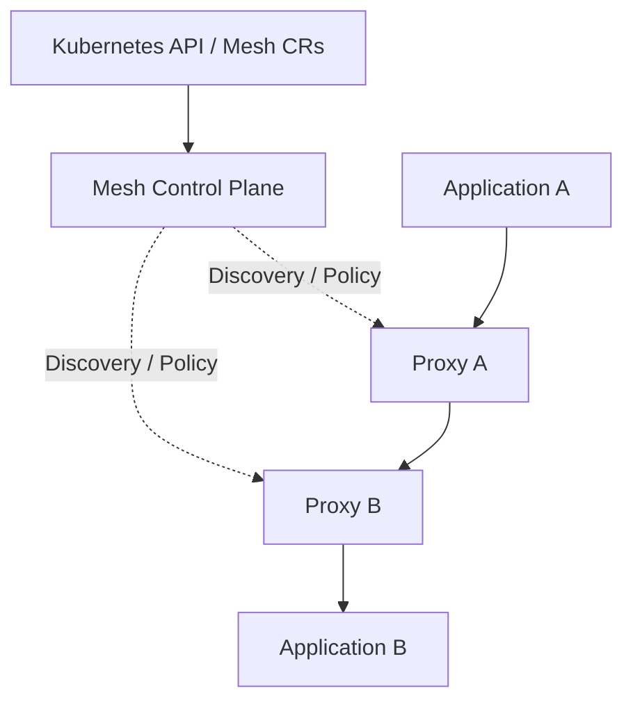
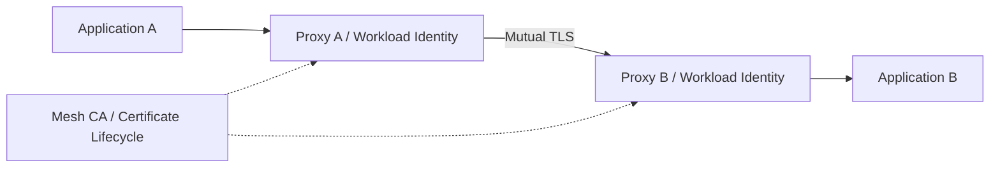
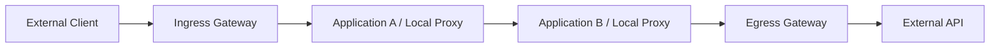

上一篇[《云上流量入口与 API 网关体系》](/posts/cloud-traffic-entry-api-gateway/)
讨论了外部请求如何进入业务系统。进入系统以后，一次请求还可能继续调用支付、
库存、用户等服务，带来连接管理、超时、重试、身份认证和部分失败等问题。

当多个团队、不同语言的服务各自实现这些能力时，策略容易不一致，升级也需要
逐个应用配合。Service Mesh 将一部分通用通信治理交给代理与控制面，让应用继续
围绕服务名称调用，由基础设施统一执行流量策略。

本文是云服务系列第九篇，以 Istio 的 Sidecar 模型和资源为主要示例，同时说明
Ambient 数据面的差异。托管产品如华为云 ASM 的版本、支持模式和资源能力，应按
实际集群文档核对，不能默认与上游 Istio 完全一致。

## 一、控制面决定策略，数据面执行转发

微服务间的东西向通信通常不经过公网 API 网关。服务网格在调用方与被调用方之间
加入数据面代理，承担路由、连接、安全和遥测等职责：


Sidecar 模式中，应用和代理位于同一个 Pod，流量通过重定向机制进入代理。应用
通常仍然访问 `http://payment-service`，而不必把代理监听端口写进业务代码。
具体拦截范围取决于网络规则、端口排除和协议支持，不能假定所有流量都已纳入治理。

Envoy 是常见数据面代理，真正转发请求。控制面观察 Kubernetes Service、
EndpointSlice 和网格策略，再向代理下发配置。业务请求无需逐次经过控制面：



控制面故障时，已有代理通常可以继续使用已接收的配置，但新服务发现、策略更新
和证书续期可能受影响，因此不能推断控制面离线对业务完全没有影响。

### xDS 将资源声明转换为代理配置

Envoy 的动态发现接口统称 xDS，常见配置类别包括：

| 接口 | 主要对象 |
|---|---|
| LDS | Listener，代理监听器与处理链 |
| RDS | Route，HTTP 路由规则 |
| CDS | Cluster，逻辑上游服务与连接配置 |
| EDS | Endpoint，具体上游实例地址 |

这里的 RDS 指 Route Discovery Service，Cluster 也不是 Kubernetes 集群。
声明提交成功后，还需要经过控制面处理、配置下发和代理接收，实际生效具有传播
过程。排障时必须检查数据面收到的配置，不能只看 YAML 是否存在。

<!-- 图片占位：Service Mesh 控制面与数据面图。实线展示应用经本地和远端代理通信，
虚线展示 Kubernetes API 到控制面、再到各代理的 xDS 配置路径。 -->

## 二、核心资源描述路由与目标策略

Kubernetes Service 提供服务名称、选择器和后端发现。网格在此基础上增加请求级
路由、目标策略与安全能力。以 Istio 资源模型为例：

| 资源 | 主要职责 |
|---|---|
| Gateway | 定义网格边界监听的协议、端口、Host 与 TLS |
| VirtualService | 定义匹配条件、目标路由、权重和请求策略 |
| DestinationRule | 定义目标 Subset、负载算法、连接池、TLS 与异常摘除 |
| ServiceEntry | 把外部或额外服务加入网格服务模型 |
| PeerAuthentication | 定义目标工作负载接受的网格 mTLS 模式 |
| AuthorizationPolicy | 根据来源身份和请求属性授权 |

这些资源是配置对象，不是请求逐个经过的网络设备。控制面将它们组合为代理配置，
代理再按配置选择后端。在典型 Sidecar HTTP 调用中，代理可以直接选择 Pod Endpoint，
不一定再经过 Service ClusterIP 的转发路径。

Istio `Gateway` 与 Kubernetes Gateway API 的 `Gateway` 属于不同 API 组。
网格也可以采用 Gateway API 表达部分路由，但具体支持范围与数据面模式需要分别
核对，不能仅凭相同的 Kind 名称判断行为。

## 三、用 Subset 与路由权重进行灰度

假设 `production` Namespace 中的 `payment-service` 有 v1、v2 两组 Pod，
共同带有 `app: payment-service`，并分别带有 `version: v1`、`version: v2`。
Kubernetes Service 的选择器需覆盖这两组实例。

先用 DestinationRule 定义 Subset：

```yaml
apiVersion: networking.istio.io/v1
kind: DestinationRule
metadata:
  name: payment-service
  namespace: production
spec:
  host: payment-service.production.svc.cluster.local
  subsets:
    - name: v1
      labels:
        version: v1
    - name: v2
      labels:
        version: v2
```

再用 VirtualService 指定内部 HTTP 请求的分配比例：

```yaml
apiVersion: networking.istio.io/v1
kind: VirtualService
metadata:
  name: payment-service
  namespace: production
spec:
  hosts:
    - payment-service.production.svc.cluster.local
  gateways:
    - mesh
  http:
    - route:
        - destination:
            host: payment-service.production.svc.cluster.local
            subset: v1
          weight: 90
        - destination:
            host: payment-service.production.svc.cluster.local
            subset: v2
          weight: 10
      timeout: 2s
```

示例假设已安装兼容 CRD、调用流量经过相应 Sidecar，并使用能识别为 HTTP 的服务
端口。它展示调用方代理向 v1、v2 分流，目标版本不需要与 Pod 数量按同比例配置。

权重表达长期统计分布，少量请求不一定严格达到 90:10。TCP、gRPC 流和长连接的
路由粒度也不同，应结合协议验证。

### 定向灰度、镜像与故障注入

Header 匹配可以让测试流量优先进入新版本，但若规则决定敏感访问范围，应由可信
入口维护标识，不能信任任意客户端自报“测试用户”。

Kubernetes Rolling Update 逐步替换 Pod；网格灰度管理新旧版本并存时的流量。
灰度应同时观察错误率、延迟、资源和业务成功率，再逐步扩大比例。流量回切也不会
自动撤销新版本已写入的数据或副作用。

流量镜像会向影子版本复制请求，其响应通常不返回给原调用者，但请求仍可能写库、
发消息或扣款。必须隔离影子环境的写路径、凭证和外部依赖，并考虑隐私与额外负载。

故障注入可以模拟延迟或错误，但应限定测试范围、观察指标和恢复条件。Istio 对
同一 VirtualService 内故障注入与重试、超时的组合存在限制，不能假定所有策略
能任意叠加，详见[流量管理文档](https://istio.io/latest/docs/concepts/traffic-management/)。

<!-- 图片占位：灰度路由图。展示 Kubernetes Service 覆盖 v1/v2 Pod，DestinationRule
按标签形成 Subset，VirtualService 以 90:10 分流；旁边对比 Pod 数量与流量比例。 -->

## 四、超时、重试与异常摘除保护下游

网格可以统一设置网络策略，但应用仍然需要决定业务期限、幂等、降级与结果查询。
代理停止等待，不代表数据库事务或下游业务已经停止。

### 明确总预算与单次尝试预算

对于适合重试的幂等读取，可以在 HTTP 路由规则中显式设置：

```yaml
# VirtualService.spec.http 中单条路由规则的片段
timeout: 2s
retries:
  attempts: 1
  perTryTimeout: 800ms
  retryOn: connect-failure,refused-stream
```

在这一 Istio 配置中，`attempts: 1` 表示初始尝试之外最多重试一次，总尝试数最多
两次；总路由超时还会限制实际可执行的尝试。具体字段语义应对照安装版本验证。

应统一客户端、APIG、应用 SDK 与网格的重试职责，避免多层相乘。设置有限尝试、
退避、抖动和重试预算；预算能力及配置入口因代理版本而异。写操作则必须有可靠
去重与幂等保证，不能因为网格支持重试就直接启用。

### 连接阈值与异常实例摘除

Istio / Envoy 常把以下能力归入 Circuit Breaking 范畴：

- Connection Pool 限制连接、等待和在途请求等资源；
- Outlier Detection 根据实际失败结果临时摘除异常 Endpoint。

它们不等同于所有 SDK 中的 Closed、Open、Half-Open 业务熔断状态机，也不会自动
执行领域降级。连接阈值和异常判断通常在各代理本地生效，应避免把某个代理的配置
理解为整个服务的全局并发配额。

下面是目标服务的示意配置，需要按压测与版本语义调整：

```yaml
# DestinationRule.spec 下的片段
trafficPolicy:
  connectionPool:
    tcp:
      maxConnections: 100
    http:
      http1MaxPendingRequests: 50
      http2MaxRequests: 200
  outlierDetection:
    consecutive5xxErrors: 5
    interval: 5s
    baseEjectionTime: 30s
    maxEjectionPercent: 25
```

字段不应仅按名称猜测，例如 `http2MaxRequests` 在相关实现中的作用范围需要查阅
参考定义。小规模实例池还要核对摘除比例与健康阈值，避免策略效果偏离预期。

Readiness 反映 Pod 是否适合接流量，异常摘除则反映某个代理观察到的调用结果。
不同代理观察样本不同，可能暂时作出不同判断。连接阈值、负载算法和异常摘除应
结合使用，参见[Istio 熔断示例](https://istio.io/latest/docs/tasks/traffic-management/circuit-breaking/)。

## 五、mTLS 提供工作负载身份，授权策略限制访问

Sidecar 模式中，代理之间可以使用 mTLS，应用进程则通常与本地代理明文通信。
网格证书证明的是工作负载身份，常与 Namespace、ServiceAccount 和信任域关联，
并不直接证明某个终端用户有业务权限。



PeerAuthentication 可以要求目标接受 STRICT mTLS，AuthorizationPolicy 再限定
允许的调用者和请求。例如允许生产 Namespace 中 `order-service` ServiceAccount
访问支付工作负载的特定 HTTP 接口：

```yaml
apiVersion: security.istio.io/v1
kind: AuthorizationPolicy
metadata:
  name: payment-from-order
  namespace: production
spec:
  selector:
    matchLabels:
      app: payment-service
  action: ALLOW
  rules:
    - from:
        - source:
            principals:
              - cluster.local/ns/production/sa/order-service
      to:
        - operation:
            methods: [POST]
            paths: ['/payments']
```

这里假设信任域为 `cluster.local`、来源身份通过 mTLS 验证、目标代理能识别 HTTP。
该策略是授权示例，本身不等于已经启用 STRICT mTLS。策略生效后，匹配工作负载
需要满足适用的授权规则；其他 ALLOW、DENY 或全局策略也会影响最终结果。

逐步迁移时应先盘点非网格调用者、探针、运维和外部客户端，再收紧 mTLS 与授权。
接收端要求 mTLS 而发送端使用明文，常表现为连接或握手失败。

网格身份授权、安全组和 NetworkPolicy 分别控制不同层次。mTLS 不替代应用的用户
授权，也不能证明同 Pod 内部和未被拦截的所有流量都受到同样保护。

<!-- 图片占位：网格身份与访问控制图。展示工作负载 ServiceAccount、证书签发轮换、
代理间 mTLS，以及 order-service 被允许而 report-service 被拒绝访问支付接口。 -->

## 六、Ingress 与 Egress 管理网格边界

Ingress Gateway 接收网格外部流量；Egress Gateway 集中处理指定外部访问。
APIG 可承担外部调用者、API 产品与配额管理，网格 Gateway 则衔接网格路由与服务
策略。它们可以协作，但应避免每一层重复配置重试和限流。

ServiceEntry 将外部目标加入网格服务模型，便于定义解析、端口和路由策略。
它不是通用的“安全放行证”。仅创建 ServiceEntry，也不会自动把所有调用引导到
Egress Gateway。



出口集中治理通常需要服务定义、路由、网关配置与相应 TLS 策略配合。固定公网出口
IP 还依赖 NAT 或云网络绑定，Egress Gateway 本身不保证公网地址固定。

如果要求不可绕过的外联限制，还需要在 NetworkPolicy、节点网络、防火墙或 NAT
层约束直连路径。网格注册表模式和代理路由不应单独视为安全边界，尤其要考虑未接入
代理、排除端口和具有特殊网络权限的工作负载。

## 七、Sidecar、Ambient 与引入成本

Sidecar 自动注入常通过 Mutating Admission Webhook 在 Pod 创建时完成。开启
Namespace 注入后，已有 Pod 通常需要重建。注入影响实际 Pod，但不一定会修改
Deployment 中保存的 Pod Template，因此应检查实际工作负载。

每个 Pod 增加代理会带来 CPU、Memory、延迟、证书与版本管理成本。应用启动时
代理是否已就绪，退出时存量连接是否完成，也需要结合生命周期配置测试。

Ambient 模式则把基础安全与转发下沉到节点级 ztunnel，按需使用 waypoint 处理
七层策略。它减少逐 Pod Sidecar 管理，但流量路径、策略绑定和兼容性与 Sidecar
不同，不能直接把上面的配置示例全部照搬。基本结构见
[Istio Ambient 概览](https://istio.io/latest/docs/ambient/overview/)。

| 场景 | 评估重点 |
|---|---|
| 服务少、调用简单 | SDK、基础入口与可观测性是否已满足需求 |
| 多语言、统一安全要求高 | 身份、证书与授权治理收益 |
| 频繁灰度、复杂调用链 | 路由能力与跨团队策略管理 |
| 大量 Pod 或资源敏感 | 代理开销、模式选择与负载测试 |

引入网格应从少量服务和明确目标开始，建立策略来源、升级路径、故障恢复和容量
指标，再扩大覆盖。托管控制面减少部分运维工作，策略设计与数据面责任仍然存在。

## 八、以实际代理配置与调用证据排障

代理能提供请求数、错误率、延迟和连接指标，但业务成功率、线程池和数据库等待
仍需应用指标。延迟应观察 p50、p95、p99，并核对直方图、采样和聚合方式。

分布式追踪也需要应用传播上下文：代理无法自动知道某个入站请求对应程序内部
发起的哪一次出站调用。业务 Span、异步消息和函数级追踪仍需要 OpenTelemetry
等应用侧集成。

### 先定位转发阶段，再定位业务错误

| 阶段 | 关键检查 |
|---|---|
| 应用请求 | 实际 Host、Port、协议、DNS 解析和请求 Header |
| 流量接入 | 代理是否注入并就绪，流量是否被拦截或绕过 |
| 配置传播 | 控制面是否接受策略，代理是否同步或拒绝配置 |
| Listener / Route | 端口识别、Host、匹配顺序与规则作用范围 |
| Cluster / Endpoint | Subset 标签、Pod Ready、端口、异常摘除状态 |
| 身份与连接 | mTLS、证书、信任域、授权与底层网络策略 |
| 应用响应 | 远端进程日志、业务权限、数据库和其他依赖 |

兼容的 Istio 工具可用于查看 Sidecar 配置：

```bash
istioctl analyze -n production
istioctl proxy-status
istioctl proxy-config routes <pod-name> -n production
istioctl proxy-config clusters <pod-name> -n production
istioctl proxy-config endpoints <pod-name> -n production
```

命令中的 Pod 名需替换为实际对象，工具版本应与控制面兼容。托管 ASM 和 Ambient
模式可能需要不同诊断入口。

Envoy Access Log 中的 Response Flags 能提供方向，例如 `NR` 表示没有匹配路由，
`UH` 表示没有健康上游，`UF` 表示上游连接失败。还应结合响应详情、上游地址、
耗时和请求标识判断，不能把所有 503 都归因于业务服务。

<!-- 图片占位：网格内部调用排障图。沿应用、本地代理、Route、Cluster、Endpoint、
mTLS、远端代理和应用逐层展开，标出配置同步检查与 NR/UH/UF 的典型位置。 -->

服务网格把服务发现、路由、安全和遥测组合在同一条通信路径上。理解资源如何经过
控制面变成代理配置，再结合真实 Endpoint、工作负载身份和请求日志验证效果，
才能让灰度、重试与安全策略形成可控的运行机制。

## 参考资料

- [Istio 流量管理](https://istio.io/latest/docs/concepts/traffic-management/)
- [Istio Circuit Breaking 示例](https://istio.io/latest/docs/tasks/traffic-management/circuit-breaking/)
- [Istio Ambient 概览](https://istio.io/latest/docs/ambient/overview/)
- [Istio VirtualService 参考](https://istio.io/latest/docs/reference/config/networking/virtual-service/)
- [Istio DestinationRule 参考](https://istio.io/latest/docs/reference/config/networking/destination-rule/)
- [Istio AuthorizationPolicy 参考](https://istio.io/latest/docs/reference/config/security/authorization-policy/)
